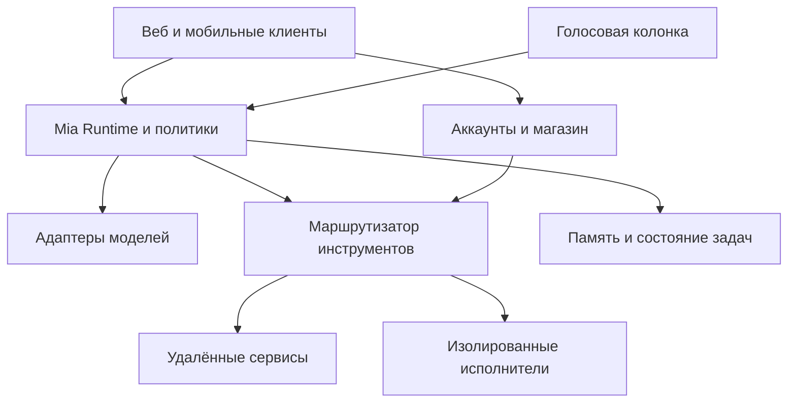

# Архитектура и план разработки Mia

Техническая документация для Aliaksei и Олега

Версия 1   7 октября 2026 года

## 1 Рекомендуемое решение

Mia стоит строить как персонального ассистента с единым ядром, подключаемыми моделями и приложениями. Веб, Android, iOS и колонка становятся клиентами этого ядра. Ядро может работать в управляемом облаке Mia или на персональном узле пользователя: ПК, домашнем сервере либо Linux колонке. Такой подход сохраняет доступ через сайт без покупки оборудования и позволяет предложить локальное хранение людям, которым оно нужно.

Первый продуктовый результат — голосовой ассистент на Android и ПК, который выполняет полезные действия через несколько проверенных интеграций. Существующие чат, магазин и дашборд нужно развивать поэтапно. Открытый рынок произвольного кода, коммерческий обмен вычислительными ресурсами и генерация приложений с публикацией относятся к следующим этапам.

**Главные решения для принятия командой**

| Область | Предлагаемое решение | Причина |
|---|---|---|
| Продукт | Общий персональный ассистент с голосом и приложениями | Связывает ваши два видения и даёт проверяемый сценарий |
| Ядро | Собственный небольшой runtime и политики поверх адаптеров моделей | Управление состоянием, разрешениями и расходами остаётся у Mia |
| Размещение | Managed Mode и Personal Node с одним протоколом | Сайт работает без колонки; персональный узел обеспечивает локальность |
| Плагины | Manifest + tools/MCP + skills + необязательные UI и executor | Поддерживает и простую интеграцию, и полноценный сервис |
| Интерфейс | Сохранить веб; нативные голосовые модули Kotlin и Swift | Не требуется переписывать готовый интерфейс ради фонового аудио |
| Стандарт UI | MCP Apps для совместимых интерфейсов; расширение Mia для плиток | Не нужно заново изобретать транспорт интерактивных приложений |
| Первое размещение | Модульный монолит, PostgreSQL, очередь на PostgreSQL, объектное хранилище | Небольшое число компонентов для маленькой команды |
| Голос | Локальная активация, отдельные STT и TTS, сменяемая текстовая LLM | Голос доступен и моделям без собственного аудио API |
| Запуск чужого кода | Изолированные workers отдельно от API и персональных секретов | Ошибка плагина не должна открывать весь аккаунт |
| Монетизация | BYOK, платный сервис синхронизации и фоновой работы, комиссия с приложений | Разовая продажа клиента не покрывает постоянные расходы |

BYOK означает использование API ключа пользователя. Personal Node далее называется персональным узлом. Runtime — процесс, который собирает контекст, вызывает модель, исполняет разрешённые действия и сохраняет состояние задачи. STT преобразует речь в текст, TTS озвучивает текст.

**Границы обещаний.** Подключение провайдера не гарантирует одинаковую функциональность всех его моделей. Собственная ключевая фраза на любом iPhone и выполнение любого бинарника на любой мобильной платформе не могут быть универсальными требованиями. Один запрос пользователя может запускать длительную сборку приложения; он не означает один вызов LLM, гарантированно работающий результат или автоматическое одобрение магазинами.

## 2 Как совместить ваши идеи

Ваш основной интерес — среда, где пользователь выбирает модель, устанавливает приложения и получает одинаковые возможности через несколько интерфейсов. Интерес Олега — личный голосовой помощник, устройство владельца как место хранения и исполнения, возможность создавать и распространять собственные приложения. Оба подхода совместимы, если отдельно определить клиент, место выполнения и место хранения.

| Идея из переписки | Оценка | Решение в архитектуре |
|---|---|---|
| Начать с голоса и узкого полезного сценария | Хороший способ проверить спрос | Первый пилот с Android и тремя интеграциями |
| Веб как ещё один способ общаться с личным ассистентом | Полностью применимо | Одна учётная запись, общие задачи и память в выбранном режиме |
| Все разговоры остаются на устройстве | Реализуемо в отдельном режиме | Personal Node, локальная БД, зашифрованная резервная копия по выбору |
| Колонка хранит данные и исполняет код | Реализуемо для Linux устройства достаточной мощности | Узел и голосовой клиент на одном устройстве либо раздельно |
| На мобилке есть bash, значит можно запускать любые приложения | Неверное обобщение | Нативный sandbox, ограничения ОС и магазинов; отдельный executor |
| Примонтировать S3 и использовать как обычный диск | Подходит лишь для части файловых сценариев | Локальный рабочий каталог; объектное хранилище для обмена и бэкапов |
| OAuth синхронизирует модель на ПК с телефоном | OAuth решает другую задачу | Авторизация плюс pairing, защищённая связь, маршрутизация и синхронизация |
| Магазин как скан публичных приложений на устройствах | Недостаточно для доверия и стабильности | Явная публикация подписанного release и отдельный реестр живых endpoints |
| Другие люди оплачивают мощность владельца | Возможный отдельный продукт | Поздняя фаза после metering, tenant isolation и расчётов с исполнителями |
| Сложность сервисов несут авторы плагинов | Верно для бизнес логики | Mia всё равно отвечает за SDK, разрешения, биллинг, модерацию и UX |

Локальное хранение и локальная обработка — разные свойства. Если персональный узел вызывает облачный API, выбранный провайдер получает переданный контекст. Если плагин исполняется на устройстве другого человека, этот владелец потенциально видит входные данные и результат. Интерфейс должен показывать маршрут данных до начала работы.

«Ассистент накапливает harness» лучше определить точнее: он сохраняет предпочтения, память, подключённые инструменты и проверенные процедуры. Он не переобучает выбранную модель и не должен самостоятельно повышать свои разрешения или менять системные правила.

## 3 Продукт и существующие аналоги

Наличие чата, MCP и нескольких моделей уже встречается в существующих продуктах. Отличие Mia следует доказывать удобством целого сценария: голосовая команда на бытовом устройстве, нужные действия в нескольких сервисах, понятное подтверждение и результат на дашборде. Это продуктовая гипотеза, а не установленное отсутствие конкурентов.

| Аналог | Что уже есть | Что полезно изучить |
|---|---|---|
| Home Assistant Assist | Android assistant, локальная активация, голосовые устройства, локальные и облачные pipelines | Аудиотракт, выбор отвечающего устройства, работа при блокировке [S03] |
| Open WebUI | Разные модели, локальное размещение, инструменты и расширения | UX подключения и обнаружения инструментов; границы доверия к Python плагинам [S18] |
| LibreChat | Чат с провайдерами, агенты, инструменты и работа с файлами | Совместимость моделей, настройки агента и организация диалогов [S19] |
| OpenClaw | Персональный gateway и подключаемые узлы | Pairing, маршрутизация, разнесение клиента и выполнения [S20] |
| MCP Apps hosts | Интерактивные интерфейсы рядом с ответами модели | Совместимость UI и инструментов вместо своего формата для всего [S07] |

OpenClaw прямо описывает ограничения своей модели доверия для взаимно недоверенных пользователей. Перенос архитектуры персонального gateway в публичный multi tenant сервис требует дополнительной изоляции [S21]. Open WebUI также предупреждает, что его расширения исполняют произвольный Python. Такой подход нельзя автоматически считать безопасной основой открытого магазина [S18].

Исследование аналогов: установить открытые проекты, прочитать лицензии, прогнать одинаковые сценарии и записать результаты. При изучении закрытых продуктов использовать публичные интерфейсы и документацию. Копирование кода, брендинга и спорное извлечение закрытых API не нужны для проверки идеи.

**Три первых сценария**

1. «Привет, Мия, что у меня сегодня?» — календарь и задачи, короткий голосовой ответ и плитка с источниками.
2. «Подготовь мои тикеты из Linear для отправки в Telegram» — выбор проекта, предпросмотр сообщения, подтверждение получателя и отправка.
3. «Напоминай о просроченных задачах по будням в девять» — сохранённое правило, явно выбранный исполнитель и отчёт о последнем запуске.

Второй сценарий не требует отдельного плагина «Linear плюс Telegram». Ассистент соединяет два разрешённых инструмента. Преднастроенный workflow полезен для повторяемости, контроля полей и стоимости. Для Telegram нужно отдельно выбрать bot API или другой разрешённый способ интеграции: наличие Telegram у пользователя само по себе не даёт боту доступ к любому личному чату.

## 4 Возможности платформ

| Возможность | Веб | Android | iOS | Linux колонка |
|---|---|---|---|---|
| Чат, магазин, дашборд | Да | Да | Да | Через связанный экран |
| Голос по кнопке | При разрешении микрофона | Да | Да | Да |
| Своя фраза активации | Только пока среда позволяет запись | Возможна, требуется нативная реализация и тесты | Не обещать как универсальный фоновый режим | Да, под вашим управлением |
| Системный ассистент | Не применимо | Роль assistant | Нет общего аналога Android; есть отдельные системные входы | Собственный интерфейс устройства |
| Постоянные фоновые задачи | Не полагаться на вкладку | Ограничения ОС | Ограничения ОС | При включённом устройстве |
| Произвольные desktop бинарники | Нет | Нет | Нет | Только совместимые сборки и изоляция |
| Локальная LLM | Возможен отдельный эксперимент | По памяти и мощности | По памяти и мощности | По памяти и мощности |

**Android.** Основа — RoleManager с ролью assistant, VoiceInteractionService и отдельная VoiceInteractionSession. Документация предусматривает работу выбранного voice service в фоне. Нужны нативная запись, разрешения микрофона и корректный жизненный цикл; ограничения foreground services следует проверять для целевых версий ОС [S01, S02].

Home Assistant уже показывает работающий сторонний wake word на Android, включая заблокированное устройство. Его документация отмечает экспериментальный статус и заметные расходы батареи [S03]. Поэтому сначала выпускается надёжный запуск кнопкой или жестом, затем опциональное фоновое распознавание. Нельзя обещать расход батареи уровня встроенного ассистента Google.

Для первого замера разумно использовать ваш Samsung S25 Ultra, затем Pixel и хотя бы один распространённый аппарат с агрессивным управлением фоном. Проверяются заблокированный экран, энергосбережение, перезагрузка, отзыв разрешений, Bluetooth, звонки, музыка и ночной простой. Поддержка устройства фиксируется в матрице совместимости.

**iOS.** Основной путь — App Intents, Siri/Shortcuts, виджет, Action button на поддерживаемых устройствах и явное открытие голосового режима. В Японии Apple документирует назначение voice приложения на боковую кнопку начиная с iOS 26.2. Это региональный сценарий запуска, а не универсальная собственная ключевая фраза [S04, S05].

Фоновое аудио должно соответствовать разрешённому назначению; постоянное молчаливое удержание процесса не является архитектурным решением. Для App Store следует учитывать требования к загружаемому коду и mini apps, согласие на передачу данных, каталог доступного ПО, правила платежей и доступ к native API. Дополнительно проверить Sign in with Apple при существующем Google login [S06].

**Мобильные плагины.** Google Play ограничивает загрузку исполняемого кода вне магазина; правила отдельно рассматривают интерпретируемые сценарии [S08]. Поэтому официальный мобильный клиент — хост веб интерфейсов и заранее встроенных нативных функций. Произвольный загружаемый бинарник не является базовым форматом магазина Mia. Интерпретатор или WASM сами по себе не гарантируют прохождение review.

**Телефон как колонка.** Старый Android на питании может стать первым голосовым терминалом. Это хороший прототип доступности, но не доказательство акустического качества серийной колонки. Для дальнего поля нужны микрофоны, подавление эха и тесты с собственным динамиком. iPhone можно использовать как клиент с предусмотренными системой способами запуска.

## 5 Границы системы и места выполнения

Архитектура состоит из трёх частей. Клиенты показывают интерфейс и получают голос. Control plane хранит аккаунты, публикации магазина, устройства, права и тарифы. Runtime plane исполняет пользовательские задачи, общается с моделями и инструментами. На старте части могут жить в одном репозитории и нескольких процессах.



На рисунке Runtime — логическая роль. В конкретной сессии её выполняет один выбранный узел. Перемещение между облаком и персональным узлом осуществляется по протоколу с проверкой прав; разные узлы не должны одновременно продолжать один run без координации.

| Режим | Где работает runtime | Где хранится содержание | Когда выбирать |
|---|---|---|---|
| Managed Mode | Облако Mia | Управляемое хранилище при включённой истории; иначе временный контекст | Пользователь пришёл только на сайт |
| Personal Node | ПК, сервер или Linux колонка пользователя | Локальная БД и файлы; шифрованный backup по выбору | Локальные модели, файловые операции и приватность |
| Гибридный маршрут | Основной узел делегирует отдельный job | По явно согласованной политике job | Сборка на macOS, тяжёлые вычисления, внешний SaaS |

Managed Mode по умолчанию может не сохранять текст разговоров на сервере: клиент хранит историю и отправляет нужный контекст. Но фоновая задача требует устойчиво сохранить её описание и нужные данные. При включении автоматизаций пользователь выбирает облачное хранение их payload либо Personal Node. После падения процесса разговор без серверной истории восстанавливается клиентом; обещать серверный resume без сохранённого состояния нельзя.

Browser only режим с прямыми запросами к провайдерам возможен как дополнительная функция для совместимых endpoints. Он не является универсальной основой из-за CORS, доступа к локальной сети, хранения ключей и приостановки вкладок. Сайт с браузерным хранилищем не обеспечивает надёжный круглосуточный scheduler.

**Что работает без интернета.** Полностью офлайн сценарий требует локальных wake word, STT, LLM, TTS, памяти и самого инструмента. Любой облачный компонент разрывает эту цепочку. Календарь, Telegram и облачный Linear обычно требуют сеть, даже если модель локальная.

## 6 Подключение устройств и локальных моделей

OAuth авторизует доступ, OIDC помогает установить личность. Ни один из них не обеспечивает сам по себе сетевой доступ к Ollama на ПК, синхронизацию файлов или шифрованное соединение устройств.

**Предлагаемый pairing**

1. Узел создаёт пару ключей устройства и показывает QR с одноразовым pairing challenge и отпечатком публичного ключа.
2. Авторизованный клиент подтверждает новый узел. Протокол привязывает ключ к аккаунту, области доступа и сроку действия приглашения.
3. Узел устанавливает исходящее WSS соединение с relay. Открывать входной порт домашнего роутера не требуется.
4. Клиент выбирает этот узел для сессии. Сообщения содержат session ID, номер последовательности и защиту от повторного воспроизведения.
5. Для Personal Node вводится шифрование содержимого между доверенными клиентами и узлом поверх relay. Используется проверенный протокол и библиотека; самостоятельный криптографический протокол не проектируется в первом спринте.
6. Отзыв устройства закрывает сессии, запрещает новые подключения и запускает ротацию доступных ему ключей.

Relay видит сетевые метаданные, размер и время сообщений. Шифрование не скрывает эти факты. Облачный провайдер модели видит переданный ему запрос. Загруженный с сервера веб клиент остаётся частью доверенной среды: компрометация его JavaScript может обойти защиту уже расшифрованных данных.

В LAN можно добавить прямое соединение; для первого релиза проще один исходящий транспорт через relay. WebRTC data channel, ICE/STUN/TURN и автоматический выбор прямого пути добавляются после замеров. TURN и relay требуют отдельного бюджета трафика.

Ollama остаётся закрытой в локальной сети или доступна только узлу. Из публичного endpoint нельзя делать открытый unauthenticated прокси на localhost. Облачному runtime запрещены произвольные обращения к private IP и metadata endpoints; доступ к локальным адресам выполняет только привязанный персональный узел с отдельной политикой.

При выключенном ПК задача получает состояние waiting_for_node и ограниченный срок ожидания. Она не переносится автоматически в облако с приватными файлами или другими ключами. Пользователь заранее настраивает допустимый fallback.

## 7 Ядро harness и адаптеры моделей

Сам API ключ не добавляет модели инструменты Mia. Провайдер может предоставлять собственные hosted tools и управляемые agent APIs, но ваши разрешения, память, плагины, UI и способы исполнения требуют координации со стороны приложения. В случае обычного function calling модель предлагает действие; приложение выполняет его и возвращает результат [S09, S10].

**Цикл одного run**

1. Проверить пользователя, выбранный узел, установленную версию плагинов и бюджет.
2. Собрать контекст: инструкция ассистента, текущая задача, релевантная память, небольшой набор skills и tools.
3. Отправить запрос через адаптер выбранной модели.
4. Собрать полный tool call, проверить JSON Schema и разрешения.
5. При необходимости запросить подтверждение с точным адресатом, данными, ценой и последствиями.
6. Выполнить вызов через Tool Router; записать receipt и вернуть результат модели.
7. Повторять до финального ответа, остановки, лимита времени, стоимости или числа шагов.

Streaming фрагмент аргументов не исполняется до завершения вызова и валидации. Независимые чтения можно выполнять параллельно. Зависимые изменения выполняются последовательно. При смене провайдера нельзя пересылать ему непрозрачное внутреннее состояние другого провайдера.

**Совместимость определяется для пары provider и model**

| Профиль | Возможности | Поведение Mia |
|---|---|---|
| Chat | Текст и базовый streaming | Чат; сложные tool сценарии недоступны |
| Structured | Устойчивый структурированный вывод | Ограниченные сценарии через проверяемый JSON |
| Tools | Native tool calling, схемы и результаты | Стандартные приложения и действия |
| Agent | Проверенная работа с длинными цепочками | Составные задачи с лимитами и checkpoints |
| Realtime | Нативное потоковое аудио | Опциональный голосовой адаптер |

Профили — проверяемые признаки, а не рейтинг модели. Небольшая модель может поддерживать tools, но часто ошибаться в выборе действия. Prompt fallback для модели без native tools допустим только для ограниченных сценариев; запрещено исполнять shell из произвольного текста ответа.

| Провайдер | Адаптер | Особенность |
|---|---|---|
| OpenAI | Responses API и официальный SDK | Сохранение item и call IDs; hosted tools отдельно от tools Mia [S09] |
| Anthropic | Messages API и официальный SDK | tool_use/tool_result, остановки и provider metadata [S10] |
| Gemini | Текущий официальный SDK и выбранный API | Нельзя терять signatures и непрозрачное состояние нужного API [S11] |
| Grok | Документированный API xAI | Различать собственные функции и инструменты провайдера [S12] |
| DeepInfra | OpenAI compatible adapter | Возможности проверяются для каждого model ID [S13] |
| Ollama | Native API либо проверенный compatible adapter | Tool calling доступен только для подходящих моделей [S14] |

Внутри хранится нейтральная модель Message, ContentPart, ToolCall и ArtifactRef, а рядом — opaque provider state для продолжения на том же API. Нужно сохранять изображения, результаты инструментов, call IDs, отмену, finish reason, usage и provider errors. Нельзя сводить историю к массиву role/content и ожидать полной совместимости.

AI SDK можно использовать как слой адаптеров и streaming, сохранив свой ModelGateway и policy engine. Его provider registry и tool support экономят код [S15]. Не следует передавать библиотеке незаметное автоматическое исполнение tools в обход авторизации. Native SDK остаётся доступен для возможностей, которых общий слой ещё не поддерживает.

**Рекомендуемые ограничения для пилота:** 12 model turns на обычный run, до 4 независимых чтений одновременно, 30 секунд на быстрый tool call, отдельный job для долгой работы. Значения являются начальными настройками; генератор приложений получает другой профиль. После каждого шага проверяется суммарный бюджет. Жёсткий потолок расходов требует резервирования максимума следующего вызова, поскольку итоговый usage может приходить с задержкой.

## 8 Контекст память и автоматизации

Модель не получает все установленные плагины и всю историю при каждом запросе. Сначала определяется короткий список подходящих инструментов по названию, описанию, категории и текущему сценарию. Полный skill загружается только после выбора. Память и результаты внешних инструментов имеют происхождение и не становятся системными инструкциями.

| Тип данных | Что сохранять | Контроль пользователя |
|---|---|---|
| История | Сообщения и ссылки на вложения | Срок хранения, экспорт, удаление |
| Предпочтения | Язык, формат ответа, рабочие часы | Просмотр и ручное редактирование |
| Долгая память | Подтверждённые факты с источником и датой | Удаление, запрет сохранения отдельных тем |
| Процедуры | Проверенные workflows и их версии | Просмотр шагов и разрешений |
| Аудит действий | Кто, каким tool, над каким ресурсом выполнил действие | Журнал без утечки ключей |
| Автоматизации | Триггер, timezone, executor, лимиты, политика повторов | Пауза, ручной запуск, история ошибок |

Начать с PostgreSQL полнотекстового поиска в облаке и SQLite FTS на узле. Embeddings и pgvector добавлять при доказанной пользе на реальных задачах. Векторизация приватных данных через сторонний API тоже является передачей данных и должна быть видна пользователю.

Для напоминаний и расписаний scheduler использует календарную семантику и IANA timezone, например Europe/Minsk. Сохраняются оригинальное правило и следующий запуск в UTC. Пропущенный запуск после отключения устройства выполняется по явной политике: skip, run_once либо limited_catch_up. Сотню накопившихся отправок нельзя запускать молча.

Облачный scheduler в строгом локальном режиме знает только непрозрачный идентификатор и время сигнала; фактический payload находится на узле. Если узел недоступен, зашифрованный relay не сможет сам прочитать и выполнить задачу. Push уведомления не должны содержать приватные тексты по умолчанию.

Фоновые советы допустимы после включения соответствующего сценария: утренняя сводка, просроченные задачи, важные изменения. Нужно определить тихие часы, дневной лимит и канал доставки. Постоянная отправка окружающего разговора в LLM не нужна.

## 9 Формат приложения и SDK

Приложение Mia — подписанный пакет метаданных и возможностей. Код бизнеса может находиться у автора, на узле пользователя или в управляемом worker. Язык реализации не ограничивается, если приложение соблюдает протокол. Переносимость интерфейса и переносимость бинарника — независимые свойства.

**Состав публикации**

| Часть | Обязательность | Назначение |
|---|---|---|
| Manifest | Обязательно | ID, версия, автор, совместимость, permissions и endpoints |
| Tools | Для действий ассистента | Схемы входа и результата, описания и ошибки |
| Skill | Рекомендуется | Когда и как использовать приложение, ограничения и примеры |
| UI | По потребности | Плитка, страница, MCP App либо ссылка на внешнее приложение |
| Executor | Для поставляемого кода | OCI image, поддерживаемый бинарник или WASI модуль |
| Store listing | Для публичной публикации | Скриншоты, описание, политика данных, поддержка и стоимость |
| Release metadata | Обязательно | Хеши, подпись, changelog, зависимости и минимальная версия host |

Agent Skills предоставляет переносимую структуру SKILL.md и связанных ресурсов [S16]. MCP описывает взаимодействие с tools, ресурсами и prompts. Ни skill, ни MCP не заменяют sandbox, авторизацию или коммерческие условия. Инструкции автора не могут сами выдавать разрешения.

**Типы выполнения**

| Тип | Где исполняется | Для чего подходит | Ограничение |
|---|---|---|---|
| Remote App | Сервер автора | SaaS, интеграции, тяжёлые сервисы | Автор видит разрешённые входные данные и отвечает за uptime |
| Personal Device App | Узел владельца | Работа с локальными файлами и сервисами | Нужны подходящая ОС, ресурсы и доступный узел |
| Managed Worker | Изолированная среда Mia или партнёра | Песочницы, сборки, обработка документов | Отдельная тарификация и строгая изоляция |
| External Native App | Самостоятельно установленное приложение | Полноценный Windows, Linux или мобильный продукт | Открывается через проверенный deep link, не встраивается как бинарник |
| UI Only | Sandbox web UI | Просмотр, формы и панели | Только capabilities, выданные host |

MCP Apps уже определяет интерактивный UI и обмен с host. Его стоит поддержать там, где требуется интерфейс внутри чата. Для постоянно размещённых плиток понадобятся собственные поля Mia: lifecycle, размеры, сохранённая конфигурация и правила обновления [S07].

**Пример проектируемого manifest**

Это предложение для Mia Plugin API v1. Поля ниже не объявляются частью стандарта MCP. Domain example.com обозначает адрес будущего сервиса, а не существующий endpoint.

```json
{
  "schemaVersion": "mia.plugin/v1",
  "id": "dev.example.tasks",
  "version": "1.0.0",
  "minHostVersion": "1.0.0",
  "execution": {
    "kind": "remote",
    "transport": "mcp-http",
    "url": "https://example.com/mcp"
  },
  "requirements": { "model": ["toolCalling"] },
  "permissions": {
    "tools": ["tasks.list", "tasks.create"],
    "network": ["api.example.com"],
    "memory": "none",
    "llm": { "viaHost": true, "maxUsdPerRun": 0.50 }
  },
  "surfaces": {
    "voice": { "enabled": true },
    "widget": {
      "resourceUri": "ui://tasks/dashboard",
      "minColumns": 2,
      "minRows": 2,
      "mobileMode": "card"
    }
  },
  "skills": ["skills/tasks/SKILL.md"]
}
```

Внешний release envelope содержит digest каждого файла, подпись издателя и разрешённую цепочку обновления. Подпись доказывает происхождение и неизменность пакета, но не безопасность его поведения.

**Минимальный Mia SDK**

| Метод | Назначение | Обязательная проверка host |
|---|---|---|
| tools.call | Вызвать разрешённый инструмент | User, plugin, resource scope и версия |
| jobs.start и jobs.get | Долгая работа и прогресс | Quota, executor и бюджет |
| artifacts.create | Вернуть файл или URL результата | Размер, MIME, tenant и срок доступа |
| llm.generate | Использовать модель пользователя | Делегированный бюджет и ограниченный контекст |
| ui.requestConfirmation | Показать подтверждение | Текст и финальные аргументы строит host |
| storage.get и storage.put | Данные приложения | Собственный namespace приложения |

Host выдаёт короткоживущий capability token, привязанный к конкретному plugin instance и run. Плагин не получает API ключ основной модели, refresh tokens других приложений и всю память пользователя. Запросы плагина к LLM проходят через gateway с отдельным лимитом глубины и бюджета; рекурсивный вызов самого себя по умолчанию запрещён.

## 10 Интерфейсы и дашборд

Основной интерфейс приложения должен работать независимо от выбранной LLM. Модель может попросить показать плитку или заполнить форму, но перемещение, обновление данных и сохранение настроек выполняются обычным кодом. Для просмотра списка задач не нужно оплачивать новый запрос к модели.

Для React веба подходит react-grid-layout с responsive layouts [S17]. Если текущий фронтенд использует другую технологию, важнее сохранить его, чем перейти на React ради одной библиотеки. Для мобильного экрана — одноколоночные карточки, явный режим редактирования и крупные touch targets; свободное масштабирование мышью не переносится буквально на телефон.

Каждый WidgetInstance содержит instance ID, plugin ID и version, desktop/tablet/mobile layout, settings, ACL, refresh policy и state version. Удаление плитки не удаляет установку приложения. Отключение приложения отзывает capabilities всех его плиток и останавливает фоновые задачи по согласованному правилу.

Начальный UI контракт: loading, ready, empty, offline, error, permission_required и incompatible. Плитка сообщает minimum size, поддерживает смену темы и языка, доступность с клавиатуры и текстовое представление. На колонке UI заменяется кратким speech summary; сложное подтверждение отправляется на телефон.

Сторонний HTML исполняется в изолированном iframe на отдельном origin. CSP ограничивает внешние ресурсы и соединения. postMessage проверяется по source/origin либо защищённому MessageChannel с nonce для изолированного origin. Плагин не получает cookies, DOM и localStorage host. Permission checks выполняются повторно на сервере или узле.

Нельзя подключать произвольный React bundle как доверенную часть приложения. На мобильных устройствах сторонний UI не получает общий Capacitor bridge. Для него создаётся отдельный непривилегированный web context и только разрешённый broker. Встраивание чужого сайта может быть запрещено его frame политикой; в таком случае нужен внешний переход или специально подготовленный UI.

Невидимые плитки приостанавливаются. Обновления объединяются, используют кеш и backoff. На первом этапе можно ограничить активные плитки шестью и проверить память на телефоне. Данные, полученные прямым UI вызовом, передаются в контекст модели только по необходимости.

## 11 Хранение синхронизация и секреты

| Данные | Managed Mode | Personal Node |
|---|---|---|
| Аккаунт, устройства, магазин | PostgreSQL control plane | Минимальные метаданные в control plane |
| История и память | По выбранной политике retention | SQLite и локальные файлы |
| Ключи моделей | KMS или envelope encryption на сервере | OS key store либо защищённое локальное хранилище |
| OAuth tokens плагинов | Разделение по user и installation | По возможности остаются на узле |
| Файлы и результаты | Приватный object storage | Локальный workspace; опциональный encrypted backup |
| Дашборд | Версионированная конфигурация | Та же схема; синхронизация по выбору |
| Логи | Метрики и обезличенные события | Локальные диагностические логи |

Не хранить production ключи в localStorage, URL, аналитике или crash reports. На мобильных клиентах использовать Android Keystore и iOS Keychain. Зашифрованное хранение серверного ключа не означает, что сервер не может его использовать: процесс расшифровывает его во время запроса.

Память разговоров, сообщения и действия хранятся как append only события с стабильными идентификаторами. Для начала достаточно одного владельца записи на conversation, optimistic concurrency и явного разрешения конфликтов настроек. Полный CRDT для всех данных не нужен. CRDT имеет смысл позже для действительно совместно редактируемых документов.

Резервная копия содержит версию схемы, manifest файлов и проверку целостности. Восстановление тестируется на новом устройстве. При пользовательском ключе шифрования заранее нужен recovery flow; пароль Google сам по себе не восстанавливает ключ E2EE.

S3 и его аналоги — объектные хранилища. Например, Mountpoint не реализует всю POSIX семантику [S25]. SQLite, active workspace сборки, lock files и исполняемые пакеты располагаются на локальном диске. В object storage уходят завершённые артефакты и согласованные snapshots. Bucket на устройстве чужого владельца не становится приватным только из-за mount.

Для MVP предлагается: исходное аудио удаляется после обработки; текстовая история включается осознанно; диагностические payload отключены; артефакты имеют срок хранения; audit события содержат минимум полей. Любое реальное обещание удаления должно охватывать резервные копии, инструменты аналитики и внешних обработчиков.

## 12 Задачи API и устойчивость

Обычный HTTP запрос не должен удерживать всю длительную работу. Клиент создаёт run или job и получает стабильный ID. Прогресс поступает через SSE или WebSocket. После переподключения события дочитываются с последнего sequence number.

**Предлагаемый публичный API Mia v1**

| Endpoint | Назначение | Существенные поля |
|---|---|---|
| POST /v1/runs | Начать запрос ассистенту | conversation_id, executor_id, model_ref, input, budget |
| GET /v1/runs/{id}/events | Получать ход выполнения | cursor, event_id, sequence |
| POST /v1/runs/{id}/cancel | Остановить работу | reason, request_id |
| POST /v1/approvals/{id}/decision | Подтвердить конкретное действие | decision, args_hash, expires_at |
| POST /v1/jobs | Запустить долгую задачу | plugin_installation_id, input, idempotency_key |
| GET /v1/jobs/{id} | Статус и результаты | status, progress, artifacts, usage |
| POST /v1/devices/pair | Привязать узел | challenge, device_public_key |
| POST /v1/plugins/installations | Установить release | plugin_id, digest, grants, executor |
| PATCH /v1/dashboard | Изменить раскладку | expected_version, widget_operations |
| GET /v1/artifacts/{id} | Получить результат | ACL, безопасное имя, временный URL |

Состояния job: queued, running, waiting_for_user, waiting_for_node, succeeded, failed, cancel_requested и cancelled. Наличие cancel_requested важно: удалённая система может уже выполнять необратимое действие. Ответ «отменено» выдаётся только после подтверждения или с явным указанием частичного результата.

На старте подходит очередь pg-boss поверх PostgreSQL [S26]. Она уменьшает число сервисов. Temporal рассматривается после появления сложных длительных workflow с множеством ожиданий и компенсаций. Выбор конкретной очереди не даёт exactly once во внешнем Telegram или другом API.

**Защита от двойного действия.** До обращения к внешнему сервису записывается уникальный operation ID. Если внешний API поддерживает idempotency key, передаётся он. Если не поддерживает, после timeout требуется проверить результат или запросить решение пользователя; автоматический повтор отправки может создать дубликат. Очередь, outbox, receipt и reconciliation проектируются вместе.

Внешние callbacks подписываются, содержат timestamp и защищены от replay. Пользовательский ID из payload не считается доказательством авторизации. Лимиты применяются одновременно к аккаунту, приложению, узлу, run и внешнему провайдеру.

Минимальные сущности БД: User, Device, Workspace, Conversation, Run, Event, Plugin, Release, Installation, Grant, Connection, WidgetInstance, Job, Approval, Artifact, UsageLedger и Subscription. Все tenant данные связаны с owner/workspace; проверка принадлежности выполняется для каждого обращения.

## 13 Безопасность открытого магазина

Главные недоверенные участники — автор плагина, внешний MCP сервер, содержимое сайта или документа, чужой исполнитель и сама ошибающаяся модель. Проверка разрешений находится в обычном коде host и runtime. Текст в prompt не заменяет запрет на уровне системы.

| Риск | Обязательная защита |
|---|---|
| Prompt injection в документе или tool result | Разделение инструкций и данных, ограничение доступных действий, проверка аргументов |
| Подмена описаний tools после установки | Закрепление release и schema digest; повторное согласие при расширении прав |
| Вывод данных через сеть плагина | Deny by default egress и явные разрешённые назначения |
| Кража ключа основной LLM | Brokered calls; секрет не попадает в UI и untrusted worker |
| Выход из sandbox | VM или microVM для недоверенного кода, обновления runtime, отсутствие привилегий |
| SSRF через URL провайдера или MCP | Проверка DNS и редиректов, запрет metadata/private ranges в облаке |
| Доступ к чужому tenant | Scopes, отдельные workspace, проверка owner и негативные тесты |
| Расходование денег рекурсивными tools | Бюджет, reservation ledger, depth limit, kill switch |
| Публикация вредоносного обновления | Подписи, immutable packages, поэтапный rollout, отзыв release |
| Команда с телевизора или чужим голосом | Подтверждение опасных действий на разблокированном личном устройстве |

Голосовая биометрия может улучшить удобство, но не должна быть единственным механизмом разрешения платежей, удаления данных или публикации. Для таких действий нужен host confirmation, привязанный к точному args hash и сроку действия. После изменения аргументов старое подтверждение недействительно.

Удалённый MCP подключается через документированный authorization flow. Access token должен предназначаться конкретному серверу; нельзя бесконтрольно передавать токены между сервисами. Redirect validation, PKCE, server identity и защита от confused deputy опираются на рекомендации MCP [S22, S23].

Контейнер полезен для упаковки и ограничения ресурсов, но обычный Docker на одном host не следует считать достаточной границей для враждебных платных арендаторов. Для открытых Managed Workers выбирать sandbox сервис или отдельные VM/microVM. Локально — непривилегированный пользователь, read only root, отдельный workspace, лимиты CPU/RAM/PIDs, seccomp, запрет Docker socket и явный доступ к файлам.

WASI/Wasmtime подходит для небольших переносимых функций с ограниченными capabilities [S24]. Он не превращает произвольное Windows приложение в мобильный плагин. Для browser automation, Android builds и сложных native зависимостей нужны другие environments.

## 14 Публикация приложений и экономика Device Apps

Жизненный цикл публикации: private draft, automated checks, review, published, deprecated, revoked. Публичная карточка включает автора, скриншоты, стоимость, совместимые поверхности, место исполнения, политику передачи данных, changelog и контакт поддержки. Отзывы привязаны к пользователю и при возможности к факту установки или покупки; нужны жалобы и модерация.

Установка фиксирует версию и scopes. Расширение разрешений требует нового согласия. Удаление отзывает токены, обрабатывает активные jobs и отдельно предлагает удалить данные плагина. Kill switch выключает опасный release, но не должен молча удалять пользовательские файлы.

Нужно различать два сценария, описанных Олегом:

| Сценарий | Кто выполняет | Что продаётся |
|---|---|---|
| Скачать приложение | Устройство покупателя | Лицензия, поддержка или функции |
| Использовать опубликованный сервис | Устройство или сервер автора | API результат и вычислительная услуга |

Для второго сценария реестр должен хранить capability, endpoint, availability, тариф, лимиты и версию. Устройство устанавливает исходящее соединение; входящему пользователю не открывается shell владельца. Каждый вызов получает отдельный workspace, а домашние файлы владельца никогда не подмешиваются в контекст.

Заработок на чужих запросах требует учёта: кто оплачивает LLM, кто CPU/GPU, какую комиссию удерживает Mia, как оформляются возвраты и кто несёт убыток при неудаче. Возможны разные модели: BYOK вызывающего пользователя, фиксированная цена за job, либо стоимость inference включена в цену автора. Смешивать их в одном непрозрачном счётчике нельзя.

Проверяемость использования ресурсов на недоверенном домашнем узле ограничена. Серверный usage ledger и подписанные receipts полезны, но не доказывают честное время GPU автора. Для первого коммерческого варианта предпочтительнее фиксированная цена результата и ограниченный список исполнителей. Полноценный рынок вычислений добавляет отдельные задачи качества, репутации, споров и доступности.

Публичный каталог нельзя получать сканированием чужих файловых систем. Автор явно публикует пакет или service listing, подписывает release и соглашается с условиями. Публичность приложения не делает публичными его данные, секреты или runtime workspace.

## 15 Генерация приложений и сайтов

Максимальный сценарий реализуется как Builder App с собственными workers. Mia отвечает за запрос, разрешения, бюджет, прогресс и передачу результата. Автор Builder App отвечает за генератор, шаблоны, тестирование и сборочную инфраструктуру. Встроенный пример такого приложения поможет проверить полноту SDK.

**Пример процесса**

1. Пользователь задаёт приложение, целевые платформы и верхний предел расходов.
2. Builder фиксирует спецификацию и создаёт приватный проект в изолированном workspace.
3. Агент генерирует код, устанавливает разрешённые зависимости и выполняет ограниченное число циклов build/test/fix.
4. Сборщик создаёт исходники, логи, отчёт проверки, preview и бинарные артефакты там, где есть необходимые ключи.
5. Пользователь получает результаты; размещение и публикация выполняются согласно ранее выданному разрешению и лимиту.

Один пользовательский запрос может запустить весь этот workflow. Уточнения остаются необходимыми, если не определены важные параметры или требуется новая авторизация. Безлимитный цикл «исправляй, пока не заработает» недопустим для платного сервиса.

| Результат | Требуемая среда | Что реально обещать |
|---|---|---|
| Веб preview | Linux sandbox и временный hosting | URL, срок жизни, статус проверок |
| Production сайт | Hosting account, domain и quotas | Деплой в согласованную среду с rollback |
| Android | JDK, Android SDK, Gradle, signing flow | Исходники, APK/AAB; подпись принадлежит владельцу |
| iOS | macOS, Xcode, signing и provisioning | Исходники; build/archive и допустимая доставка при наличии аккаунта |

Xcode и Apple signing pipeline требуют отдельной среды [S27]. ZIP с проектом и готовое приложение в App Store — разные результаты. Рассмотрение магазина, права аккаунта и корректность функциональности не гарантируются формулировкой prompt.

Signing keys держит отдельный release service. Генерируемый код, build scripts и зависимости не получают production секреты во время сборки. Предпросмотр по умолчанию приватный и имеет TTL. Если пользователь сразу запросил публикацию на заранее выбранном домене с установленным бюджетом, не нужно повторно спрашивать о каждом шаге; новые расходы или расширение доступа требуют отдельного решения.

Рекомендуемые initial limits Builder App: один активный job на пользователя, отдельный бюджет LLM, 30 минут Linux compute, ограничение диска и артефактов, максимум три цикла автоматического исправления. Сложным проектам нужен другой тариф и явно увеличенный лимит.

## 16 Рекомендуемый стек

Стек ниже рассчитан на небольшую команду и повторное использование текущего веба. Если backend уже написан на другом поддерживаемом стеке, сначала выделяются контракты и тестируется граница runtime; переписывание ради единого языка не является обязательным этапом.

| Часть | Выбор для новой разработки | Причина |
|---|---|---|
| Репозиторий | pnpm workspace; Turborepo по необходимости | Общие типы и независимые сборки |
| Runtime и API | TypeScript, Node LTS, Fastify | Подходит существующему fullstack опыту и MCP SDK |
| Web | Сохранить текущий; при новом React, Vite, TanStack Query, Zod | Отдельные state и transport, простая статическая доставка |
| Android | Kotlin voice layer; существующий WebView либо Capacitor shell | Assistant API и audio lifecycle реализуются нативно |
| iOS | Swift voice/App Intents layer плюс общий web UI | Системная интеграция без полного переписывания интерфейса |
| Колонка | Linux, systemd, Node runtime, отдельный audio process | Предсказуемый запуск и обновления |
| Desktop Node | Node service; optional Tauri shell | Узел работает даже без открытого окна |
| Model adapters | AI SDK за собственным интерфейсом плюс native SDK | Экономия кода без зависимости бизнес логики от одного SDK |
| MCP | Официальный TypeScript SDK | Стандартный transport и lifecycle |
| Валидация | JSON Schema и Ajv; Zod в TypeScript границах | Строгая проверка вызовов и событий |
| База | PostgreSQL в облаке; SQLite на узле | Разные режимы эксплуатации через repository interfaces |
| Jobs | pg-boss и transactional outbox | Начальный scheduler без отдельного Redis |
| Файлы | S3 API storage, локальный workspace | Артефакты отдельно от БД |
| Наблюдаемость | OpenTelemetry, Sentry с редактированием данных, метрики | Измерение latency, отказов и затрат без записи prompts |
| Проверки | Vitest, Playwright, Android instrumentation, XCTest | Проверка реальных контрактов и платформенных сценариев |
| CI/CD | GitHub Actions или текущий CI, Docker, IaC | Воспроизводимость, подписанные releases и rollback |

Capacitor поддерживает web приложение с нативными возможностями [S28]. Его разумно использовать, если существующая оболочка не даёт удобного plugin bridge. Менять уже рабочий Android проект на Capacitor исключительно ради названия технологии не нужно. React Native также не устраняет необходимость писать assistant service и системные iOS интеграции.

Для wake word — пилот microWakeWord с обучением и проверкой русской фразы «Привет, Мия». Для локального STT — sherpa-onnx либо отдельный совместимый движок после сравнительного теста; готовые модели и лицензии проверяются отдельно от лицензии runtime [S29, S30]. Для MVP TTS можно использовать установленный системный движок, с проверкой реально офлайн голоса. Облачные STT/TTS остаются сменяемыми.

Не добавлять одновременно LangChain, LangGraph, отдельный proxy gateway, Redis, Kafka и Temporal. Для каждой библиотеки должно быть конкретное требование, которое сложнее выполнить уже выбранными средствами. Версии SDK фиксируются lockfile; обновление провайдера проходит contract tests, а не выполняется автоматически во всех runtime.

**Предлагаемые пакеты репозитория**

| Каталог | Ответственность |
|---|---|
| apps/web | Чат, магазин, дашборд и developer portal |
| apps/android и apps/ios | Нативная оболочка и голос |
| apps/control-api | Аккаунты, публикации, subscriptions и device registry |
| apps/runtime-worker | Выполнение runs и jobs в облаке |
| apps/personal-node | Тот же runtime с локальными adapters |
| packages/protocol | Версионированные messages, events и JSON Schema |
| packages/runtime-core | Agent loop, checkpoints и budgeting |
| packages/model-gateway | Адаптеры и capability registry |
| packages/plugin-sdk | Developer API и test harness |
| packages/policy | Grants, approvals и проверка аргументов |
| packages/storage | Реализации PostgreSQL, SQLite и BlobStore |

## 17 Голосовой тракт и колонка

Независимый от модели pipeline: локальная ключевая фраза, краткий audio buffer, VAD, STT, runtime, TTS и воспроизведение. VAD определяет начало и конец речи. AEC подавляет эхо собственного динамика. Barge in позволяет перебить ассистента и останавливает воспроизведение; отмена уже отправленного действия обрабатывается отдельно.

Пример: пользователь говорит «Мия, добавь задачу». Устройство локально обнаруживает активацию, показывает индикатор, передаёт только согласованный аудиофрагмент в STT. Runtime вызывает задачу через plugin. TTS озвучивает краткий результат, а дашборд показывает полные поля и ссылку. Frontier модель может находиться в облаке; локальная модель — на ПК, который доступен персональному узлу.

Состояния аудиосессии: idle, wake_detected, listening, transcribing, thinking, speaking, interrupted и error. К каждому состоянию привязаны таймаут и понятный сигнал. Полный текст ошибок провайдера не нужно озвучивать; пользователь слышит короткое объяснение и получает подробности на экран.

При нескольких устройствах выбирается один отвечающий терминал по времени активации, качеству сигнала и приоритету. Нужна короткая election window и возможность вручную передать разговор на другой экран. Иначе телефон и колонка начнут одновременно отвечать на одну фразу.

Цели пилота, подлежащие замеру: реакция на wake word до 500 мс; первый осмысленный звук после конца короткой фразы p50 до 2,5 секунды и p95 до 6 секунд для выбранного быстрого cloud профиля. Отдельно измеряются ASR endpointing, сеть, очередь, время первого токена модели и старт TTS. Такие показатели не обещаются для любой frontier модели и любого домашнего ПК.

**Аппаратные ступени**

1. Android телефон на зарядке или Linux ПК с USB микрофоном и динамиком — проверка сценария.
2. Linux SBC либо mini PC плюс отдельный audio front end — проверка always on и локального узла.
3. Голосовой satellite на микроконтроллере — отдельная низкая стоимость, но без обещания исполнять Device Apps и большую LLM.
4. Собственная серийная колонка — только после стабильного софта: акустика, физическое отключение микрофона, индикация, provisioning, OTA с rollback, watchdog и восстановление после сбоя питания.

Колонка не обязана содержать GPU. Она может выполнять wake word, аудио и небольшой runtime, а LLM вызывать на ПК или по API. Если узел должен собирать Android приложения, это другой класс устройства. Linux arm64 также не исполняет произвольный x86 Windows бинарник без дополнительных слоёв и потерь совместимости.

## 18 Размещение и эксплуатация

**Выбор для пилота:** один Linux VM с ориентиром 4 vCPU и 8 GB RAM, Docker Compose, reverse proxy, API, runtime worker и PostgreSQL; отдельное объектное хранилище и резервные копии вне VM. Тяжёлые и недоверенные plugin jobs исполняются отдельно. Это стартовая конфигурация для замеров, а не гарантия производительности или отказоустойчивости.

В пилоте отсутствие high availability принимается осознанно. До платного production запуска: отдельная БД либо управляемый PostgreSQL, минимум два API/relay процесса, резервирование, восстановление и staging. SQLite на узле не разделяется по сети.

Если уже есть удобный GCP deployment, можно оставить Cloud Run для API и workers, PostgreSQL в managed сервисе и GCS через отдельный BlobStore adapter. Длительные WebSocket соединения учитываются как активные запросы и требуют переподключения из-за timeout; рассчитывать их стоимость как короткие HTTP запросы нельзя [S31]. Постоянный device relay можно выделить на VM.

Для managed облака необходимы ограничения числа instances и concurrency, пул соединений БД, очередь с backpressure и budgets. Kubernetes не требуется до появления измеренной потребности в большом числе исполняющих узлов или сложном scheduling.

| Метрика | Что обнаруживает | Действие |
|---|---|---|
| p95 первого ответа и queue age | Перегрузку или медленного провайдера | Масштабирование нужного компонента |
| Tool error rate по plugin version | Сломанное обновление | Quarantine или rollback release |
| Usage и budget overshoot | Финансовую утечку | Ограничение rate и остановка run |
| Успех reconnect и device offline time | Проблемы relay и домашней сети | Повторное подключение и понятный статус |
| DB restore time и backup age | Невосстанавливаемую систему | Приоритет восстановления до новых функций |
| Wake false accepts и battery delta | Непригодный голосовой режим | Изменение модели, порога или supported devices |

Начальные эксплуатационные цели: RPO до 24 часов для пилотных данных и RTO до 4 часов после проверенного восстановления. Для платного облачного режима целевые RPO до 1 часа и availability 99,9 процента вводятся только после реализации соответствующей инфраструктуры. Это целевые показатели проекта, а не свойства одной VM.

Нужно проверить доступность выбранных провайдеров, оплаты и аккаунтов для страны пользователя и юридического лица команды. Локальный режим снижает часть зависимостей, но не отменяет правила внешнего LLM API и магазина приложений. Не следует обещать доступность сервиса через обход региональных ограничений.

## 19 Стоимость поддержки

Все суммы ниже в USD без налогов. Диапазоны инфраструктуры и труда — инженерный бюджет по указанной нагрузке, а не коммерческое предложение провайдера. Установка локального узла переносит часть затрат на электричество и оборудование пользователя, но не делает поддержку бесплатной.

**Что платит кто**

| Статья | BYOK по умолчанию | В управляемом тарифе |
|---|---|---|
| Основная LLM | Пользователь своему провайдеру | Mia с лимитом и учётом |
| STT и TTS | Локально, ключ пользователя либо отдельный пакет | Mia по минутам или токенам |
| Plugin SaaS | Автор или пользователь по условиям | Не включать молча в подписку Mia |
| Relay, аккаунт и каталог | Mia | Mia |
| Builder compute и hosting | Отдельный бюджет задачи | Mia списывает metered usage |
| Домашний узел | Пользователь | Возможная платная поддержка |

**Предположения для инфраструктуры.** В каждом сценарии 20 пользовательских запросов на активного пользователя в день, 30 дней в месяце. MAU — пользователи за месяц, DAU — активные в день. Вход и выход к LLM идут потоково; GPU, массовая генерация приложений и полноценный media relay в эти суммы не включены.

| Нагрузка | Пилот | Небольшой продукт | Рост |
|---|---|---|---|
| MAU | 100 | 1 000 | 10 000 |
| DAU | 30 | 250 | 2 500 |
| Запросов в месяц | 18 000 | 150 000 | 1 500 000 |
| API, worker, relay | 10–25 | 25–75 | 120–400 |
| БД и backups | 8–20 | 35–100 | 180–600 |
| Objects и CDN | 2–8 | 5–25 | 30–150 |
| Метрики, email, CI | 5–17 | 15–60 | 70–250 |
| Резерв по нагрузке | 5–10 | 20–40 | 100–400 |
| Инфраструктура всего | **30–80** | **100–300** | **500–1 800** |

В пилотной таблице стоимость общей VM распределена между API и БД, а не посчитана дважды. Рост требует проверки одновременных сессий, количества узлов, retention, widget polling и доли крупных файлов. На 10 000 пользователей труд модерации и поддержки обычно существенно важнее стоимости хранения.

**Тарифные опоры на дату исследования.** В официальной таблице Hetzner для Германии и Финляндии CX33 стоит $9,99 в месяц, CX43 — $18,49, без VAT и IPv4 [S32]. Это ориентир стоимости VM; объём памяти, наличие, регион и конечную цену нужно сверять при заказе. В Cloudflare R2 Standard хранение стоит $0,015 за GB month, Class A — $4,50 за миллион, Class B — $0,36; есть free tier и бесплатный egress со стороны R2 [S33]. Сетевые расходы других компонентов от этого не исчезают.

Cloud Run request based тариф для us central1: $0,000024 за vCPU секунду активного времени, $0,0000025 за GiB секунду и $0,40 за миллион запросов, до учёта бесплатных квот [S34]. Например, 100 000 активных vCPU секунд и 50 000 GiB секунд дают $2,525 compute до request fees. Постоянно открытые соединения, min instances, БД и трафик меняют итог. Managed база часто становится главным постоянным расходом небольшого проекта.

**LLM на одного активно пользующегося человека.** 20 запросов в день дают 600 в месяц. Для расчёта принято 4 000 входных и 800 выходных токенов суммарно по всем model calls одного пользовательского запроса. Итого 2,4 млн входных и 0,48 млн выходных токенов в месяц. Кеширование не учтено; платные tools и long context тарифицируются дополнительно.

| Ценовой профиль | Input за 1 млн | Output за 1 млн | LLM в месяц |
|---|---|---|---|
| Экономичный | $0,10 | $0,50 | **$0,48** |
| Средний | $2,00 | $10,00 | **$9,60** |
| Дорогой | $10,00 | $50,00 | **$48,00** |

Профили соответствуют опубликованным short context Standard ставкам GPT 6 Luna, GPT 6.1 Sol и GPT 6 Astra на дату исследования [S35]. Это иллюстрация чувствительности расходов, а не утверждение об одинаковом качестве. Длинные истории, tool outputs, reasoning tokens и несколько agent loops могут заметно увеличить фактический объём.

**Голос.** Для бюджета принято 300 минут входной речи и 300 минут озвучивания в месяц, то есть по 10 минут в день. Расчётные ставки $0,006 за минуту STT и $0,020 за минуту TTS дают $1,80 + $6,00 = **$7,80 в месяц**. Эти две ставки — допущения для планирования, не обещанный тариф конкретной модели. При 1 000 таких пользователей только этот голосовой слой стоит $7 800.

Нативные realtime API считают затраты иначе. Например, официальная цена GPT Live 1 sessions — $0,05 за минуту, backend model и tools оплачиваются отдельно: 300 минут сессии дают $15 плюс эти расходы [S35]. Минуты сессии не равны сумме минут STT и TTS, поэтому прямое сравнение требует записи реального сценария. Локальные STT/TTS убирают этот API счёт, но увеличивают требования к устройству и поддержку моделей.

**Стоимость всего обслуживания для команды**

| Стадия | Поддержка в месяц | Труд при $40–60 в час | С инфраструктурой |
|---|---|---|---|
| Пилот | 10–25 часов | $400–1 500 | **$430–1 580** |
| 1 000 MAU | 30–60 часов | $1 200–3 600 | **$1 300–3 900** |
| 10 000 MAU | 100–220 часов | $4 000–13 200 | **$4 500–15 000** |

Ставка труда принята для расчёта. Время включает обновления зависимостей, инциденты, поддержку пользователей и ограниченную модерацию; круглосуточная дежурная смена не включена. LLM, голос, платежные комиссии, налоги, платные plugin APIs, юридические расходы и гарантийный сервис устройств считаются сверх таблицы.

Пример для 1 000 MAU и 250 ежедневно активных пользователей: инфраструктура $100–300 плюс голос 250 × $7,80 = $1 950 и LLM среднего профиля 250 × $9,60 = $2 400. Если Mia оплачивает оба API слоя, машинные расходы составят **$4 450–4 650 в месяц**; с 30–60 часами поддержки — **$5 650–8 250**. При BYOK и локальном голосе у Mia остаются прежде всего $1 300–3 900 инфраструктуры и труда.

**Builder App считается отдельно.** Пример расчётного job: 0,4 млн input и 0,08 млн output по среднему профилю стоят $1,60; 20 минут Linux worker по условной полной ставке $0,01 за минуту — $0,20. Итого $1,80 до хранения, сети, повторов и комиссии. Если весь такой workflow повторился три раза, резерв должен покрывать $5,40. macOS workers, signing, долгоживущий hosting и базы созданных сайтов имеют отдельные цены [S36].

**Колонка.** Для единичного Linux прототипа закладывать ориентировочно $150–300 на вычислительный модуль, питание, накопитель, микрофоны, динамик и корпус. Это инженерный резерв, не проверенный BOM и не цена серийной продукции. Электричество при среднем потреблении 8 W: 0,008 × 24 × 30 = 5,76 kWh в месяц, умноженные на местный тариф. Разработка корпуса, сертификация, логистика, возвраты и гарантия не включены.

## 20 Модель монетизации

Бесплатный веб с BYOK соответствует вашей идее и помогает привлечь разработчиков. Бесплатность интерфейса не должна означать неограниченные серверные jobs, облачный голос и хранение. Нужны небольшие квоты и понятная страница фактических расходов.

Рекомендуемые источники дохода: подписка на управляемую синхронизацию и круглосуточные автоматизации; metered голос и compute; комиссия с платных приложений; продажа колонки с отдельно оговорённым сервисом. Одноразовая покупка мобильного клиента возможна как лицензия на локальные функции, но не должна финансировать вечный облачный сервис.

Если платный мобильный клиент нужен с первого дня, бесплатный пробный режим позволит проверить голос на конкретном телефоне до покупки. Запрет пробовать главную функцию увеличит риск возвратов из-за ограничений OEM и iOS.

Комиссия Mia должна считаться от заранее определённой базы после или до внешних комиссий. Пример только для проверки арифметики: из $10 продажи после условных 15 процентов комиссии канала остаётся $8,50; 15 процентов Mia от этой суммы — $1,275. Фактическая ставка канала зависит от страны, программы и типа покупки. Налоги, возвраты и платежи автору учитываются отдельно.

Правила App Store и Google Play для цифровых функций и marketplace flows необходимо проверить до реализации платежной схемы. Нельзя считать внешний checkout универсальным способом избежать правил магазина. Для iOS web mini apps не превращают Mia автоматически в разрешённый альтернативный магазин native приложений [S06, S08].

Измерять стоит не число установленных плагинов, а долю успешных сценариев, время до первой полезной команды, удержание через четыре недели и валовую маржу по активному пользователю. На старте достаточно бесплатных приложений и одного платного тарифа Mia; выплаты тысячам авторов не требуются для проверки спроса.

## 21 План реализации и оценка разработки

Оценка предполагает двух разработчиков, повторное использование текущего PoC и периодическое участие QA или дизайнера. Person week здесь равна 30 часам сосредоточенной инженерной работы. Это не календарная неделя команды: исследования, review магазинов, ожидание тестировщиков и исправление устройств увеличивают календарный срок.

| Этап | Результат | Person weeks | Часы |
|---|---|---|---|
| 0 Проверка оснований | Аудит PoC, Android voice spike, iOS входы, пять контрактных сценариев | 2–4 | 60–120 |
| 1 Ядро и permissions | Runtime core, adapters, runs, grants, budgets, миграция чата | 6–10 | 180–300 |
| 2 Android и три приложения | Voice pipeline, assistant role, интеграции, подтверждения | 6–10 | 180–300 |
| 3 Personal Node | Pairing, relay, локальное хранение, Ollama, reconnect | 5–8 | 150–240 |
| 4 SDK и магазин | Подписанные releases, UI isolation, dashboard contract, публикация | 6–10 | 180–300 |
| 5 iOS и колонка prototype | App Intents, мобильные ограничения, Linux audio, OTA prototype | 7–12 | 210–360 |
| 6 Production готовность | Payments, наблюдаемость, нагрузка, восстановление, QA | 5–8 | 150–240 |
| Всего основной продукт | Без рынка вычислений и серийного hardware | **37–62** | **1 110–1 860** |

При двух разработчиках арифметический минимум составляет примерно 19–31 рабочую неделю с неполной параллельностью. Для календарного плана разумнее **6–10 месяцев** до достаточно цельной версии web + Android + iOS + Linux prototype. Инженерный резерв 25 процентов даёт 1 388–2 325 часов, или **$55 500–139 500** при $40–60 в час. Если разрабатываете сами, это стоимость вашего времени, а не обязательный денежный платёж подрядчику.

Первые 6–10 календарных недель должны дать узкий Android/web пилот с облачным BYOK и тремя проверенными интеграциями. Это ограниченный срез этапов 0–2, а не полное выполнение всех строк этих этапов. Полный Personal Node, открытая публикация и iOS следуют после проверки сценария.

| Расширение после основной версии | Дополнительная оценка | Что не входит |
|---|---|---|
| Builder App для веб и Android | 6–12 person weeks | Универсальное качество любых созданных продуктов |
| iOS build и release integration | 3–6 person weeks | Одобрение приложений App Store |
| Публичные чужие Device Apps с оплатой | 12–24 person weeks | Большая платформа GPU аренды |
| Серийная колонка | Отдельное аппаратное проектирование | Нельзя оценить достоверно без BOM, партии и рынка |

**Предлагаемое разделение ответственности.** Aliaksei ведёт runtime, provider adapters, web, plugin contracts и control plane. Олег ведёт Android voice spike, локальный узел, аудиотракт и аппаратный prototype, если это соответствует его навыкам. Политики безопасности и формат plugin API проектируются вместе. Перед обещанием сроков нужно подтвердить фактическую загрузку и компетенции обоих.

**Условия перехода между этапами**

1. После этапа 0 есть измерения на устройствах и перечень реально переиспользуемого кода.
2. После ядра пройдены негативные проверки permissions, повторов и budget limits.
3. После пилота не менее 10–20 пользователей выполняют выбранные сценарии несколько раз в неделю; команда измеряет причины отказов.
4. Открытая публикация запускается после review, isolation и механизма отзыва releases.
5. Серийная колонка начинается после проверки спроса на голосовой продукт и unit economics поддержки.

## 22 Переход от существующего прототипа

Сохранить работающие подключения провайдеров, чат, Google auth, интерфейс магазина и дашборд. Не менять все пользовательские потоки одновременно. Новое ядро вводится за совместимым facade, а старый путь выключается по feature flag после проверки.

| Уже есть по описанию | Что сохранить | Что необходимо проверить или добавить |
|---|---|---|
| Chat с шестью источниками моделей | UI и работающие адаптеры | Tools, state, cancel и ошибки по каждому provider/model |
| Голосовой ввод | Запись и имеющиеся разрешения | End of turn, TTS, barge in, background lifecycle |
| Базовые плагины | Полезные бизнес интеграции | Manifest, schema validation, grants и version pinning |
| Магазин | Карточки и навигацию | Publisher identity, review, signatures и revoke |
| Дашборд | Текущие раскладки | UI sandbox, mobile layouts, lifecycle и migrations |
| Google auth | Account identity | Device identity, plugin OAuth, recovery и iOS login flow |
| Android backend interaction | Транспорт и успешные сценарии | Assistant service, locked screen, reconnect и battery tests |

Сначала добавить Run ID и логирование стадий без содержимого. Затем обернуть один существующий плагин новым Tool Router и policy engine. Перенести его через feature flag. Только после этого мигрировать остальные инструменты, очередь и историю. Старый плагин с широкими правами не должен автоматически получить те же права в новой системе.

**Первые десять рабочих дней**

| День | Работа | Проверяемый результат |
|---|---|---|
| 1–2 | Инвентаризация PoC и фиксация пяти сценариев | Карта компонентов и baseline latency |
| 2–4 | Android assistant service на двух телефонах | Вызов из lock screen, запись, расход батареи |
| 3–5 | Контракт Run/Tool/Artifact и adapters | Один одинаковый tool workflow с двумя провайдерами |
| 5–6 | Linear read и Telegram draft/send | Подтверждение конкретного адресата и текста |
| 6–8 | Минимальный Personal Node transport | Телефон вызывает локальную модель через исходящее соединение |
| 8–9 | Isolated widget и manifest prototype | Плитка работает без доступа к host secrets |
| 10 | Совместная проверка результатов | Решение о scope Android пилота и обновлённая оценка |

Эти дни частично пересекаются между двумя людьми. Результат transport spike не считается готовым E2EE продуктом; безопасность pairing и восстановления проверяется отдельно.

## 23 Реестр основных проблем

| Проблема | Приоритет | Решение | Критерий готовности |
|---|---|---|---|
| iOS не даёт требуемой универсальной активации | P0 | Честная capability matrix и системные входы | UX не обещает отсутствующую функцию |
| Android background и батарея | P0 | Native service, opt in wake word, device testing | Измеренные показатели и supported devices |
| Утечка данных через плагин | P0 | Grants, isolated runtime, ограниченный egress | Атаки не получают лишний ресурс |
| Двойная отправка после timeout | P0 | Idempotency, receipt и reconciliation | Повтор клиента не вызывает повторную отправку |
| Утечка API ключей | P0 | Vault и broker, очистка логов | Секреты отсутствуют в UI, worker и traces |
| «Любая модель» работает только в чате | P0 | Capability probes и contract tests | Неподдерживаемое действие блокируется заранее |
| Конфликт локальности и облачных задач | P0 | Явный режим и местоположение данных | Пользователь понимает, где выполняется run |
| Произвольный код в мобильном магазине | P0 | Web UI и удалённые executors | Согласованная схема дистрибуции |
| Узел владельца выключен | P1 | Offline state, TTL и выбранный fallback | Нет ложного успеха и скрытой миграции |
| S3 используется как обычный диск | P1 | Local workspace и snapshots | Restore проходит, locks не зависят от object storage |
| Сотни tools расходуют контекст | P1 | Tool discovery и lazy skills | Снижение tokens без потери task success |
| Сложный плагин съедает бюджет | P1 | Reservation, limits и cancel | Остановка до следующего дорогого шага |
| Установка нового release ломает данные | P1 | Версии, migrations и rollback plan | Восстановление на тестовом аккаунте |
| Слабое отличие от аналогов | P1 | Сценарные интервью и измерение retention | Пользователи возвращаются к выбранному сценарию |
| Отзывы и авторы требуют модерации | P1 | Постепенная публикация и publisher onboarding | Жалоба имеет владельца и срок реакции |
| Сложность серийной колонки | P2 | Сначала готовое устройство | Спрос и стабильный audio pipeline подтверждены |

P0 означает блокер публичного обещания или безопасного использования; P1 — необходимое для устойчивого продукта; P2 — расширение после проверки спроса.

## 24 Приёмка и решения которые ещё нужны

**Набор проверок ядра.** Для каждого поддерживаемого provider/model выполнить сценарии: один tool, два независимых tools, зависимая цепочка, неверный JSON, timeout, отмена, ошибка прав, повтор job, длинный tool result и превышение бюджета. Проверять итоговое действие и отсутствие побочных эффектов, а не только текст ответа модели.

**Набор проверок безопасности.** Злонамеренный plugin пытается получить ключ, вызвать чужой tool, прочитать другой tenant, обратиться к metadata endpoint и подменить подтверждённые аргументы. Документ с prompt injection просит отправить секреты. Ожидаемый результат — отказ и audit event без утечки содержимого.

**Набор проверок голоса.** Около 500 фраз от нескольких людей, шум и музыка, разные расстояния, русские имена, смешанная русско английская речь. Отдельно считать false accepts на час фоновой записи и false rejects на заданный набор активаций. Для пилота можно поставить цели не более одной ложной активации за 8 часов тестового шума и не более 10 процентов пропусков в оговорённых условиях; это цели, не характеристика выбранного движка.

**Набор проверок устойчивости.** Отключить сеть в момент отправки, перезапустить worker, закрыть мобильный клиент, выключить персональный узел, отозвать OAuth grant и заполнить диск. Каждый сценарий должен завершаться определённым состоянием без повторной оплаты или двойного внешнего действия. Если внешний API не позволяет гарантировать отсутствие дубля, интерфейс показывает uncertain outcome до reconciliation.

**Перед утверждением product roadmap команда принимает шесть решений**

1. Основная первая аудитория: технические пользователи с BYOK или массовый голосовой продукт с оплатой внутри Mia. Предложение: начать с первой.
2. Приватность default: cloud история по согласию и отдельный строгий Personal Node. Не обещать отсутствие облачной обработки всем пользователям.
3. Android wake word: экспериментальная опция до прохождения device matrix; iOS — отдельная формулировка возможностей.
4. Первая публикация: авторы по приглашениям и бесплатные Remote Apps. Открытую загрузку executable packages отложить.
5. Платёжная база: managed service subscription и metered jobs; комиссия авторам после первых коммерческих приложений.
6. Hardware: Linux prototype после Android пилота; решение о серийной колонке по спросу, акустике и себестоимости.

## 25 Источники и проверка актуальности

Платформенные положения и тарифные ориентиры проверены 7 октября 2026 года. Архитектурные выборы, ограничения пилота, трудозатраты, нагрузка и целевые метрики являются предложениями для проекта. Перед релизом повторно проверить правила магазинов, поддерживаемые API и deprecation notices; они меняются независимо от Mia.

- [S01] Android VoiceInteractionService. https://developer.android.com/reference/android/service/voice/VoiceInteractionService
- [S02] Android foreground service restrictions. https://developer.android.com/develop/background-work/services/fgs/restrictions-bg-start
- [S03] Home Assistant Assist on Android. https://www.home-assistant.io/voice_control/android/
- [S04] Apple App Intents. https://developer.apple.com/documentation/appintents
- [S05] Apple Changes to iOS in Japan. https://developer.apple.com/support/app-distribution-in-japan
- [S06] Apple App Review Guidelines, 2.5, 3.1, 4.7, 4.8. https://developer.apple.com/app-store/review/guidelines/
- [S07] MCP Apps overview. https://modelcontextprotocol.io/extensions/apps/overview
- [S08] Google Play Device and Network Abuse. https://support.google.com/googleplay/android-developer/answer/16559646?hl=en
- [S09] OpenAI Function calling. https://developers.openai.com/api/docs/guides/function-calling
- [S10] Anthropic Tool use. https://platform.claude.com/docs/en/agents-and-tools/tool-use/overview
- [S11] Gemini Function calling and state. https://ai.google.dev/gemini-api/docs/function-calling и https://ai.google.dev/gemini-api/docs/thinking
- [S12] xAI Function calling. https://docs.x.ai/developers/tools/function-calling
- [S13] DeepInfra Chat Completions. https://docs.deepinfra.com/chat/overview
- [S14] Ollama Tool calling. https://docs.ollama.com/capabilities/tool-calling
- [S15] AI SDK provider management and tool calling. https://ai-sdk.dev/docs/ai-sdk-core/provider-management
- [S16] Agent Skills specification. https://agentskills.io/specification
- [S17] React Grid Layout. https://github.com/react-grid-layout/react-grid-layout
- [S18] Open WebUI extensions and trust. https://docs.openwebui.com/features/extensibility/plugin/
- [S19] LibreChat Agents. https://www.librechat.ai/docs/features/agents
- [S20] OpenClaw Gateway architecture. https://docs.openclaw.ai/concepts/architecture
- [S21] OpenClaw Security. https://docs.openclaw.ai/gateway/security
- [S22] MCP Authorization. https://modelcontextprotocol.io/specification/latest/basic/authorization
- [S23] MCP Security best practices. https://modelcontextprotocol.io/specification/latest/basic/security_best_practices
- [S24] Wasmtime. https://wasmtime.dev/
- [S25] AWS Mountpoint semantics. https://docs.aws.amazon.com/AmazonS3/latest/userguide/mountpoint-usage.html
- [S26] pg boss PostgreSQL queue. https://github.com/timgit/pg-boss
- [S27] Apple Xcode. https://developer.apple.com/xcode/
- [S28] Capacitor runtime. https://capacitorjs.com/docs
- [S29] microWakeWord. https://github.com/OHF-Voice/micro-wake-word
- [S30] sherpa onnx. https://k2-fsa.github.io/sherpa/onnx/index.html
- [S31] Cloud Run WebSockets. https://docs.cloud.google.com/run/docs/triggering/websockets
- [S32] Hetzner price table. https://docs.hetzner.com/general/infrastructure-and-availability/price-adjustment/
- [S33] Cloudflare R2 pricing. https://developers.cloudflare.com/r2/pricing/
- [S34] Cloud Run pricing. https://cloud.google.com/run/pricing
- [S35] OpenAI API pricing. https://developers.openai.com/api/docs/pricing
- [S36] GitHub Actions billing. https://docs.github.com/en/billing/concepts/product-billing/github-actions
- [S37] OpenAI deprecations. https://developers.openai.com/api/docs/deprecations

Аудиомодели особенно важно держать за заменяемым адаптером: документация OpenAI уже содержит объявленные сроки вывода ряда прежних audio и transcription моделей [S37]. Выбор конкретного model ID фиксируется в конфигурации после проверки доступности, языка и стоимости.
