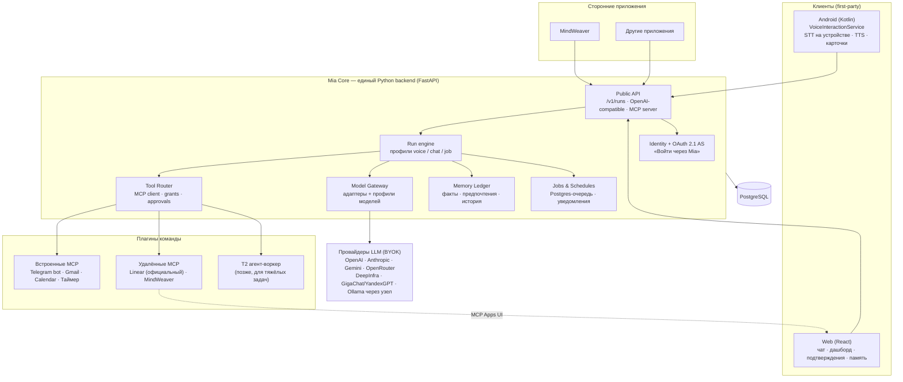
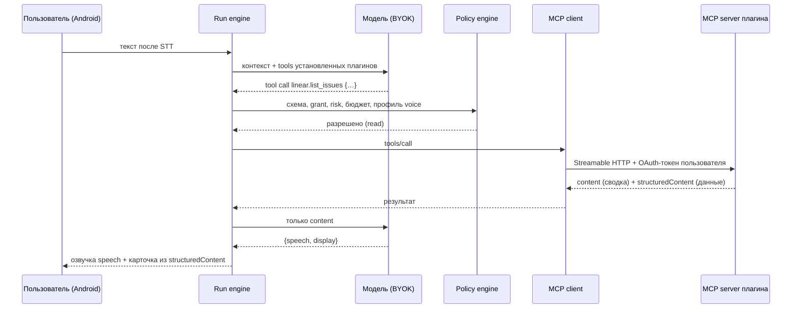

# Mia: независимая ревизия архитектуры и рекомендуемый вариант

Дата: **9 октября 2026 года**.
Основания: [Mia_Architecture.md](Mia_Architecture.md) (v1, 07.10.2026),
[Mia_MVP_Gap_Analysis.md](Mia_MVP_Gap_Analysis.md), исходная переписка с Олегом,
код `mia-helper` (HEAD `b98fd99`), проект MindWeaver (`~/mind-map-generator`),
веб-исследование состояния рынка и стандартов на 09.10.2026 (источники в §13).

Документ не заменяет два предыдущих: он сравнивает альтернативы, фиксирует,
где я согласен и где расхожусь с `Mia_Architecture.md`, и даёт конкретный
вариант под уточнённые цели.

---

## 0. Коротко

**Рекомендация:** строить Mia как **тонкое облачное ядро персонального
ассистента на Python** (развитие существующего backend) поверх **открытых
стандартов**, а не собственных форматов:

- интеграции — это **MCP-серверы** (спецификация `2026-07-28`) + **Agent Skills**
  (`SKILL.md`) + UI в виде **MCP Apps**;
- **Android-клиент на Kotlin** — системный ассистент по умолчанию с каскадным
  голосом. Распознавание речи на устройстве (GigaAM), дальше любая LLM, затем TTS;
- **веб** — тот же ассистент с чатом, дашбордом и подтверждениями;
- **«Войти через Mia»** — OAuth 2.1 + OpenAI-совместимый endpoint. Сторонние
  приложения, первым MindWeaver, используют модель, память и инструменты
  пользователя через его согласие;
- **память** — прозрачный «журнал фактов», который пользователь видит и правит.
  Шифрование с первого дня спроектировано так, чтобы ключ можно было перенести
  на устройства пользователя (E2EE) без переделки модели данных.

**Архитектуру «каждая интеграция — отдельный контейнер-агент, общение на
естественном языке»** как основу **не рекомендую**. Она ломает голосовую
задержку и надёжность на слабых моделях, многократно увеличивает расход
токенов и требует инфраструктуры, которую одному человеку не потянуть.
**Её сильную идею стоит взять как отдельный уровень исполнения:**
изолированный агент-воркер для тяжёлых и недоверенных задач (генерация
приложений, большие документы, чужой код). Его вызывают как типизированную
фоновую задачу, а не как собеседника. Подробно в §4.

**Главные отличия от `Mia_Architecture.md`:**

1. Стек остаётся Python/FastAPI + Kotlin + React; Node/Fastify и монорепо не нужны.
2. Слои host из `Mia_Architecture.md` сохраняются: manifest, магазин,
   discovery, policy engine, гранты, дашборд, jobs. Manifest остаётся
   «конвертом» плагина, как в его §9: исполняемая часть — MCP-сервер, UI —
   MCP Apps, инструкции — `SKILL.md`. Меняется объём MVP: без executor-пакетов,
   подписанных releases и review. Добавляются встроенные и декларативные
   плагины, которые Mia исполняет сама (§5.4).
3. Personal Node, E2EE-relay и открытый магазин убраны за пределы ближайших 6 месяцев.
4. Голосовой вывод становится контрактом harness: «сказать» отдельно от
   «показать». Фоновые задачи — встроенный инструмент модели.
5. SDK «Войти через Mia» входит в MVP, а не в этап 4.
6. Дифференциация переносится с «harness + магазин» на «русскоязычный голосовой
   Android-ассистент с любой моделью». Harness как таковой за 2026 год стал
   бесплатным товаром (OpenClaw, Hermes).

---

## 1. Уточнённая постановка

Из ответов на вопросы:

| Параметр | Значение | Следствие для архитектуры |
|---|---|---|
| Команда | Один разработчик + Claude Max + Codex Plus; объём работы больше фуллтайма | Минимум сервисов и языков; без собственных протоколов, где есть стандарт; всё проверяемо автотестами, чтобы агенты могли работать автономно |
| Первый результат | Android-приложение заменяет стандартного ассистента; плагины Telegram, Linear, Gmail и т.п.; веб с теми же возможностями | Ядро общее для web и Android; голос — первоклассный путь, а не надстройка |
| Провайдеры | Основная модель — GPT на подписке Plus, если это допустимо, иначе DeepInfra GLM-5.3-flash; сначала всё на одной модели, потом остальные | Одна основная модель для разработки и тестов; остальные адаптеры остаются «на уровне чата» и проверяются позже (§5.5) |
| Магазин | Качество плагинов к MVP не важно (MVP — это PoC); важна **механика**: добавить плагин в магазин, установить, подключить | Полный цикл каталог → установка → подключение аккаунта → плитка → вызов голосом; публикуют только плагины команды, плюс «добавить свой MCP по URL» для своего аккаунта (§5.4.5) |
| SDK | Нужен рабочий SDK/API для MindWeaver, где основной сценарий идёт через Mia | «Войти через Mia» + inference API + MindWeaver как MCP-плагин Mia |
| Harness | Базовый пользовательский, не coding agent; голос получает только нужное; задачи в фон | Профили run (voice/chat/job), контракт ответа, инструмент `background.start` |
| Приватность | Решение за мной | Предложение в §7 |
| Рынок | Русский язык, разные регионы, BYOK | Русский голосовой тракт; региональные и юридические вопросы вынесены в [Mia_Backlog.md](Mia_Backlog.md) |
| Хранение личных данных | Personal Node не делаем; Mia должна помнить людей и факты («Яна») с просмотром и удалением | Облачное ядро + данные на телефоне (§7.5) |

---

## 2. Что изменилось в мире к октябрю 2026 и что из этого следует

Оба исходных документа почти не опираются на изменения последних месяцев.
Ниже факты, которые меняют решения. Ссылки в §13.

| Факт (проверено 09.10.2026) | Следствие для Mia |
|---|---|
| **MCP `2026-07-28`** — большая stateless-ревизия: нет сессий и `initialize`, есть `server/discover`, Streamable HTTP, `input_required` вместо sampling/elicitation. OAuth 2.1 + PKCE + Resource Indicators; **Client ID Metadata Documents** вместо DCR. Управление — Agentic AI Foundation (Linux Foundation) | Писать MCP-клиент сразу под `2026-07-28`; не использовать Sampling/Roots/старый SSE |
| **MCP Apps** — официальное расширение (`_meta.ui.resourceUri`, sandboxed iframe, JSON-RPC через postMessage). Поддерживают Claude, ChatGPT, VS Code, M365 Copilot, Cursor, Goose | Плитки дашборда = MCP Apps view; не изобретать свой bridge |
| **OpenAI «plugins» = skills + MCP server + UI**; Apps SDK фактически построен на MCP Apps | Индустрия сошлась на том же составе, что задумывался для Mia: интерфейс + skill + tools. Формат уже существует |
| **Agent Skills (`SKILL.md`)** поддерживают ~50 клиентов; есть расширение «Skills over MCP» с SHA-256 digest | Skill плагина Mia переносим в Claude/ChatGPT/Codex и обратно |
| **A2A 1.0** (Linux Foundation): Agent Card, Task с `input-required`, artifacts. Используется в основном в enterprise-платформах | Как основа не нужен; модель состояний задачи полезна для фоновых jobs |
| **Sign in with ChatGPT**: OIDC + отдельные inference-scopes на подписке пользователя, недельный лимит на приложение, **без доступа к памяти**. OpenRouter OAuth PKCE выдаёт приложению ключ пользователя. Puter.js — модель user-pays | «Войти через Mia» — признанный паттерн. У Mia есть отличие: память и инструменты пользователя по согласию |
| **Anthropic запрещает** сторонним приложениям вход через Claude.ai и маршрутизацию запросов через подписки Free/Pro/Max; Google не даёт санкционированного пути для подписки Gemini | В Mia только API-ключи (и OpenRouter OAuth). Никаких «подключите подписку Claude/Gemini» |
| **Google Assistant удалён с телефонов с 04.09.2026**, по умолчанию Gemini. Сторонний «цифровой ассистент» по умолчанию по-прежнему назначается (ChatGPT, Perplexity, Claude это делают) | Окно возможностей: пользователи заново выбирают ассистента |
| Сторонним приложениям **недоступен аппаратный hotword (DSP)**. Но приложение, предоставляющее **VoiceInteractionService, освобождено от запрета** запускать microphone foreground service из фона (Android 14+) | Программный wake word «Привет, Мия» легален для ассистента по умолчанию. Цена — батарея, OEM-убийцы фона, постоянный индикатор микрофона |
| **Picovoice закрыл бесплатный tier с 30.06.2026**; openWakeWord/microWakeWord обучаются в основном на английском | Русскую фразу активации придётся обучать самим. Существующий spectral-template детектор S27 не выбрасывать |
| **GigaAM-v3** (MIT, ~240M): средний WER на русском ~8% против ~25% у Whisper large-v3 (по model card; сторонние тесты подтверждают разрыв в 2–3 раза); есть в sherpa-onnx для Android | Распознавание речи на устройстве: дёшево, приватно, лучше по качеству для русского |
| **OpenClaw** (~390k звёзд, MIT, фонд) и **Hermes Agent** (~250k) — бесплатные персональные gateway + skills + каналы. Слабое место обоих — голос на мобильных | Конкурировать «harness’ом» бессмысленно; конкурировать голосом на Android можно |
| **ClawHavoc**: 341 вредоносный skill из 2 857 в ClawHub; RCE в gateway OpenClaw (CVE-2026-25253) | Открытый магазин = ответственность за supply chain. Решение «только плагины команды» правильное |
| Голос Claude (июль 2026) работает с connectors (Gmail, Calendar, Slack); Siri на Gemini в iOS 27; Alexa+ общедоступна в США | Голос + инструменты больше не уникальны. Уникальна комбинация: любая модель + русский + Android по умолчанию + свои плагины + SDK |

**Вывод о позиционировании.** Аргумент Олега «чем это лучше ChatGPT»
справедлив для чата с MCP. Для голосового Android-ассистента, который
работает на **любой** модели (в том числе локальной или GigaChat/YandexGPT),
хорошо понимает **русский** и даёт **API своим и чужим приложениям**, прямого
аналога на рынке нет. Отсюда приоритет: голос и SDK важнее количества
провайдеров и магазина.

---

## 3. Альтернативы архитектуры

### 3.1. Рассмотренные варианты

| # | Вариант | Суть |
|---|---|---|
| A | **Документ GPT** | Своё ядро + собственный формат плагинов `mia.plugin/v1` + Managed Mode и Personal Node с одним протоколом; стек TypeScript/Node |
| B | **Агентное общество (вариант друга)** | Каждая интеграция — контейнер с bash и своей сессией LLM; агенты общаются на естественном языке |
| C | **Local-first (исходная идея Олега)** | Runtime, история и исполнение кода на устройстве владельца: телефон, ПК или колонка; облако только relay |
| D | **Надстройка над OpenClaw/Hermes** | Mia — голосовой Android-клиент и набор skills к готовому gateway |
| E | **Тонкое облачное ядро на стандартах + «AI-аккаунт» (рекомендуется)** | Существующий Python backend как единое ядро; MCP/Skills/MCP Apps; OAuth-провайдер «Войти через Mia»; нативный голос на Android |
| F | **Browser-only BYOK** | Всё в браузере: ключи и вызовы провайдеров из клиента, как TypingMind |

### 3.2. Сравнение

Оценка от 1 (плохо) до 5 (хорошо) применительно к **вашим** целям на 6 месяцев.

| Критерий | A | B | C | D | **E** | F |
|---|---|---|---|---|---|---|
| Android как ассистент по умолчанию + web | 4 | 3 | 3 | 2 | **5** | 1 |
| Посильно одному разработчику с агентами | 2 | 1 | 2 | 3 | **4** | 5 |
| Голосовая задержка (p50 ≤ 2,5 с) | 4 | 1 | 3 | 3 | **4** | 2 |
| Работа на слабых/локальных моделях | 3 | 1 | 3 | 3 | **4** | 3 |
| Приватность «из коробки» | 3 | 3 | 5 | 4 | **3→4** | 4 |
| Фоновые задачи и расписания | 4 | 4 | 2 | 4 | **4** | 1 |
| SDK для сторонних приложений (MindWeaver) | 3 | 2 | 2 | 2 | **5** | 1 |
| Переиспользование готового кода | 2 | 1 | 2 | 2 | **5** | 2 |
| Стоимость эксплуатации | 4 | 1 | 5 | 4 | **4** | 5 |
| Риск безопасности | 3 | 2 | 3 | 2 | **4** | 3 |
| Путь к магазину, колонке и Personal Node | 5 | 3 | 4 | 3 | **4** | 1 |

### 3.3. Почему не A, C, D, F

- **A** сам по себе разумен: E — это A, упрощённый под одного человека и
  обновлённый под стандарты. Расхождения с A перечислены в §11. Главное:
  переписывание на Node и собственный формат плагинов отнимают месяцы и не
  приближают north star.
- **C** — правильное направление для режима приватности, но как основа MVP
  требует дублировать runtime на телефоне и ПК. Нужны relay, pairing и E2EE,
  а фоновые задачи зависят от того, включено ли устройство. Android убивает
  фоновые процессы. Оставить как **будущий режим** ([Mia_Backlog.md](Mia_Backlog.md)): данные и протокол
  проектируются так, чтобы ядро могло переехать на узел.
- **D** ставит Mia в зависимость от чужого single-user gateway на TypeScript
  с историей уязвимостей и моделью доверия «один владелец». Он не рассчитан
  на облачный multi-tenant веб. Из D стоит взять **совместимость**: те же
  `SKILL.md`. Позже Mia-Android может стать «узлом» OpenClaw как интеграция.
- **F** не даёт ни системного ассистента, ни фоновых задач, ни SDK.

---

## 4. Разбор архитектуры «контейнер-агент на интеграцию»

### 4.1. Что в ней правильно

1. **Изоляция.** У каждой интеграции свои секреты, файловая система и лимиты.
   Ошибка или взлом одной интеграции не задевает остальные.
2. **«Дайте агенту компьютер».** Агенты с bash и файлами действительно часто
   сильнее агентов с сотней узких tools. Примеры: Claude Agent SDK, «Code
   execution with MCP» (−98,7% токенов в примере Anthropic), Cloudflare Code
   Mode, Vercel (−80% tools, стоимость вызова $1,00 → $0,25). CodeAct даёт до
   +20 п.п. к успешности против JSON tool calls.
3. **Порог входа для автора плагина.** Dockerfile + `AGENTS.md`/`SKILL.md`
   проще, чем аккуратная JSON Schema для каждого действия.
4. **Универсальность.** Естественный язык не требует версионирования схем.
5. **Пригодность для долгих задач**: сборка приложений, исследование,
   браузерная автоматизация.

### 4.2. Что ломается

| Проблема | Цифры и аргументы |
|---|---|
| **Задержка голоса** | Один ход «STT → LLM → TTS» укладывается в ~0,8–1,2 с до первого звука. Делегирование на естественном языке добавляет минимум три полных последовательных генерации: главный агент пишет просьбу, агент интеграции планирует и выполняет, отвечает текстом, главный агент переваривает ответ. Плюс пробуждение контейнера (~1 с). Итого 3–8 с на frontier API, на локальном Qwen хуже. Цель p50 ≤ 2,5 с недостижима без «заполнителей» |
| **Токены и деньги пользователя** | Мульти-агентная система Anthropic тратит ~15× токенов чата против ~4× у одиночного агента. При BYOK это платит пользователь, у локальной модели это время |
| **Надёжность** | MAST (NeurIPS 2025, 1 600+ трасс): 36,9% отказов — рассогласование между агентами, 41,8% — ошибки спецификации. Google Research (январь 2026): независимые агенты усиливают ошибки до 17,2×; на последовательном планировании все мульти-агентные варианты теряли 39–70%. При равном бюджете токенов одиночный агент не хуже. Естественный язык между агентами — сжатие с потерями: получатель не видит хода мыслей отправителя (принцип Cognition) |
| **Слабые и локальные модели** | Qwen3.5-27B: ~42% на Terminal-Bench 2.0. Один bash-цикл с ограничителями работает, но цепочка из 5 агентов перемножает ошибки. Это противоречит обещанию «любая модель» |
| **Подтверждения** | Подтвердить отправку конкретному адресату конкретного текста можно только над структурированными аргументами (args hash). Фраза «агент Telegram, отправь это Пете» не даёт точного объекта для одобрения |
| **Безопасность** | Prompt Infection: инъекция распространяется от агента к агенту. Unit 42 описал «session smuggling» в A2A. Агент Linear, выполняющий текстовые просьбы другого агента, — классический confused deputy: действует своими правами по непроверяемой инструкции. Правило Meta «Agents Rule of Two» нарушается по построению |
| **Стоимость инфраструктуры** | 1 000 пользователей × 5 интеграций = 5 000 контейнеров. Всегда включённые (1 vCPU/2 GiB, E2B или Daytona) ≈ **$300k/мес**. Со сном при простое — ~$1,5–6k/мес, но каждый «разбуд» добавляет ≥1 с. Одиночный FastAPI-процесс обслуживает те же интеграции за ~$10–30/мес |
| **Мобильность** | На телефоне контейнеров нет; Google Play ограничивает загрузку исполняемого кода. Архитектура работает только в облаке или на узле |
| **Отладка одним человеком** | Пять LLM-сессий с недетерминированным диалогом вместо одной трассы вызовов |

### 4.3. Вердикт и что взять

Основой — нет. **Как третий уровень исполнения — да.** Рекомендуемая
иерархия:

| Уровень | Что это | Примеры | Как вызывается |
|---|---|---|---|
| **T0. UI-only** | Плитка или форма без собственной логики | Часы, заметки | Напрямую из UI, без LLM |
| **T1. Typed tools (MCP)** | Детерминированные вызовы API | Linear, Gmail, Calendar, Telegram bot | Один агентный цикл ядра, JSON Schema, подтверждения |
| **T2. Агент-воркер в песочнице** | Изолированный контейнер (Firecracker-класс) с bash и своим циклом LLM | Builder App, «разбери PDF на 200 страниц в карту», исследование, чужой код | Как **фоновая задача** с типизированным входом и результатом: `goal` (текст) + `inputs` (данные) → `status` + `artifacts` + `summary` |

Правила для T2, которые сохраняют дух идеи друга без её проблем:

1. Воркер получает **задачу**, а не беседу. Естественный язык допустим в
   поле `goal`, но ID, адресаты и деньги передаются структурой. Это модель
   A2A Task (`submitted → working → input-required → completed/failed`),
   протокол A2A при этом брать не обязательно.
2. Воркер **не делает внешних побочных действий сам**. Отправка, публикация и
   оплата идут через ядро с подтверждением. Секреты подставляет брокер на
   egress; агент их не видит.
3. Результат воркера помечается как **недоверенные данные**. Ядро не
   выполняет инструкции из его текста.
4. Один контейнер на **задачу**, а не на интеграцию: создаётся под job и
   засыпает или удаляется после. На старте подойдёт внешний сервис песочниц
   (E2B, Daytona, Cloudflare Sandbox, Vercel Sandbox) или Docker с gVisor на
   своей VM для задач команды.
5. В голосовом пути T2 не используется никогда. Голос говорит «запустила,
   сообщу», дальше это фоновая задача (§5.2).

Для MVP T2 не нужен. Первым кандидатом будет тяжёлая генерация MindWeaver
или Builder App.

---

## 5. Рекомендуемая архитектура (вариант E)

### 5.1. Общая схема



Принципы:

- **Один backend-процесс** (модульный монолит, как в ADR-0001) + один
  воркер jobs + PostgreSQL. Всё на одной VM за $10–30 в месяц.
- **Клиенты — тонкие.** Android и web не содержат агентной логики; они
  показывают события run, проигрывают речь и собирают подтверждения.
  Исключение — голосовой тракт Android (§6).
- **First-party клиенты используют тот же публичный API**, что и сторонние
  приложения (dogfooding). Тогда SDK для MindWeaver не отдельный продукт, а
  побочный результат.

### 5.2. Harness: «личный ассистент», а не coding agent

Базовый цикл остаётся таким, как в `Mia_Architecture.md` §7, но добавляются
три вещи, которых там нет.

**(a) Профили run.**

| Профиль | Когда | Лимиты (начальные) | Особенности |
|---|---|---|---|
| `voice` | Голос с Android/колонки | ≤ 3 шагов модели, ≤ 2 tool calls, бюджет ~6 с до первого звука | Только быстрые чтения; запись — через подтверждение на экране; всё долгое → `background.start` |
| `chat` | Web, текст | ≤ 12 шагов, 60–150 с | Полный набор инструментов, карточки, подтверждения |
| `job` | Фоновые задачи и расписания | Свой бюджет денег/шагов, до 30 мин | Без пользователя «на линии»; результат → уведомление + входящие |
| `app` | Запрос стороннего приложения через SDK | Бюджет и scopes из гранта приложения | Без доступа к чужим инструментам, если не выдан scope |

**(b) Контракт ответа «сказать / показать».** Финальный ответ модели — это
не просто текст, а структура:

```json
{
  "speech": "Сегодня три встречи, первая в 10:00 с Олегом. Просроченных задач две.",
  "display": { "kind": "card", "markdown": "…полный список со ссылками…" },
  "followups": ["Перенести просроченные на завтра?"]
}
```

- `speech` — не больше 1–2 предложений и ~250 символов, без markdown,
  ссылок и ID. Его озвучивает TTS.
- `display` — полная информация: карточка, плитка или ссылка. В голосовом
  режиме это то, что видно на экране телефона и в вебе.
- Для моделей без structured output: финальный текст режется по маркеру или
  первой фразе, а длинное уходит в `display`. Проверить на двух выбранных
  моделях.

**(c) Инструменты возвращают два представления.** MCP уже разделяет `content`
(для модели) и `structuredContent` (для клиента/UI). Правило для плагинов
Mia: `content` — компактная сводка до ~1–2k токенов (что нужно модели для
ответа), `structuredContent` и MCP App — полные данные для карточки. Так
модель в голосе получает «только нужное», а пользователь на экране видит всё.

**(d) Фон как встроенный инструмент модели.** Ядро всегда даёт модели:

| Инструмент | Что делает |
|---|---|
| `background.start(goal, inputs?, notify?)` | Создаёт job с профилем `job`; возвращает ID; голос отвечает «Запустила, сообщу» |
| `background.status(id)` / `background.cancel(id)` | Статус и отмена |
| `schedule.create(rule, timezone, goal, delivery)` | Расписание (RRULE + IANA TZ) с политикой пропусков |
| `memory.remember(fact, category)` | Предложить факт в память (по умолчанию требует согласия, см. §7) |
| `notify(channel, text)` | Push в приложение или сообщение через Telegram-бота |

Результат завершённого job попадает во **входящие** ассистента и в push.
При следующем голосовом обращении Mia коротко говорит: «Пока вас не было:
карта по PDF готова». Это и есть «ассистент, который работает, пока телефон
лежит рядом».

**(e) Контекст.** На старте плагинов ≤ 10, поэтому все определения tools
передаются целиком (без tool search). Контекст run: системная инструкция +
закреплённый профиль пользователя + до N релевантных фактов памяти (Postgres
FTS) + последние ходы + сводка старой части ленты. Embeddings — только если
FTS докажет недостаточность.

**(f) Одна лента вместо множества чатов.** Для персонального ассистента
основная сущность — одна непрерывная лента (голос, текст, результаты jobs) с
эпизодическими сводками. Отдельные «темы» в вебе возможны, но голос всегда
пишет в основную ленту. Это проще для памяти и ближе к идее Олега
«накапливает harness».

### 5.3. Подтверждения и безопасность действий

Без изменений относительно `Mia_Architecture.md` §7/§12, но в MVP-объёме:

- Каждый tool в каталоге помечен `risk`: `read` / `write_reversible` /
  `write_external` (отправка, удаление, деньги).
- `write_external` в любом профиле создаёт **Approval** с точными
  аргументами, `args_hash` и `expires_at`. В голосе Mia говорит «Отправить
  Пете в Telegram: „…“? Подтвердите на экране» — подтверждение только на
  разблокированном телефоне или в вебе.
- `operation_id` записывается до вызова внешнего API; при таймауте статус
  `uncertain`, без автоповтора.
- Результаты tools и текст писем/сообщений помечаются как недоверенные
  данные. Инструкции оттуда не исполняются как системные.

### 5.4. Плагины, магазин и дашборд: что даёт MCP и что остаётся слоем Mia

#### 5.4.1. Как работает MCP

MCP — протокол между **host** и **плагином**. Host — Mia Core: он владеет
пользователем, моделью, правами и UI. Плагин — **MCP-сервер**. Внутри host
на каждый подключённый сервер работает свой **MCP-клиент**.

Сервер объявляет три примитива:

| Примитив | Что это | Пример в Mia |
|---|---|---|
| **Tools** | Функции с JSON Schema входа (и, по желанию, выхода). Результат: `content` — текст для модели, `structuredContent` — данные для кода и UI | `linear.list_issues`, `timer.start` |
| **Resources** | Данные по URI, которые host читает сам. Сюда же относится HTML интерфейса (`ui://…`) | `ui://timer/tile`, файл результата Builder |
| **Prompts** | Шаблоны запросов, которые пользователь может вызвать явно | «Сводка дня» |

Транспорты:

- **stdio** — сервер запущен локальным процессом;
- **Streamable HTTP** — сервер доступен по URL.

В версии `2026-07-28` каждый HTTP-запрос самодостаточен, без сессии. Это
удобно для облака: сервер не держит состояние соединения.

Авторизация — **OAuth 2.1**. Сервер плагина (например, Linear) выступает
resource server. Mia проводит пользователя через вход в Linear, получает
токен именно для этого сервера и хранит его в своём хранилище подключений.
Плагин никогда не видит ключ модели пользователя.

Официальные расширения, важные для Mia:

- **MCP Apps.** Tool или ресурс ссылается на `ui://…` HTML. Host показывает
  его в изолированном iframe. Через postMessage (JSON-RPC) интерфейс может:
  - вызвать tools своего сервера — через host и с проверкой прав;
  - отправить сообщение в разговор;
  - обновить контекст модели.
- **Tasks.** Долгие операции: создать задачу → опрашивать статус →
  дослать ввод, если сервер его запросил → забрать результат.
- **Skills over MCP.** Сервер раздаёт свои `SKILL.md` с SHA-256 digest.

Путь одного голосового запроса:



**Главное:** MCP описывает только то, как плагин отдаёт действия, данные и
UI. Он **не определяет**:

- магазин и установку;
- права пользователя, подтверждения и бюджеты;
- расписания, push-уведомления и события «извне»;
- дашборд, память, биллинг.

Всё это слой Mia (host), и он сохраняется из `Mia_Architecture.md` (§5.4.3).

#### 5.4.2. Покрываются ли все планируемые плагины

Да. Ни один из запланированных типов плагинов не требует уходить от MCP.
Для части из них MCP описывает только интерфейс, а «механику» делает host.

| Плагин / сценарий | Что делает MCP | Что делает Mia (host) | Итог |
|---|---|---|---|
| **Таймер, будильник** | Встроенный сервер: `start/get/cancel`, плитка `ui://timer/tile` | Хранит дедлайн в состоянии плагина. **Срабатывание** — планировщик ядра + push. Будильник на телефоне ставится и через device-tool `device.alarm.set` (Android AlarmManager): звонок не должен зависеть от сети и вкладки | Да; звонок — функция host или устройства |
| **Заметки, фокус** и прочие текущие встроенные | Встроенный сервер в процессе ядра | Состояние в Postgres | Да, прямой перенос `web_poc/runtime.py` |
| **Декларативные приложения** (текущий manifest v2: `state.patch`, `model.prompt`, view `fields/html`) | Mia **сама** выступает их MCP-сервером: tools генерируются из `actions`, view превращается в MCP App | Хранит состояние; `model.prompt` идёт через бюджет пользователя | Да; сохраняется как no-code тип плагина |
| **Новостная сводка, дайджесты** | Tools получения данных + плитка | Расписание (job), доставка, пауза и ручной запуск | Да |
| **Linear, Gmail, Calendar, Telegram** | Tools + OAuth; у Linear есть готовый официальный сервер | Подтверждения записи, хранение токенов. **Входящие события** (новое письмо, новая задача) идут через вебхук или периодический job ядра: MCP-сервер не может «разбудить» host, если соединения нет | Да |
| **Плитки дашборда** | MCP App view. Iframe обновляет данные вызовом tools через host, **без LLM** | Раскладка, размеры, настройки и refresh-политика — **расширение Mia** в manifest + `WidgetInstance`. На Android тот же HTML рендерится в WebView, в голосе используется `speech`-сводка | Да; постоянные плитки — расширение Mia поверх стандарта |
| **Удалённый Builder** (приложения, сайты) | Удалённый MCP-сервер автора: `build.start` как **Task** с прогрессом и `input_required`; результат — ссылки на артефакты (resources/URL) | Job-обёртка, бюджет, подтверждение трат и публикации, уведомление. LLM Builder вызывает **модель пользователя** через SDK Mia (`llm.generate` с лимитом) | Да; это и есть уровень T2 из §4 |
| **MindWeaver** | Удалённый MCP + плитка карты | SDK «Войти через Mia» (§8) | Да |
| **Внешнее приложение автора** (Windows, Android, сайт) | Не обязано быть MCP | Ссылки на скачивание на странице магазина (есть в v2 `downloads`); приложение использует SDK Mia для входа и запросов к модели | Да, через SDK, а не MCP |
| **Действия на телефоне** (контакты, Telegram с телефона, будильник, открыть приложение) | Те же JSON Schema tools, но исполнитель — Android-клиент | Клиент при подключении регистрирует свои **device tools**; ядро отправляет вызов по каналу run, телефон исполняет и возвращает результат | Да (§7.5) |
| **Локальная модель или файлы на ПК** | — | Требует Personal Node | Не в MVP ([Mia_Backlog.md](Mia_Backlog.md)) |

#### 5.4.3. Слои Mia: что сохраняется из `Mia_Architecture.md`

Подход astra не поменялся по сути. Его manifest уже предполагал
`execution.transport: "mcp-http"` и `surfaces.widget.resourceUri:
"ui://…"`. Меняется **объём MVP**, а не набор слоёв.

| Слой host | Есть в astra | MVP-реализация |
|---|---|---|
| **Каталог / магазин** (страница, скриншоты, отзывы, версии) | Да | Существующий web-магазин; записи создаются из manifest |
| **Manifest** | Да (`mia.plugin/v1`) | `mia.json` — конверт плагина (пример ниже) |
| **Установка и гранты** | Да | Экран согласия: tools, риски, данные, лимит LLM; версия закреплена |
| **Подключения (vault)** | Да | OAuth-токены и ключи интеграций на пользователя, зашифрованы |
| **Discovery layer** | Да (короткий список tools + lazy skills) | Модель получает tools установленных плагинов, отфильтрованные по профилю run: в `voice` — только помеченные `voice: true` и быстрые. В системный промпт идёт только `description` skills; полный `SKILL.md` подгружается, когда плагин выбран. Поиск по tools — когда их станет больше ~30–50 |
| **Policy engine** | Да | Проверка схемы аргументов; grant и scope; `risk` → Approval; бюджеты и лимиты; allow-list адресов удалённых MCP (защита от SSRF); digest описаний tools при установке (подмена описания после установки = повторное согласие) |
| **Run engine, jobs, расписания** | Да | §5.2, фаза 4 |
| **Events ingress** | Частично | Вебхуки и опрос внешних сервисов → события → job или уведомление |
| **Дашборд (`WidgetInstance`)** | Да | Раскладка с `expected_version`, плитки = MCP App, refresh по политике |
| **Память, аудит, журнал расходов** | Да | §7, существующий аудит backend |
| Подписи releases, review, изолированные executors, платежи | Да | **Не в MVP** ([Mia_Backlog.md](Mia_Backlog.md)) |

#### 5.4.4. Пример `mia.json`

```json
{
  "schemaVersion": "mia.plugin/1",
  "id": "team.linear",
  "version": "0.1.0",
  "name": "Linear",
  "listing": {
    "description": "Задачи Linear в чате, голосе и на дашборде",
    "category": "work",
    "icon": "assets/icon.png",
    "screenshots": ["assets/s1.png"],
    "downloads": []
  },
  "server": { "kind": "remote", "url": "https://mcp.linear.app/mcp", "auth": "oauth" },
  "skills": ["SKILL.md"],
  "tools": {
    "list_issues":  { "risk": "read", "voice": true },
    "create_issue": { "risk": "write_reversible" },
    "delete_issue": { "risk": "write_external" }
  },
  "surfaces": {
    "tiles": [{
      "id": "my-issues",
      "resourceUri": "ui://team.linear/my-issues",
      "bundled": "ui/my-issues.html",
      "sizes": ["2x2", "4x2"],
      "mobile": "card",
      "refresh": { "tool": "list_issues", "everySeconds": 300 }
    }]
  },
  "permissions": {
    "network": ["mcp.linear.app"],
    "llm": { "viaHost": false },
    "memory": [],
    "notify": true
  }
}
```

Варианты `server.kind`:

| `server.kind` | Где исполняется |
|---|---|
| `builtin` | Python-модуль в процессе ядра |
| `remote` | MCP по URL |
| `declarative` | Блок `actions` в стиле v2, исполняет сама Mia |
| `worker` | T2, позже |

Поле `bundled` позволяет приложить **свой UI** к чужому серверу. У
официального сервера Linear нет плиток, но плагин команды их добавляет:
Mia раздаёт HTML как `ui://`-ресурс, а данные берутся вызовом
`list_issues`.

#### 5.4.5. Магазин в MVP: механика, а не качество плагинов

1. **Публикация (команда).** `mia plugin publish ./plugins/linear` или
   страница администратора. Проверки:
   - схема `mia.json`;
   - сервер доступен (`server/discover`);
   - список tools совпадает с manifest;
   - CSP интерфейса;
   - фиксируются digest описаний tools и версия.

   После этого создаётся запись в каталоге.
2. **«Добавить свой MCP по URL»** (режим разработчика). Любой удалённый
   MCP-сервер ставится **только в свой аккаунт**, без публикации в каталог.
   Это дёшево и сразу показывает открытость платформы. Через этот же путь
   подключается MindWeaver до публикации.
3. **Установка.** Экран согласия → подключение аккаунта (OAuth) → плитки
   добавлены на дашборд → tools доступны в чате и голосе.
4. **Обновление.** Если новая версия расширяет права или меняет описания
   tools, нужно повторное согласие.
5. **Удаление.** Отзыв токенов, удаление плиток, отдельное предложение
   удалить данные плагина.
6. **Конструктор** существующих no-code приложений (v2) сохраняется: он
   создаёт `mia.json` с `server.kind: "declarative"`.

Первые плагины для проверки механики: **таймер** (builtin, плитка,
срабатывание), **заметки** (builtin), **Linear** (remote, OAuth, bundled
UI), **Telegram** (device tool + бот, §7.5), **MindWeaver** (remote через
«добавить по URL», затем публикация). Gmail/Calendar добавляются тем же
путём, когда понадобятся.

### 5.5. Модели

- **Одна основная модель на всю разработку.** Все контрактные сценарии,
  отладка и голос сначала доводятся до работы на **одной** модели. Вторая и
  следующие подключаются только после этого: прогоняется тот же набор тестов,
  исправляются расхождения адаптера.
- **Какая основная — решает короткий spike (1–2 дня) в начале фазы 1:**

  | Вариант | Условие | Если не выходит |
  |---|---|---|
  | **GPT на подписке ChatGPT Plus** через Sign in with ChatGPT (OAuth, Responses API на лимитах плана) | OpenAI разрешает использование плана для open-source и локально или самостоятельно размещённых приложений; клиент регистрируется во время входа. Для Mia в разработке, где вы сами хостите сервер и сами входите своим Plus, это выглядит допустимым. Для многопользовательского сервиса нужна заявка (interest form) | — |
  | **DeepInfra GLM-5.3-flash** (OpenAI-совместимый API, оплата за токены) | Работает сразу; `reasoning_content` уже обрабатывается в `web_poc` | Основная по умолчанию |

  Spike проверяет:
  1. Регистрацию клиента и вход своим Plus.
  2. Запросы Responses API с `store: false` и `stream: true`.
  3. **Function calling** на плане: документация этого явно не описывает.
  4. Доступные модели и лимиты Plus (окно в 5 часов общее для всех
     приложений и самого ChatGPT).

  Если все четыре пункта проходят, основная модель — GPT. Иначе — GLM, и
  фаза 1 стартует на ней без ожидания.
- **Нельзя:** использовать токены входа Codex CLI или ChatGPT в обход
  официального потока. Это нарушает условия OpenAI и рискует аккаунтом.
  Адаптер `chatgpt-plan` — отдельный провайдер в Model Gateway рядом с
  обычным OpenAI API.
- **Остальные провайдеры почти бесплатны.** Восемь адаптеров из
  `app/web_poc/providers.py` (Anthropic, Gemini, Groq, Mistral, Ollama, LM
  Studio и др.) переносятся в Model Gateway ядра вместе с сохранением
  provider parts (это решает OI-W6-013). Они помечаются «чат-совместимо,
  действия без гарантий». Generic OpenAI-compatible адаптер покрывает
  OpenRouter, xAI, YandexGPT, vLLM. Перевести модель в «проверенные» =
  прогнать на ней тот же набор контрактных тестов.
- **Подписки:** только через официальные OAuth-потоки — Sign in with
  ChatGPT (выше) и OpenRouter OAuth PKCE. Подписки Claude и Gemini
  подключать нельзя (§2).
- **Ollama на домашнем ПК** в MVP недоступна облачному ядру: это сценарий
  Personal Node.

---

## 6. Android и голосовой тракт

### 6.1. Активация

| Способ | Статус | Приоритет |
|---|---|---|
| Долгое нажатие home/power, жест ассистента | Работает после назначения Mia цифровым ассистентом (`ROLE_ASSISTANT`, `VoiceInteractionService` + `VoiceInteractionSessionService`) | **MVP** |
| Кнопка в приложении, виджет, плитка в шторке | Тривиально | MVP |
| Вызов с экрана блокировки | Поддерживается сессией ассистента; проверить на S25 Ultra и Pixel | MVP (проверка) |
| Программный wake word «Привет, Мия» | Легален для ассистента по умолчанию (исключение FGS для VIS), но нужен обученный русский детектор, замеры батареи и ложных срабатываний | После MVP, opt-in, «экспериментально» |
| Аппаратный hotword (DSP) | Недоступен сторонним приложениям | Не планировать |

Существующий S27 (spectral-template + enrollment) остаётся прототипом. Для
production — собрать корпус (свой голос + 10–20 человек + шум) и обучить
openWakeWord-совместимую ONNX-модель (например, синтетикой через LiveKit
trainer + реальные записи). Возвращать в scope по ADR-009, когда будут замеры.

### 6.2. Каскад вместо realtime-модели

```text
mic → VAD (есть) → STT на устройстве (GigaAM-v3 через sherpa-onnx) → текст
    → Run(profile=voice) в ядре → speech (стрим) → TTS → динамик
```

| Звено | Рекомендация MVP | Альтернатива |
|---|---|---|
| VAD / endpointing | Существующий локальный VAD + явный commit | Silero VAD в sherpa-onnx |
| STT | **GigaAM-v3 на устройстве**: лучший открытый русский ASR, MIT, аудио не покидает телефон, $0 за минуту | Облачный STT (OpenAI/Gemini transcribe, Yandex SpeechKit) как fallback для слабых устройств |
| LLM | Выбранная пользователем модель через ядро, стрим токенов | Gemini Live / gpt-realtime как отдельный «премиум realtime» режим (существующий код Live сохранить) |
| TTS | Системный Android TTS (бесплатно, офлайн при наличии русского голоса) → затем Piper/Kokoro-ru на устройстве | Облачный TTS по ключу пользователя |
| Barge-in | Существующий flush/cancel | — |

Почему каскад, а не Gemini Live по умолчанию: realtime-API привязывают
голос к одному вендору и его модели, а это противоречит «любой модели».
Каскад медленнее, поэтому нужен быстрый первый звук: короткое
подтверждение («Сейчас посмотрю») озвучивается сразу, если run не
укладывается в ~1,5 с.

**Бюджет задержки (цель для замера):** endpointing 300–600 мс + STT на
устройстве 150–400 мс + TTFT модели 300–800 мс + первый звук TTS 100–200 мс
≈ **0,9–2,0 с** для простого ответа. Один tool call добавляет 0,3–1,5 с.
Измерить на S25 Ultra в рамках S31-R1 (его стоит переформулировать под
каскад).

### 6.3. Что остаётся от текущего Android-кода

Всё из списка «не нужно повторять» gap-анализа: audio engine, VAD,
контроллер сессии, auth, Room, текстовый клиент. Новое: VIS/Session,
sherpa-onnx STT-модуль, TTS-модуль, рендер карточек `display` и
подтверждений, push (FCM) для результатов jobs, экран памяти и подключений.
Магазин и дашборд на Android в MVP — WebView на веб-страницы, а не нативные
экраны.

---

## 7. Память и приватность: предложение

### 7.1. Что нужно пообещать и что можно выполнить

«У пользователя не должно быть вопросов» складывается из трёх свойств:

1. **Видимость.** Пользователь в любой момент видит всё, что Mia о нём
   помнит, откуда это взялось, и может исправить или удалить.
2. **Минимальность.** Mia хранит только то, что нужно; сырой звук не
   покидает телефон; провайдеру модели уходит минимум контекста.
3. **Техническая невозможность чтения оператором** там, где это реально.

С облачным runtime и BYOK-провайдерами третье свойство нельзя обещать
полностью. Во время запроса текст расшифрован в памяти сервера и уходит
провайдеру LLM. Провайдер хранит его по своей политике: OpenAI до 30 дней
по умолчанию, Gemini API 55 дней, Anthropic до 30 дней. Честное обещание
Mia строится на этом ограничении, а не скрывает его.

### 7.2. Варианты

| Вариант | Оператор может прочитать? | Фоновые задачи | Сложность для соло | Комментарий |
|---|---|---|---|---|
| V1. **Прозрачная память** + шифрование at rest с per-user ключом на сервере | Технически да, политикой и логами — нет | Без ограничений | Низкая | Как ChatGPT/Claude, но с журналом происхождения и строгими настройками |
| V2. **E2EE-хранилище**, ключ из passkey (WebAuthn PRF) + код восстановления; ядро получает ключ только на время активной сессии клиента | В покое — нет; во время активной сессии — в памяти процесса | Только по «профилю автоматизаций», который пользователь явно оставляет читаемым | Средняя | PRF поддерживается Android/GPM, Apple Passwords, 1Password, Windows Hello с февраля 2026; используется Bitwarden |
| V3. **Всё на устройстве или узле** | Нет | Только когда устройство включено | Высокая | Режим Personal Node |
| V4. Обработка в **TEE с аттестацией** (Tinfoil, NEAR AI, Phala) | Нет, проверяемо | Да | Средняя и высокая | Только open-weights модели; frontier-провайдеры в TEE не предлагаются |

### 7.3. Рекомендация: V1 сейчас, данные готовы к V2, V3/V4 как режимы

**MVP (V1 + элементы минимальности):**

- **Memory Ledger.** Каждый факт — запись `{id, text, category, source
  (ход/плагин/импорт), created_at, last_used_at, scope, sensitivity}`. Экран
  «Что Mia знает обо мне»: просмотр, правка, удаление, запрет тем.
- **Запись в память только с ведома пользователя.** Модель вызывает
  `memory.remember`; по умолчанию факт попадает в «предложенные», и
  пользователь подтверждает его одним касанием. В настройках можно включить
  автоматическое сохранение для нечувствительных категорий.
- **Инкогнито-режим** (ход не пишется ни в историю, ни в память) и
  **retention** истории: 30 дней / 1 год / бессрочно / не хранить.
- **Сырой звук не покидает телефон** (STT на устройстве). Это сильное и
  проверяемое обещание.
- **Минимизация контекста:** провайдеру уходят только отобранные факты, а не
  вся память. В UI отображается «эта модель видит: …» и политика хранения
  выбранного провайдера.
- **Шифрование at rest с envelope-ключом на пользователя** (DEK пользователя,
  обёрнутый мастер-ключом). Это сразу даёт «криптографическое удаление»
  (удалён DEK — удалены данные, включая бэкапы) и путь к V2.
- **Логи без содержимого** (уже принцип backend), никакой аналитики по
  тексту, никакого обучения.
- **Экспорт** памяти как обычных файлов (`/memories/*.md`, формат memory tool
  Anthropic) и **импорт** из ChatGPT/Claude/Gemini через очередь проверки.
- **Страница «Где ваши данные»:** что хранит Mia, что видит провайдер, что
  видят плагины, как всё удалить.

**После MVP (V2):** перевести историю и чувствительные категории памяти на
ключ пользователя (passkey PRF + обязательный код восстановления + одобрение
с другого устройства). Сервер хранит шифротекст. Ядро получает обёрнутый
ключ на время активной клиентской сессии. Фоновые задачи видят только
«профиль автоматизаций», явно отмеченный пользователем. Если в MVP DEK уже
на пользователя, переход меняет только место хранения обёртки ключа.

**Позже:** V3 через Personal Node (ключ живёт на узле, фоновые задачи там же)
и V4 для режима «приватная модель» на open-weights через аттестованный
провайдер.

### 7.4. Память для сторонних приложений

- Приложение запрашивает **scopes по категориям**: `memory.read:profile`,
  `memory.read:work`, `memory.suggest`. Пользователь видит, какие именно
  факты попадут в приложение.
- По умолчанию приложение **не получает сырые факты**. Оно получает
  контекст, подставленный ядром в запрос к модели (`context: "auto"` в
  inference API). Приложение видит ответ модели, а не память.
- Сырые факты отдаются только по явному scope `memory.read:*`; каждое чтение
  пишется в журнал, видимый пользователю.
- Запись из приложений — только `memory.suggest` (попадает в «предложенные»).
- Честное ограничение: что приложение уже получило, отозвать нельзя.
  Отзывается только дальнейший доступ.

### 7.5. Где хранятся личные данные без Personal Node

Personal Node в ближайшие месяцы не делаем. Личные данные хранятся в
**двух местах**: в облачном ядре Mia (Managed Mode) и **на телефоне
пользователя**. Телефон — естественное «личное устройство», которое уже
есть у каждого пользователя Android-приложения.

| Данные | Где | Как пользователь видит и удаляет |
|---|---|---|
| Аккаунт, устройства, установки плагинов | Postgres ядра | Настройки; удаление аккаунта |
| **Память: факты и люди** («Яна — жена, Telegram @yana») | Postgres ядра, зашифровано ключом пользователя (DEK) | Раздел «Что Mia знает» → вкладки «Люди», «Факты», «Предпочтения»; правка, удаление, экспорт |
| История разговоров | Postgres ядра по выбранному retention | Лента; удаление хода, периода или всей истории |
| Сырой звук | Только телефон, удаляется после распознавания | — |
| **Контакты телефона** | Только телефон; читаются по запросу через device tool | Mia не копирует их на сервер, пока пользователь не скажет «запомни» |
| Токены интеграций (Linear, Google) | Хранилище подключений ядра, зашифровано | «Подключения»: отключить = отозвать и удалить |
| Сессия Telegram «от моего аккаунта» (если включена) | **Только телефон** (TDLib на устройстве) | Выход из сессии в приложении |
| Состояние плагинов | Postgres ядра | Удаление плагина с опцией «удалить данные» |

**Пример: «Напиши Яне в Телеграм, что надо купить молоко».**

1. Телефон распознаёт речь локально; на сервер уходит только текст.
2. Run(`voice`). Модель вызывает `people.resolve("Яна")`.
3. Ядро ищет человека по порядку:
   - в **памяти Mia** (люди с алиасами: «Яна», «Янка», «жена»);
   - в **контактах телефона** через device tool `device.contacts.search`.
     Результат возвращается только в этот run и на сервере не сохраняется;
   - в контактах подключённого Telegram.
4. Если вариантов несколько, Mia спрашивает: «Яне Петровой или Яне с
   работы?». После выбора предлагает: «Запомнить, что Яна — это Яна
   Петрова?». Согласие создаёт запись в «Людях».
5. Модель формирует действие `telegram.send_message {to: person:42, text:
   "Надо купить молоко"}`. Policy engine создаёт Approval: «Отправить Яне
   Петровой в Telegram: „Надо купить молоко“?».
   - По умолчанию подтверждение нажатием на экране.
   - Можно разрешить голосовое «да» для людей из списка «доверенные
     контакты».
6. Отправка и запись `operation_id` / receipt.

**Важная оговорка про Telegram.** Bot API **не может написать Яне**,
пока Яна сама не начала диалог с ботом Mia. Отправка «от имени
пользователя» требует пользовательского клиента Telegram. Поэтому три
уровня:

| Уровень | Как работает | Когда |
|---|---|---|
| **L0. Передача в Telegram** | Android открывает чат с Яной с готовым текстом (deep link или share intent); пользователь нажимает «Отправить» | **PoC**: без API, без риска бана, без хранения сессии |
| **L1. TDLib на телефоне** | Device tool `telegram.send` отправляет сам после подтверждения; сессия Telegram живёт только на телефоне | Следующий шаг: полноценный голосовой сценарий |
| **L2. Сессия на сервере** | Отправка, даже когда телефон офлайн; нужна для фоновых задач | Позже. Это самый чувствительный секрет пользователя, решать вместе с E2EE ([Mia_Backlog.md](Mia_Backlog.md)) |

Бот Mia при этом нужен как **канал уведомлений самому пользователю**:
результаты фоновых задач и напоминания.

**Модель «Человек» в памяти:**

```text
Person { id, display_name, aliases[], relation?, identifiers{telegram_user_id?, phone?, email?},
         source (сказал пользователь | контакты | Telegram), sensitivity, created_at, last_used_at }
```

Имена и идентификаторы не попадают в логи и метрики. Провайдеру модели
передаётся только то, что нужно для текущего запроса: имя и отношение, без
телефона и ID. Для разрешения адресата модель получает ссылку `person:42`;
настоящий `telegram_user_id` подставляет ядро на этапе исполнения.

Честное ограничение остаётся тем же (§7.3). В облачном режиме оператор
технически может расшифровать память, пока ключ на сервере. Переход на
ключ пользователя (V2) — задача после MVP; модель данных к нему готова.

---

## 8. SDK и API: «Войти через Mia» и интеграция MindWeaver

### 8.1. Модель

Mia выступает **OAuth 2.1 Authorization Server** и **resource server** для
трёх видов доступа. Отдельно идентичность, отдельно inference, отдельно
контекст, как в Sign in with ChatGPT, но с памятью и инструментами.

| Scope | Что даёт | Ограничения |
|---|---|---|
| `openid profile email` | Вход: ID, имя, email | — |
| `llm.generate` | Запросы к **активной модели пользователя** через ядро | Месячный лимит денег на приложение задаёт пользователь; ключ провайдера приложению не выдаётся |
| `memory.context` | Ядро добавляет к запросам приложения релевантный контекст памяти | Категории выбирает пользователь |
| `memory.read:<cat>` / `memory.suggest` | Прямое чтение / предложение фактов | Журнал доступа |
| `tools.use:<plugin>` | Запросы с доступом к установленным плагинам пользователя (например, «отправь результат в Telegram») | Подтверждения как обычно |
| `jobs` / `notify` | Фоновые задачи от имени приложения и уведомления пользователю | Квоты |
| `mia.install` | Приложение регистрируется как плагин Mia (MCP-сервер) у пользователя | Согласие на установку |

- Клиенты идентифицируются через **Client ID Metadata Documents** (HTTPS URL
  с метаданными), как в MCP-авторизации, без ручной регистрации.
- PKCE обязателен; публичные клиенты (SPA, мобильные) без секрета.
- Токены короткие + refresh; отзыв на странице «Подключённые приложения»
  (там же расходы и журнал доступа к памяти).

### 8.2. API

| Endpoint | Зачем |
|---|---|
| `POST /v1/chat/completions`, `POST /v1/responses` (**OpenAI-совместимые**) | Любое приложение на OpenAI SDK или LiteLLM работает через Mia, меняя `base_url` и токен. `model: "mia:default"` — активная модель пользователя. Расширения в `extra_body`: `mia.context`, `mia.tools`, `mia.budget` |
| `POST /v1/runs` + `GET /v1/runs/{id}/events` (SSE) | Полноценный run ассистента с tools, подтверждениями и событиями. Им же пользуются Android и web |
| `POST /v1/jobs`, `GET /v1/jobs/{id}` | Фоновые задачи |
| `GET /v1/memory/context?query=…` | Сжатый контекст по scope |
| `POST /v1/notify` | Уведомить пользователя (push/Telegram) |
| MCP-endpoint ядра `/mcp` | Mia как MCP-сервер: Claude, ChatGPT и Cursor могут подключить Mia и пользоваться памятью и плагинами пользователя (по тем же OAuth scopes) |

SDK = тонкие обёртки: `@mia/sdk` (JS: OAuth PKCE, runs/events, completions)
и `mia-sdk` (Python). Генерируются из OpenAPI ядра, поэтому поддержка
почти бесплатна.

### 8.3. MindWeaver через Mia: обе стороны

В MindWeaver уже есть FastAPI, Google OAuth, ключи пользователя, LiteLLM и
stdio MCP-сервер с операциями над картами (`mcp_ops.py`). Это хорошая
стартовая точка.

**Сторона 1 — MindWeaver использует модель пользователя Mia.**

1. Кнопка «Войти через Mia» (OAuth PKCE, scopes `openid llm.generate
   memory.context`).
2. В `services/llm.py` добавить провайдер `mia/*`: LiteLLM вызывает
   OpenAI-совместимый endpoint Mia с access token пользователя. Отдельные
   ключи в MindWeaver становятся необязательными.
3. Стоимость генерации видна и в MindWeaver, и в Mia (единый журнал
   расходов).

**Сторона 2 — Mia управляет MindWeaver голосом.**

1. Добавить **hosted MCP-транспорт** (Streamable HTTP, `2026-07-28`) поверх
   существующих `mcp_ops` с авторизацией токеном Mia. Это закрывает и
   текущее ограничение «нет публичного `/mcp`».
2. `SKILL.md`: когда строить карту, как ссылаться на `P2.N3`, когда
   запускать долгую генерацию в фоне.
3. MCP App `ui://mindweaver/map` — превью карты как плитка дашборда и
   карточка в ответе.
4. Сценарий: «Мия, сделай карту по статье, которую я отправил в Telegram» →
   Telegram tool получает файл → `background.start` → MindWeaver строит
   карту (используя модель пользователя через сторону 1) → push «Карта
   готова» → плитка на дашборде.

Это одновременно **приёмочный тест SDK** и демонстрация идеи «приложение
полагается на наш ИИ».

### 8.4. Что не делать в SDK сейчас

- Платные плагины, выплаты авторам и комиссию: нужны только после того,
  как появятся чужие авторы.
- Выдачу приложению ключа провайдера (модель OpenRouter): Mia всегда
  проксирует, чтобы работали бюджет, контекст и отзыв.
- Собственный стандарт переносимой памяти: экспорт в файлы достаточно; за
  MacPaw Portable Memory и Human Context Protocol наблюдать.

---

## 9. BYOK и региональные ограничения

Для MVP принимается позиция: **Mia — нейтральный BYOK-клиент**. Пользователь
отвечает за свой ключ и аккаунт у провайдера, Mia проксирует запросы с этим
ключом.

Ограничения MVP:

- Только API-ключи и OpenRouter OAuth, никаких подписок (§2).
- Никакой рекламы «доступа к западным моделям из неподдерживаемых стран».
- В условиях использования прямо написано, что ответственность за ключ и
  его допустимость несёт пользователь.

Открытые вопросы перечислены в [Mia_Backlog.md](Mia_Backlog.md), раздел
«Регионы, право и провайдеры». Это условия провайдеров для посредника,
санкционные ограничения для оператора, 152-ФЗ и белорусские правила
передачи данных, альтернативные провайдеры и режим прямого вызова.
Вернуться к ним нужно до публичного запуска и приёма платежей, не до PoC.

---

## 10. Стек и план для одного разработчика с агентами

### 10.1. Стек

| Часть | Решение | Почему |
|---|---|---|
| Backend | **Python 3.12, FastAPI**, существующий `app/` (модульный монолит) + перенос `app/web_poc` внутрь как модулей | Работающий код, тесты, ADR; переписывание на Node не даёт пользы |
| БД | **PostgreSQL** (уже есть) | Аккаунты, лента, память, jobs, гранты |
| Очередь/расписания | **Procrastinate** (Postgres-очередь для Python) или своя таблица с `SKIP LOCKED` | Без Redis для jobs; Redis лимитов остаётся |
| MCP | Официальный **Python MCP SDK** (клиент и сервер) под `2026-07-28` | Один язык с ядром |
| OAuth AS | **Authlib** (OAuth 2.1/OIDC в Python) | Не писать криптографию самим |
| Модели | Свой Model Gateway на адаптерах из `web_poc/providers.py` + generic OpenAI-compatible | Уже работает; сохранение provider parts |
| Web | Существующий React/Vite; MCP Apps host через `@mcp-ui/client` / AppBridge | Сохраняем UI |
| Android | Существующий Kotlin/Compose + VIS + **sherpa-onnx** (GigaAM-v3, позже KWS) + Android TTS + FCM | Нативный голос; WebView для магазина и дашборда |
| Песочница T2 (позже) | Внешний сервис (E2B, Daytona, Cloudflare) или Docker + gVisor на VM | Не держать свою инфраструктуру microVM |
| Деплой | Одна VM (Hetzner CX33/CX43), Docker Compose, бэкапы Postgres вне VM | $10–30/мес на пилот |

Не добавлять: Node-сервис, Temporal, Kafka, LangChain/LangGraph, vector DB,
Kubernetes, собственный relay и E2EE-протокол.

### 10.2. Порядок работ

Оценки — календарные недели для одного человека с агентами. Ориентир, не
обещание: голос и устройства плохо ускоряются агентами.

| Фаза | Результат | Проверка готовности | Нед. |
|---|---|---|---|
| **0. Решения и каркас** | Принять этот документ или его правки; ADR: стандарты MCP/Skills/MCP Apps, профили run, контракт ответа, Memory Ledger, OAuth AS | ADR в `docs/adr/`, новые session cards | 0,5–1 |
| **1. Единое ядро** | `web_poc` → модули ядра на Postgres; общий аккаунт web+Android; Run/events (SSE); Model Gateway с одной основной моделью (spike GPT-на-Plus vs GLM, §5.5); Tool Router (MCP-клиент, risk, approvals, operation_id); таймер мигрирован | Таймер работает из web, Android и SDK; негативные тесты прав и бюджета | 3–4 |
| **2. Голос Android** | VIS + роль ассистента; каскад GigaAM → Run(voice) → TTS; контракт speech/display; карточки и подтверждения на экране; push | Замеры: p50/p95 первого звука, 20 ходов подряд, lock screen, батарея за час активного использования | 3–4 |
| **3. Магазин и плагины** | `mia.json`, публикация командой, «добавить MCP по URL», установка с согласием, OAuth-подключения, плитки MCP Apps (web + WebView на Android), декларативные v2-приложения; плагины: таймер, заметки, Linear (официальный MCP), Telegram L0 + бот уведомлений, device tools (контакты, будильник) | Плагин публикуется, ставится, подключается, появляется плиткой и вызывается голосом; «Напиши Яне…» проходит через память или контакты и подтверждение | 3–4 |
| **4. Фон** | `background.*`, `schedule.*`, воркер, входящие, доставка в push/Telegram | Расписание переживает рестарт; пропуски по политике; голос сообщает результаты | 1–2 |
| **5. SDK + MindWeaver** | OAuth AS, `/v1/chat/completions`, `/v1/runs` для приложений, `/mcp`; MindWeaver: «Войти через Mia», провайдер `mia/*`, hosted MCP, плитка | Сценарий «карта по документу голосом» от начала до конца; отзыв гранта останавливает доступ | 2–3 |
| **6. Память и приватность** | Memory Ledger (люди, факты, предпочтения), предложенные факты, инкогнито, retention, экспорт/импорт, страница «Где ваши данные», per-user DEK | Удаление аккаунта удаляет данные, в том числе через уничтожение DEK; провайдеру уходит только отобранный контекст | 1–2 |
| **7. Пилот** | 5–20 пользователей, метрики успешности сценариев, задержки, расходов | Решение о wake word, Personal Node и следующих плагинах по данным | 2+ |

Итого **~16–22 недели** до цельного пилота. Фазы 3 и 5 частично
параллелятся агентами, если ядро (фаза 1) стабильно.

**Как это стыкуется с текущим планом сессий.** S31-R1 переформулировать под
каскадный голос: Gemini Live остаётся опцией. S32/S33 (старый internal beta
gate) не блокируют фазы 1–2. Новые фазы оформить как session cards
`docs/implementation/SESSION_EXECUTION_PLAN.md`, чтобы их можно было
запускать командой «Выполни Sxx».

### 10.3. Где агенты помогут сильнее всего, а где нет

- **Хорошо:** миграция `web_poc` в модули, адаптеры, MCP-обёртки
  интеграций, OAuth AS, SDK из OpenAPI, тесты контрактов, web UI. Условие —
  чёткие контракты и автотесты как критерий готовности.
- **Плохо:** акустика, задержки на реальном телефоне, поведение OEM-фона,
  обучение wake word, проверка Google OAuth, юридические вопросы. Здесь
  нужно ваше время и физические устройства. Планируйте фазы 2 и 7 с запасом.

---

## 11. Расхождения с `Mia_Architecture.md`

| Тема | Документ GPT | Эта ревизия | Причина |
|---|---|---|---|
| Стек | TypeScript/Node/Fastify, pnpm monorepo | Python/FastAPI, текущие репозитории | Один разработчик, работающий код и тесты; gap-анализ пришёл к тому же |
| Формат плагина | `mia.plugin/v1`: manifest-конверт, исполнение через MCP (`mcp-http`), UI через `ui://`, плюс OCI/WASI executors и подписанные releases | Тот же подход: `mia.json` как конверт + MCP + Skills + MCP Apps. В MVP без executors и подписей; добавлены `builtin`, `declarative` и device tools | По сути совпадает (§5.4.3); отличается объёмом MVP |
| Personal Node | Этап 3, транспорт уже в первые 10 дней | После пилота | Не north star; дорого (pairing, relay, E2EE) |
| Голос | Локальная активация + отдельные STT/TTS, облачный STT в пилоте допустим | STT **на устройстве** (GigaAM) по умолчанию; wake word после пилота | Русское качество, приватность, $0 за минуту; VIS-исключение делает wake word возможным, но позже |
| Harness | Общий цикл run | + профили voice/chat/job/app, контракт speech/display, `background.*` как инструмент | Ваше требование «голос получает только нужное, задачи в фон» |
| SDK | Этап 4, методы для плагинов | **MVP**: OAuth AS + OpenAI-совместимый API + MCP-сервер Mia | Ваш сценарий MindWeaver; dogfooding клиентами Mia |
| Память | Таблица типов данных, FTS | Memory Ledger с согласием, per-user DEK, путь к E2EE, scopes для приложений | Требование приватности и SDK |
| Магазин | Публикация, review, подписи | Полная механика каталога и установки; публикует только команда; свой MCP по URL — только в свой аккаунт | Ваше решение; урок ClawHavoc |
| Дифференциация | Удобство сценария | Русский голос + Android по умолчанию + любая модель + SDK | Harness стал бесплатным товаром; голос на Android у конкурентов слабый |
| Мульти-агентность | Не рассматривалась | Уровень T2 «агент-воркер» для тяжёлых задач | Анализ варианта друга (§4) |

**Согласен без изменений:** границы обещаний (§1 GPT), различие локального
хранения и локальной обработки, подтверждения с `args_hash`, operation_id и
uncertain outcome, запрет SSRF и private IP в облаке, профили совместимости
моделей, «не добавлять LangChain/Kafka/Temporal», осторожность с iOS и
колонкой, экономика (§19–20).

---

## 12. Риски и открытые решения

| Риск | Вероятность | Что делать |
|---|---|---|
| Каскадный голос ощущается медленным | Средняя | Быстрое подтверждение, стрим TTS по предложениям, профиль быстрой модели для `voice`, опция Live |
| GigaAM на устройстве медленный или тяжёлый для бюджетных телефонов | Средняя | Облачный STT как fallback; замер на 2–3 устройствах в фазе 2 |
| Gmail restricted scope блокирует публичный запуск | Высокая | Пилот в testing mode; верификацию начать заранее или заменить чтение Gmail на отправку и пересылку |
| Модели ошибаются в tool calls | Средняя | Сначала одна основная модель; контрактные тесты на каждый сценарий; новые модели — только после прохождения тех же тестов |
| Sign in with ChatGPT не разрешит использование Plus или не поддержит function calling | Средняя | Основная модель — GLM через DeepInfra; заявка в OpenAI для хостинговой версии ([Mia_Backlog.md](Mia_Backlog.md)) |
| Ранний релиз отправляет лишнее | Низкая при Approvals | Подтверждения, negative tests, operation_id |
| Блокировки ключей пользователей из неподдерживаемых регионов | Средняя | Нейтральное позиционирование (§9); исследование в [Mia_Backlog.md](Mia_Backlog.md) |
| Один разработчик выгорает на ширине | Высокая | Жёсткий scope: никакой открытой публикации, iOS, колонки, Personal Node до пилота |

**Решения, которые нужны от вас:**

1. Принять вариант E как базу (или указать, с чем не согласны) — от этого
   зависят ADR и новые session cards.
2. ~~Модели~~ — решено: одна основная модель (GPT на Plus по итогам
   spike, иначе GLM-5.3-flash); остальные — после того, как всё работает.
3. Telegram: L0 (передача в Telegram с готовым текстом) в PoC, L1 (TDLib на
   телефоне) следующим шагом — подтвердить (§7.5).
4. Обсудить с Олегом §4: роль агента-воркера и место Personal Node.

---

## 13. Источники (проверены 09.10.2026)

Стандарты и платформы:

- MCP `2026-07-28` changelog — https://modelcontextprotocol.io/specification/2026-07-28/changelog
- MCP Authorization — https://modelcontextprotocol.io/specification/2026-07-28/basic/authorization
- MCP Apps — https://modelcontextprotocol.io/extensions/apps/overview ; client matrix — https://modelcontextprotocol.io/extensions/client-matrix
- Skills over MCP — https://modelcontextprotocol.io/extensions/skills/overview ; Agent Skills — https://agentskills.io
- OpenAI: MCP Apps in ChatGPT — https://developers.openai.com/apps-sdk/mcp-apps-in-chatgpt ; plugins — https://developers.openai.com/plugins
- A2A specification — https://a2a-protocol.org/latest/specification/
- Sign in with ChatGPT — https://developers.openai.com/siwc/quickstart
- Sign in with ChatGPT для open-source и локальных приложений — https://developers.openai.com/siwc/token-sharing-open-source ; cookbook — https://developers.openai.com/cookbook/articles/sign-in-with-chatgpt
- OpenRouter OAuth PKCE — https://openrouter.ai/docs/guides/overview/auth/oauth
- Anthropic: ограничения на подписки в сторонних приложениях — https://code.claude.com/docs/en/legal-and-compliance
- Puter user-pays — https://docs.puter.com/user-pays-model/

Голос и Android:

- Android FGS background start restrictions (исключение VIS) — https://developer.android.com/develop/background-work/services/fgs/restrictions-bg-start
- ChatGPT как ассистент по умолчанию и ограничения hotword — https://www.androidauthority.com/chatgpt-default-assistant-on-android-3535089
- Замена Google Assistant на Gemini (04.09.2026) — https://aiweekly.co/alerts/google-sets-sept-4-cutoff-to-replace-assistant-with-gemini
- Picovoice: конец бесплатного tier — https://community.home-assistant.io/t/fyi-picovoice-confirmed-free-tier-accesskeys-will-stop-working-after-june-30-2026/1012744
- GigaAM-v3 — https://huggingface.co/ai-sage/GigaAM-v3 ; sherpa-onnx — https://k2-fsa.github.io/sherpa/onnx/index.html
- OpenClaw — https://github.com/openclaw/openclaw ; voice wake — https://docs.openclaw.ai/nodes/voicewake.md
- ClawHavoc — https://thehackernews.com/2026/02/researchers-find-341-malicious-clawhub.html
- Hermes Agent — https://github.com/NousResearch/hermes-agent
- Claude voice с connectors — https://www.androidauthority.com/claude-voice-mode-models-tools-3691101/

Мульти-агентные системы и песочницы:

- Anthropic, multi-agent research system — https://www.anthropic.com/engineering/multi-agent-research-system
- Cognition, Don’t Build Multi-Agents — https://cognition.com/blog/dont-build-multi-agents
- MAST — https://arxiv.org/abs/2503.13657
- Google Research, scaling agent systems — https://research.google/blog/towards-a-science-of-scaling-agent-systems-when-and-why-agent-systems-work/
- Anthropic, code execution with MCP — https://www.anthropic.com/engineering/code-execution-with-mcp
- Cloudflare Code Mode — https://blog.cloudflare.com/code-mode-mcp/
- Vercel: removed 80% of tools — https://vercel.com/blog/we-removed-80-percent-of-our-agents-tools
- Prompt Infection — https://arxiv.org/abs/2410.07283 ; Unit 42 A2A session smuggling — https://unit42.paloaltonetworks.com/agent-session-smuggling-in-agent2agent-systems/
- Цены песочниц: https://e2b.dev/pricing , https://www.daytona.io/pricing , https://modal.com/pricing , https://developers.cloudflare.com/containers/pricing/ , https://vercel.com/docs/sandbox/pricing , https://docs.fly.io/about/pricing

Приватность и память:

- WebAuthn PRF support — https://www.corbado.com/blog/passkeys-prf-webauthn ; Bitwarden PRF — https://bitwarden.com/blog/prf-webauthn-and-its-role-in-passkeys/
- Trail of Bits, аудит WhatsApp Private Processing — https://blog.trailofbits.com/2026/04/07/what-we-learned-about-tee-security-from-auditing-whatsapps-private-inference/
- Tinfoil — https://docs.tinfoil.sh/verification/attestation-architecture ; NEAR AI Cloud — https://near.ai/cloud
- Claude memory tool — https://platform.claude.com/docs/en/agents-and-tools/tool-use/memory-tool
- Политики хранения API: Anthropic — https://privacy.claude.com/en/articles/7996866 ; Gemini — https://ai.google.dev/gemini-api/docs/logs-policy
- CJEU C-413/23 P (псевдонимизация) — https://www.hunton.com/privacy-and-information-security-law/eu-court-of-justice-clarifies-definition-of-personal-data-in-the-context-of-pseudonymization

Часть цифр (цены песочниц, бенчмарки малых моделей, статус отдельных
функций) взята из вторичных источников или пресс-релизов. Перед
использованием в расчётах их нужно перепроверить. Юридические пункты в [Mia_Backlog.md](Mia_Backlog.md) —
перечень вопросов, а не юридическое заключение.
