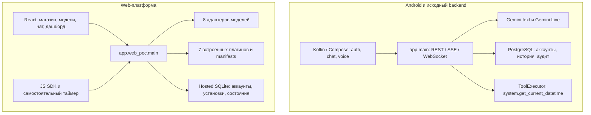

# Mia: что уже есть и что осталось до MVP новой архитектуры

Дата сверки: **7 октября 2026 года**.
Основание: [Mia_Architecture.md](Mia_Architecture.md), версия 1 от 07.10.2026.

## 1. Основной вывод

У Mia уже есть существенная часть будущего продукта: нативное Android-приложение
с голосовым трактом, авторизацией и историей; backend с потоковым текстом,
Gemini Live, политиками инструментов и аудитом; web с магазином, подключением
разных моделей, исполняемыми плагинами, дашбордом и SDK.

До MVP из нового документа главным образом нужны **объединение этих частей,
три реальные интеграции, подтверждения внешних действий и надёжные фоновые
задания**. Отдельный существенный пробел — голосовой путь, который работает
с выбранной текстовой моделью, а не только с Gemini Live.

Нельзя считать, что Android-голос ещё нужно написать с нуля. Нельзя считать и
обратное: наличие web-магазина, Android-голоса и Google-входа уже даёт единого
ассистента на всех устройствах. Сегодня web и Android используют разные API,
хранилища аккаунтов, циклы работы модели и наборы инструментов.

Практическое решение: сохранить Python/FastAPI, React и Kotlin/Compose;
постепенно перенести web-возможности за общее ядро и подключить к нему Android.
Архитектура сама разрешает переиспользовать существующий стек (§16, §22).
Переход на Node, Capacitor или новый монорепозиторий не является условием MVP.

## 2. Что здесь понимается под MVP

В архитектуре описаны два разных объёма:

| Объём | Содержание | Как учитывать в этой сверке |
| --- | --- | --- |
| **Первый MVP / пилот**, §21 | Android и web/ПК, облачный BYOK, три проверенные интеграции; ориентир первых 6–10 календарных недель | Основная граница сравнения |
| **Основной продукт**, этапы 0–6 | Полное ядро, Personal Node, SDK и публикация, iOS, Linux-прототип, production и платежи | Следующие этапы; не все являются блокерами пилота |
| Расширения | Builder App, платные чужие Device Apps, рынок вычислений, серийная колонка | После основного продукта |

Пилот — ограниченный срез этапов 0–2, как прямо сказано в §21. Минимальный
Personal Node transport из «первых десяти дней» (§22) — исследовательский
прототип связи, а не требование сразу построить pairing, relay, E2EE и recovery.

Три продуктовых сценария взяты из §3:

1. «Что у меня сегодня?» — календарь и задачи, короткий голосовой ответ и плитка
   с источниками.
2. «Подготовь мои тикеты из Linear для отправки в Telegram» — чтение, предпросмотр,
   подтверждение конкретного получателя и текста, отправка.
3. «Напоминай о просроченных задачах по будням в девять» — сохранённое правило,
   выбранный исполнитель и отчёт о последнем запуске.

Для оценки принят набор **календарь + Linear + Telegram**. Конкретный календарный
сервис и способ доступа к Telegram ещё нужно утвердить. Существующие заметки
и будильник полезны, но не заменяют эти внешние интеграции.

Wake word не обязателен для первого запуска голосом по кнопке. Его возврат в
пилот требует отдельного изменения принятого scope. Системная роль Android
assistant входит в этап 2 новой архитектуры; её можно проверить параллельным
spike, но обещать запуск с заблокированного экрана только после device gate.

## 3. Источники и границы проверки

Проверены код, контракты, тесты и handoffs в двух репозиториях:

| Репозиторий | Проверенное состояние |
| --- | --- |
| `mia-helper` | HEAD `c5fc60fb5d290c4f9c4911f562c1e9affc6dec08`; проверялось также текущее рабочее дерево, где новые web-компоненты и документы ещё не входят в отдельный integrated commit |
| `mia-helper-android` | HEAD `30a4ea880f93e67d0b781d9c49a630bb321d567e`; рабочее дерево чистое на момент сверки |

Старый раздел wave W6 в `STATUS.md` указывает backend `37922dd`. Это исторический
срез; текущий backend HEAD приведён выше. Для Android README со словом scaffold
также недостаточен: фактический клиент уже существенно развился.

Обозначения:

- **Есть** — реализация найдена и подтверждается кодом/тестами или конкретным
  handoff; её пределы указаны отдельно.
- **Частично** — существует полезная основа, но не весь требуемый сценарий.
- **Нет** — в проверенных компонентах не найдена соответствующая реализация.
- **Не проверено** — код есть, но нужный реальный замер или end-to-end gate
  не завершён.

В рамках этой сверки повторно выполнено:

```sh
.venv/bin/python -m pytest tests/web_poc tests/auth/test_google_verifier.py -q
```

Результат: **71 тест PASS**. Они проверяют протоколы адаптеров на тестовых
транспортах, выполнение инструментов, изоляцию, SDK, hosted auth и сохранение
данных. Это не проверка доступности всех моделей в реальных аккаунтах.

Результаты Android на физическом телефоне, предыдущих browser journeys и
публикации web взяты из handoffs. Новый акустический прогон, платные запросы
к моделям и проверка текущего публичного сервера в этой работе не выполнялись.
Тарифы и правила платформ из архитектуры не пересчитывались: задача этой сверки
— состояние нашего продукта. Secret-value файлы не читались.

## 4. Что у нас работает сейчас

### 4.1. Карта существующих компонентов



Общий Google identity provider не связывает автоматически аккаунты двух БД,
установки, историю и права. Объединяющего продуктового пути между этими частями
сейчас нет.

### 4.2. Android: голос уже реализован, но имеет конкретные границы

| Возможность | Фактическое состояние | Что осталось относительно архитектуры |
| --- | --- | --- |
| Нативное приложение | Kotlin, Compose, отдельные модули auth/chat/audio/voice/database/wake | Сохранить проект и работающие экраны |
| Google-вход и сессии | Реальный вход, refresh, logout/re-login проверены на Samsung SM-S938B; токены защищены Android Keystore | Связать с общим аккаунтом платформы; это пока не хранилище BYOK-ключей |
| Текстовый чат | REST/SSE, история, Room-кеш, сохранённые pending-операции и retry; реальный Gemini-сценарий пройден | Дать доступ к выбранным пользователем моделям и установленным плагинам |
| Захват и воспроизведение звука | Нативные `AudioRecord`/`AudioTrack`, PCM, ограниченные буферы, диагностика, управление ресурсами | Переиспользовать; проверить акустику, маршруты аудио и lifecycle на device matrix |
| Распознавание речи и голосовой ответ | Аудио идёт через backend в Gemini Live; возвращаются входные/выходные транскрипты и аудио | Это существующее распознавание речи. Самостоятельного STT-модуля для произвольной LLM пока нет |
| Конец пользовательской реплики | Локальный VAD и явный commit; автоматическая детекция Gemini отключена после исправления конфликта двух VAD | Сохранить поведение при добавлении STT/TTS-пути; измерить endpointing |
| Голос в приложении | Экран реально подключён; после S25-R3 наблюдались три последовательные речевые реплики без закрытия сессии | S31-R1: слышимость, 20-turn soak, barge-in, reconnect, latency и voice tool smoke |
| Перебивание ответа | Локальный flush/cancel, отбрасывание старых кадров и provider-side interruption реализованы | Замерить нынешний путь; прежние 83/84 мс с fake gateway не подтверждают текущую cloud latency |
| Wake phrase | Есть локальный spectral-template detector, enrollment, pre-roll, foreground coordinator и оценочный harness | PARTIAL, выключен по умолчанию. Нет независимых замеров качества, батареи и температуры; это не microWakeWord |
| Системный Android assistant | `AssistantRoute` остаётся scaffold; VoiceInteractionService/Session и роль assistant не реализованы | Добавить сервис и системный запуск; проверить lock screen и фон отдельно |
| Магазин/дашборд/настройка моделей | Web-возможности не подключены к нативному клиенту | Минимум: те же installations, active model и tools; затем мобильная поверхность плагинов |

Основания: [Android AppContainer](../../mia-helper-android/app/src/main/kotlin/by/mia/assistant/AppContainer.kt),
[RealtimeVoiceController](../../mia-helper-android/feature/voice/src/main/kotlin/by/mia/assistant/feature/voice/RealtimeVoiceController.kt),
[core/audio](../../mia-helper-android/core/audio/src/main/kotlin/by/mia/assistant/core/audio/AndroidDuplexAudioEngine.kt),
[AssistantRoute](../../mia-helper-android/feature/assistant/src/main/kotlin/by/mia/assistant/feature/assistant/AssistantRoute.kt),
[S30](implementation/handoffs/S30.md), [S25-R3](implementation/handoffs/S25-R3.md),
[S27](implementation/handoffs/S27.md), [ADR-009](adr/0009-defer-wake-word-activation.md).

**Что нельзя вычеркнуть из оставшейся работы:** независимые STT/TTS, системный
assistant, фон/lock screen и проверка батареи. **Что не нужно повторять:**
нативный audio engine, realtime transport, базовый VAD, контроллер сессии,
авторизация, Room и весь текстовый клиент.

### 4.3. Web: магазин, модели и плагины уже являются работающим POC

| Возможность | Фактическое состояние | Граница реализации |
| --- | --- | --- |
| Интерфейс | React/TypeScript/Vite; магазин, библиотека, чат, модели, авторские формы, дашборд | Сохранять существующий UI |
| Магазин | Поиск, категории, отдельные страницы, реальные скриншоты, установка с правами, удаление | Каталог встроенных приложений; не открытый рынок пакетов |
| Отзывы | Hosted отзывы аккаунтов, редактирование/удаление своего отзыва, проверка установки | Нет полного процесса жалоб и модерации авторов |
| Модели | OpenAI, Anthropic, Gemini, DeepInfra, **Groq**, Mistral, Ollama, LM Studio / local compatible | Восемь адаптеров. **Grok/xAI из новой архитектуры пока отсутствует; Groq — другой провайдер** |
| Выбор модели | Несколько подключений, active connection, редактируемый model ID, «Тест API» | Сохранённое подключение не означает проверенную совместимость конкретной модели |
| Работа с tools | Native tool loop для адаптеров; до 6 шагов/12 вызовов и 150 секунд на tool-enabled чат; проверка аргументов и установки | JSON fallback есть для ограниченных сценариев. Нет полноценного registry профилей Chat/Tools/Agent/Realtime |
| Provider continuation | Внутри одного native loop сохраняются Gemini thoughtSignature, OpenAI output items, Anthropic blocks и compatible reasoning_content | Нет единой долговечной межклиентской модели истории с opaque state и resume |
| Встроенные плагины | Часы, таймер, будильник, заметки, фокус, Интернет, новостная сводка | Полезные приложения уже есть; календаря, Linear и Telegram нет |
| Единый action runtime внутри web | Кнопки, модель, виджеты и SDK изменяют одно состояние установки | Это единое ядро web-POC; Android ToolExecutor сюда не подключён |
| Авторские приложения | Manifest v2, skill, typed actions, fields/HTML view, download links; импорт/экспорт, совместимость с рецептами v1 | Пользовательские эффекты ограничены `state.patch` и `model.prompt`; произвольные server handlers не исполняются |
| SDK | Код привязки, согласие, scoped token, отзыв, вызов state/actions/генерации; самостоятельный таймер | Grants в памяти, до часа; нет jobs/artifacts API и production identity издателя/клиента |
| HTML view | `sandbox="allow-scripts"` без same-origin, CSP, bridge с проверкой source и scope | Есть основа изоляции; нет законченного MCP Apps host и отдельного origin для публичных пакетов |
| Дашборд | Плитки трёх размеров, перестановка, удаление/добавление, серверное состояние, mobile layout | Нет полного WidgetInstance-контракта с version/settings/ACL/lifecycle и optimistic concurrency |
| Голос в браузере | Диктовка через SpeechRecognition, озвучка через speechSynthesis | Зависит от браузера/его сервисов; не общий Android voice pipeline и не гарантия офлайн |
| Hosted данные и auth | Google-вход, Secure/HttpOnly cookie, SQLite: аккаунты, установки, состояние, layout, отзывы и ограниченный audit | Web-история временная; connections/ключи в памяти до 8 часов/restart; SDK grants временные |
| Публикация web | WEB-P1-R2/R3 опубликованы на общем сервере; есть Docker-сборка и release/rollback scripts | Публикация сайта уже есть. Это не публикация произвольных авторских приложений |

Основания: [web/README](../web/README.md), [WEB_PLATFORM_PLAN](WEB_PLATFORM_PLAN.md),
[PluginRuntime](../app/web_poc/runtime.py), [agent loop](../app/web_poc/agent.py),
[providers](../app/web_poc/providers.py), [AccountStore](../app/web_poc/accounts.py),
[ViewBridge](../web/src/plugins/ViewBridge.tsx), [PLUGIN_DEVELOPMENT](PLUGIN_DEVELOPMENT.md),
[WEB-P1-R3](implementation/handoffs/WEB-P1-R3.md), [deploy/README](../deploy/README.md).

Локальный Ollama/LM Studio работают на машине **web API**. На hosted сервере
loopback inference специально запрещён. Возможность выбрать Ollama в локальном
POC ещё не означает, что опубликованный сайт или телефон подключаются к модели
на домашнем ПК.

### 4.4. Исходный backend: готовая основа для общего ядра

| Компонент | Что уже есть | Что не покрывает |
| --- | --- | --- |
| Модульный монолит | FastAPI, явная composition, PostgreSQL, Alembic, Redis | Общее ядро с web-плагинами ещё не собрано |
| Аккаунты/устройства | Google verification, JWT/refresh rotation, отзыв; Device связан с Android-installation | Device не является Personal Node с публичным ключом, pairing и relay |
| История | Conversation/Turn/Entry, sequence, text/voice modality, tool entries, provider metadata, idempotency | Не общий storage для web; нет полной retention/consent-модели и долгой памяти |
| Потоковый протокол | REST/SSE, realtime WebSocket, нормализованные AI events и ошибки | Не durable run/job event log с произвольным возобновлением после restart |
| Модели | Провайдерный интерфейс, fake и Gemini text/Live | Выбор глобальной конфигурации backend, а не пользовательский BYOK/active model |
| Инструменты | Общий executor для text/Live; registry, risk/scope policy, input/output limits, timeout, PostgreSQL audit | Зарегистрирован только `system.get_current_datetime`; write tools запрещены, confirmation — будущий port |
| Лимиты | Дневные счётчики запросов в Redis, session limits, circuit breakers, voice/text kill switches | Не денежный usage ledger, reservation перед дорогим вызовом или лимит расходов плагина |
| Эксплуатация | Docker/CI, liveness/readiness, корреляция, JSON logs без payload, метрики, security scan и backup/restore drill script | Не завершённая эксплуатация объединённого продукта, jobs и relay; полная production-приёмка не пройдена |

Основания: [composition](../app/composition.py), [модели истории](../app/modules/conversations/models.py),
[Device/AuthSession](../app/modules/auth/models.py), [ToolExecutor](../app/modules/tools/executor.py),
[registry](../app/modules/tools/registry.py), [AI events](../app/providers/ai/base/events.py),
[лимиты](../app/core/limits.py), [ops/README](../ops/README.md).

## 5. Сверка требований MVP: есть / поменять / доделать

| Требование архитектуры | Статус | Что переиспользовать | Что поменять или доделать |
| --- | --- | --- | --- |
| Один ассистент для web и Android, §1/5 | **Частично** | Оба клиента и backend-модули | Общие User/Workspace/Installation/Conversation, ModelGateway и Tool Router |
| BYOK и несколько моделей, §7/21 | **Есть в web, частично для продукта** | Восемь адаптеров, connections UI, active selection | Пользовательские подключения в общем ядре, vault; выбор доступен Android |
| Проверенные provider/model capabilities, §7/24 | **Частично** | Adapter tests, «Тест API», native/JSON modes | Матрица конкретных моделей, tool-chain/cancel/error проверки, блокировка несовместимых действий |
| Голос по кнопке, §4/17 | **Есть, gate частично** | Android audio/Live, браузерная диктовка и озвучка | Закрыть акустику S31-R1 и доступ инструментов из голоса |
| Голос для сменяемой текстовой LLM, §1/17 | **Нет на Android** | Capture/playback/VAD, web model adapters | STT → общее ядро → TTS, сменяемые voice adapters; Live оставить отдельной опцией |
| Фраза «Привет, Мия», §4/16/17 | **Частично, отложено** | Foreground detector/enrollment/harness | Corpus и device measurements; решить, развивать detector или заменить; фон отдельно |
| Android assistant/lock screen, §4/21 | **Нет** | Kotlin-клиент и audio lifecycle | Role/service/session и device matrix; scope новой архитектуры шире старой internal beta |
| Три интеграции, §3/21 | **Нет** | Plugin action schemas, state/views, SDK | Calendar read, Linear read, Telegram draft/send; connection scopes и OAuth/token lifecycle |
| Подтверждение точного внешнего действия, §7/13 | **Нет** | Установка с правами и SDK consent как UX-основа | Approval с recipient/payload/args hash/expiry; повторная серверная проверка перед send |
| Плагины с tools/skill/UI, §9 | **Есть ограниченный формат** | Manifest v2, typed actions, HTML view, import/export | Версионирование, remote connectors и resource-scoped grants; MCP по мере нужды |
| Магазин и дашборд, §10/14 | **Есть POC** | Каталог, страницы, отзывы, responsive tiles | Разделить installation/widget IDs и versions, добавить lifecycle/concurrency; не переделывать UI с нуля |
| Независимый UI без LLM, §10 | **Есть** | Кнопки плагинов и виджеты вызывают runtime без модели | Сохранить свойство после объединения |
| Надёжная автоматизация по расписанию, §8/12 | **Нет** | Deadline-состояния и серверный цикл сводки как прототип | Durable Job/Schedule, timezone, retry/missed-run policy, worker, уведомления и last-run status |
| История и контроль хранения, §8/11 | **Частично** | PostgreSQL история и Android Room; SQLite state web | Общая история, явная политика сохранения, экспорт/удаление/retention; web сейчас теряет диалог при уходе с экрана |
| Долгая память и процедуры, §8 | **Нет** | Заметки и сохранённые manifests как исходные данные | Отдельные управляемые факты/предпочтения/версионируемые workflows; заметки не считать памятью ассистента |
| Run ID, события, resume/cancel, §7/12/22 | **Частично** | Turn IDs, sequence, response IDs, SSE/WS, cancellation и idempotency | Общий Run, durable events/checkpoints, статусы ожидания; web сейчас возвращает итоговый JSON |
| Защита от повторной внешней отправки, §12 | **Частично на уровне основы** | PostgreSQL idempotency и tool audit, web request/call cache | Durable operation + outbox + receipt/reconciliation; web cache не переживает restart |
| Секреты и ограничение расходов, §9/11/13 | **Частично** | Ключи не выдаются плагинам, brokered generation, Keystore для Android-auth, rate limits | Vault BYOK/OAuth, раздельные grants, usage ledger и reservation; лимит запросов не равен лимиту денег |
| Аудит/наблюдаемость, §8/18 | **Частично** | PostgreSQL audit, web action audit, content-free backend logs/metrics | Единая трассировка run → plugin → approval → receipt; метрики успеха сценариев и расходов |
| Production release gate, §21/24 | **Не завершён** | Existing tests/CI/deployment scripts | S31-R1 → voice S32 → S33; затем gate объединённого MVP с новыми интеграциями |

Наличие поля `artifact_ref` в старых контрактах — основа представления результата,
но не готовый Artifact API, BlobStore, ACL, TTL или механизм загрузки файлов.
Встроенная ревизия web workspace — основа обновления UI, но endpoint раскладки
пока не проверяет `expected_version`.

## 6. Что именно нужно поменять в существующей реализации

### 6.1. Объединить ядро, сохранив клиентские поверхности

Нужен один путь выполнения:

```text
web / Android / SDK
  → общий аккаунт и workspace
  → Run + выбранное подключение модели
  → ModelGateway
  → Tool Router + installation/version/grants
  → исполнение + audit/receipt
  → общие события и состояние → чат / голос / дашборд
```

Рекомендуемый порядок — facade над существующими API и миграция по одному
плагину. Первым подходит таймер: он уже проходит путь модель → action → state →
дашборд → SDK. Перенос должен сохранить этот сценарий и добавить управление из
Android. Затем мигрируются остальные плагины и новые connectors.

Нужно совместить сильные части двух реализаций: PostgreSQL/историю/events/policy
исходного backend и model adapters/skills/installations/action runtime из web.
`ToolExecutor` сейчас отклоняет write tools; web runtime умеет менять локальное
состояние. Поэтому нельзя просто направить все web-actions в старый executor
без проектирования рисков и разрешений.

### 6.2. Объединить аккаунты и хранилища

Hosted web использует собственные `web_users` и SQLite workspace; Android —
PostgreSQL users/devices/auth_sessions. Нужна явная связь через проверенную
Google identity, а не совпадение email, и общие внутренние owner IDs.

Web cookie/BFF и Android bearer/refresh могут остаться разными транспортами
авторизации. Они должны давать доступ к одному аккаунту и одному набору прав.
Нужен перенос hosted installations/state/layout/reviews с проверкой владельца,
версии схемы и восстановления. Временные SDK tokens не переносить как постоянные
grants; анонимные данные переносить только по явному выбору пользователя.

Для управляемого продукта целевой storage — существующий PostgreSQL. SQLite
оставить для локального режима/узла и текущего POC до миграции. Сам факт хранения
web-данных в SQLite сейчас не означает потерю данных при штатном restart.

### 6.3. Сделать model contract полнее

В старом backend `TextMessage` сводится к user/assistant text, а `ToolFeedback`
не переносит opaque continuation token. Именно это ограничило старый Gemini
tool loop; [OI-W6-013](implementation/OPEN_ISSUES.md) остаётся открыт.

Web loop сохраняет исходные provider parts внутри запроса и уже содержит
полезное решение этой проблемы. Его следует перенести в общий gateway вместе
с call IDs, usage, finish reason, cancellation и provider errors. Но хранение
parts внутри текущего Python-вызова ещё не даёт durable checkpoint.

Нужен registry возможностей **provider + model**, а не разрешение tools для
всех моделей провайдера. Для пилота достаточно двух явно проверенных профилей
с одинаковым workflow; остальные адаптеры сохранить с честным статусом.
Добавление Grok/xAI — отдельная задача, не причина заменять существующий Groq.

### 6.4. Добавить подтверждения и денежные ограничения

Согласие установить плагин и согласие привязать SDK-приложение уже есть.
Это не подтверждение отправить конкретное сообщение конкретному адресату.
Для Telegram требуется host-owned preview и Approval, привязанный к финальным
аргументам и сроку действия. Изменение текста или адресата аннулирует одобрение.

Бюджеты старого backend считают число запросов/сессий; web ограничивает шаги,
вызовы, время и частоту. Нужны usage ledger и резервирование следующего вызова
для обещания верхнего предела расходов. Вложенные вызовы новостной сводки,
авторского `model.prompt` и SDK тоже должны учитываться.

### 6.5. Развить manifest и UI contract совместимо

`schemaVersion: "2.0"` текущего manifest и `mia.plugin/v1` примера архитектуры
— разные схемы. Пример из §9 не является уже принятой заменой. Нужно определить
целевой контракт и миграцию v1-рецептов/v2-приложений, сохранив рабочие импорты.

Добавить host compatibility, requirements, execution kind, resource scopes,
release digest и правила обновления. Строковое поле version в manifest уже
существует; отсутствует система доверенных immutable releases и привязка grants
к конкретному release.

Для первого пилота достаточно контролируемых встроенных/приглашённых connectors.
Полный публичный pipeline подписания и review относится к этапу магазина.
Существующий HTML sandbox развить до проверенной границы доверия перед
открытой публикацией. Его собственный SDK bridge пока не равен MCP Apps.

### 6.6. Разделить голос и выбор LLM

Существующий Gemini Live сохранить как realtime adapter. Добавить второй путь:

```text
Android microphone + VAD → STT → текстовый Run с active model → TTS → playback
```

STT/TTS должны иметь свои адаптеры и настройки маршрута данных. Локальные
движки из архитектуры — кандидаты для сравнения, а не готовые зависимости
нашего приложения. В пилоте допускается облачный STT/TTS с понятной передачей
данных; офлайн обещание требует проверки каждого звена цепочки.

Сохраняются Kotlin audio, управление микрофоном и cancellation. Распознавание
речи на Android уже есть через Live; новый модуль нужен для независимости от
аудиомодели. Браузерную диктовку/озвучку также можно сохранить как клиентскую
реализацию с явными ограничениями.

### 6.7. Заменить временные циклы надёжными jobs

Существующий серверный цикл новостной сводки работает и при закрытой вкладке,
пока процесс и runtime-сессия живы. Он не является durable scheduler. Таймеры
хранят deadlines, но их звук зависит от браузера.

Для повторяющихся напоминаний нужны сохранённые Schedule/Job, IANA timezone,
worker claim/lease, retry, история запусков и политика пропусков. API-процесс
и клиент могут завершаться без потери задания. Для внешней отправки нужны
operation ID, outbox и состояние неопределённого результата при timeout.

Очередь на PostgreSQL соответствует архитектуре. Конкретная библиотека должна
соответствовать сохраняемому Python backend; `pg-boss` из Node-примера не
обязывает переписывать backend. Существующий Redis auth/limits не нужно удалять
ради новой схемы jobs.

## 7. Что требуется доделать для трёх сценариев

| Сценарий | Уже пригодная основа | Недостающая реализация | Критерий готовности |
| --- | --- | --- | --- |
| Сегодняшний день | Чат, голосовой транспорт, часы с timezone, заметки, сводка и плитки | Calendar read; источник задач, например Linear; пользовательский timezone, права подключения, короткий speech summary | Одна команда показывает реальные события/задачи со ссылками в web и даёт проверенный голосовой ответ на Android |
| Linear → Telegram | Typed actions, tool loop, state/view, аудит | Linear connector; выбор проекта/тикетов; Telegram connector; draft preview, recipient selection, Approval и receipt | Отправлены только показанные и подтверждённые данные; deny/edit/expiry исключают send; повтор после timeout не выполняет слепую отправку |
| Просроченные задачи по будням в 09:00 | Состояние плагина, deadlines, opt-in автообновление сводки | Durable расписание с timezone, источник просроченных задач, executor, канал доставки, pause/run-now/last-run UI | После закрытия клиентов и restart worker правило сохраняется; запуск имеет понятный результат, пропуск и retry следуют заданной политике |

Google-вход в Mia не выдаёт автоматически разрешение читать календарь или
Linear. Нужны отдельные connection/grant flows. Для Telegram сначала определить
доступный bot/иной разрешённый сценарий, затем обещать конкретные адресаты.

## 8. Рекомендуемая последовательность оставшейся работы

Это предложение нового порядка реализации, **не новые исполняемые Sxx cards**.
Существующие статусы сессий сохраняют своё значение.

| Шаг | Работа | Проверяемый выход |
| --- | --- | --- |
| 1 | Закрыть baseline голоса по S31-R1; отдельно зафиксировать два поддерживаемых provider/model профиля | Акустические измерения и voice tool smoke; понятные пределы поддержки моделей |
| 2 | Facade общего ядра, общий owner/workspace, Run/events contract; перенести таймер | Web, SDK и Android работают с одним таймером, одним активным model connection и общим аудитом |
| 3 | Постоянные подключения/vault, installation/grant migration, полное provider continuation, budgets | Restart сохраняет нужные данные; scope/owner/budget проверки работают до исполнения |
| 4 | Calendar + Linear read и плитка дня; STT/TTS-путь к выбранной модели | Первый сценарий выполняется из Android и web; поддержана смена между двумя проверенными моделями |
| 5 | Telegram draft/send, Approval, operation/outbox/receipt/reconciliation | Второй сценарий и негативные проверки без лишней или двойной отправки |
| 6 | Durable schedules/jobs, уведомления и UI запусков | Третий сценарий не зависит от вкладки или жизни API-процесса |
| 7 | Общая приёмка Android/web пилота, rollout на 10–20 пользователей | Измерены успех сценариев, latency, расходы и причины отказов |

Android assistant spike можно вести отдельно от миграции ядра. Если lock-screen
вызов становится обязательным обещанием первого пилота, его device gate нужно
включить перед шагом 7. Wake word следует возвращать в scope только вместе
с corpus/device/battery работой, учитывая ADR-009.

**Старый незакрытый путь:** `Выполни S31-R1`, затем закрытие voice-модальности
S32 и release gate S33 по dependency evidence. Даже успешный S33 подтвердит
старую internal beta; приёмку новых connectors и общего runtime он не заменяет.
WEB-P2 и дальнейшие web-этапы пока roadmap, а не готовые сессионные команды.

### Как скорректировать «первые десять дней» из архитектуры

| Исходная задача §22 | Поправка с учётом того, что уже сделано |
| --- | --- |
| Инвентаризация PoC | Эта сверка даёт карту переиспользования; добавить baseline latency и фиксированные контрактные сценарии |
| Android voice spike | Захват/Live/VAD/playback уже есть; измерять текущий голос, исследовать assistant service и независимый STT/TTS |
| Run/Tool/Artifact и adapters | Не писать все adapters заново; объединить существующие contracts и переносить web loop, начать с одного плагина |
| Linear read / Telegram draft-send | Остаётся новой работой; прежде send нужен работающий Approval и durable operation |
| Personal Node transport | Отдельный spike после стабилизации общего протокола; не смешивать с обещанием полного Personal Node |
| Isolated widget/manifest prototype | Уже есть v2 и iframe bridge; теперь нужны негативные проверки, version/grants contract и план MCP Apps |
| Решение о scope пилота | Принять на основе измеренного голоса и сквозного сценария, а не числа готовых экранов |

Исходную оценку 1 110–1 860 часов нельзя целиком назвать оставшейся работой,
но нельзя и вычесть из неё стоимость экранов по проценту «готовности».
Часть разработки уже выполнена, а объединение двух runtime и сохранение данных
добавляют собственную работу. Новую оценку стоит строить по шагам выше после
одного перенесённого плагина, первого connector и измеренного голосового пути.

## 9. Что остаётся после узкого MVP

| Этап архитектуры | Что уже есть как задел | Что ещё потребуется |
| --- | --- | --- |
| Personal Node, §6 / этап 3 | Локальные Ollama/LM Studio adapters, Android Device и SDK pairing как отдельные механизмы | Узел, ключи устройства, безопасный pairing, outbound WSS relay, routing, локальный storage, E2EE/recovery, revoke, waiting_for_node и явный fallback |
| SDK и открытый магазин, §9/14 / этап 4 | Manifest v2, работающий JS SDK, HTML views, каталог, отзывы, import/export/download links | Проверенный publisher/client ID, signed immutable releases, schema digest, pinned grants, moderation/revoke/updates, Remote Apps/MCP, jobs/artifacts, полноценный widget lifecycle |
| iOS и Linux-прототип, §4/17 / этап 5 | Общие будущие API, текущий web и Android audio опыт | Отдельные клиенты/системные входы, Linux audio/device process, provisioning, обновления и платформенные проверки |
| Production и платежи, §18/20 / этап 6 | CI, Docker, release scripts, backend метрики, ограничения и restore tooling | Приёмка восстановлений, нагрузка и multi-instance state, наблюдаемость всего runtime, billing/subscription, SLA, эксплуатация новых jobs/relay |
| Builder App и коммерческие Device Apps | Ограниченные AI-рецепты, авторский UI и download links | Изолированная сборочная среда, source/build/test/preview/artifacts, signing/release, compute accounting, расчёты и споры |

SDK pairing по коду сейчас связывает внешнее приложение с установкой плагина.
Он не связывает доверенные устройства криптографическими ключами и не создаёт
канал к домашней модели. Аналогично возможность скачать авторский JSON или
перейти по download link не является подписанным release pipeline.

Долгая память, lazy skill discovery, полноценные процедуры и артефакты следует
развивать по потребностям сценариев. Перед пилотом нужны минимальные контекст,
история и политика данных; embeddings, универсальная память и Builder для
первых трёх сценариев не обязательны.

## 10. Приёмка MVP и оставшиеся продуктовые решения

Предлагаемый минимальный набор приёмки:

1. **Общее состояние:** один пользователь устанавливает плагин в web, вызывает
   его из Android и видит результат на дашборде; другой аккаунт не получает
   ни установку, ни состояние, ни tool result.
2. **Модели:** один tool workflow проходит с двумя выбранными provider/model
   профилями; неправильные аргументы, неподдерживаемые tools, timeout/cancel
   и лимит бюджета не создают ложного успеха.
3. **Голос:** понятная активация по кнопке, слышимый ответ, 20 последовательных
   ходов, измеренный barge-in и reconnect. Отдельно измерены STT → LLM → TTS
   и Live; цели latency из §17 не выдаются за достигнутые без замеров.
4. **Внешние действия:** exact preview/confirmation, deny/expiry/args-change,
   отзыв доступа и restart в момент send. При неизвестном результате — явный
   uncertain outcome/reconciliation, а не автоматическая повторная отправка.
5. **Фон:** расписание переживает закрытие вкладки, завершение клиента и restart
   worker; timezone, пропуски, пауза и журнал запусков проверены.
6. **Данные и эксплуатация:** постоянное состояние, секреты вне UI/плагинов/logs,
   проверка восстановления пилотных данных и согласованное удаление/retention.
7. **Польза:** 10–20 пилотных пользователей повторяют выбранные сценарии;
   команда фиксирует успешность, время до результата и причины отказов.

Перед новой реализацией нужно принять несколько продуктовых решений:

| Решение | Предложение для MVP |
| --- | --- |
| Первая аудитория | Технические пользователи с BYOK, как предлагает архитектура |
| Голос и активация | Сначала проверенный tap-to-talk; assistant/lock screen после spike; wake word экспериментально после замеров |
| Первые connectors | Один календарь, Linear read и ограниченный Telegram send; точный сервис и способ Telegram-доступа выбрать явно |
| Режим хранения | Managed для пилота с явной политикой истории; строгий Personal Node следующим этапом |
| Автоматизации | Облачный исполнитель и выбранный канал доставки; без обещания офлайн/круглосуточной работы телефона |
| Магазин | Сохранить нынешний каталог и SDK; приглашённые бесплатные integrations раньше открытой публикации кода |

Эти решения не мешают уже считать готовыми интерфейс магазина, model connections,
web tool loop, нативный Android audio engine, auth и историю. Они определяют,
какие оставшиеся части должны войти в первый цельный продукт.

## 11. Связь с текущим планом и открытыми вопросами

| Пробел этой сверки | Текущий источник координации |
| --- | --- |
| Android акустика / voice tools / release | [STATUS](implementation/STATUS.md): S31-R1, S32 PARTIAL, S33 PENDING; [S25-R3](implementation/handoffs/S25-R3.md) |
| Wake и assistant scope | [ADR-009](adr/0009-defer-wake-word-activation.md): S27 PARTIAL, S28 не начат |
| Старый provider continuation | [S13-R1](implementation/handoffs/S13-R1.md), OI-W6-013 в [OPEN_ISSUES](implementation/OPEN_ISSUES.md) |
| Постоянные BYOK-подключения | OI-WEB-001; WEB-P2 в [WEB_PLATFORM_PLAN](WEB_PLATFORM_PLAN.md) |
| Durable напоминания | OI-WEB-002; WEB-P4/WEB-P6 |
| Открытая публикация и версии | OI-WEB-003; WEB-P5 |
| Реальные web provider/model проверки | OI-WEB-004 |
| Миграция установок и production app identity | OI-WEB-005; WEB-P2/WEB-P6 |

Документ фиксирует сверку и предложенный порядок. Он не объявляет незавершённые
сессии выполненными, не меняет старые dependency gates и не заменяет будущие
implementation cards для объединённого MVP.
