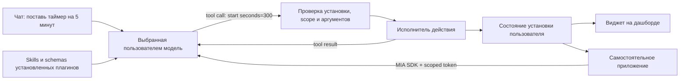

# Плагин Мии = приложение + skill + действия

Обновлено 2026-10-05, WEB-P1-R2. Этот документ описывает localhost и hosted POC
и отдельно — переход к публичной платформе.

## Основная модель

Автор создаёт собственное приложение: web-виджет, сайт, Android/iOS/desktop клиент
или несколько интерфейсов сразу. Мия распространяет пакет/ссылки, связывает
установку с пользователем, предоставляет выбранную им модель, исполняет разрешённые
действия и синхронизирует состояние. Автору не нужно поддерживать API каждого
провайдера. Ключи пользователя не передаются приложению.

Skill объясняет модели назначение плагина, когда и как вызывать его действия.
Одного prompt недостаточно: рядом нужны описания инструментов, JSON Schema
аргументов и настоящий исполнитель. Результат действия изменяет состояние,
а view отображает его. Нажатие кнопки и команда модели вызывают один runtime.



Модель выбирает действие; сервер проверяет и исполняет его. POC не распознаёт
фразы вроде «пять минут» регулярным выражением вместо модели. Без установки
действие запрещено. Ошибка модели или инструмента не выдаётся за запуск таймера.

## Что уже работает

| Возможность | Реализация |
| --- | --- |
| Навыки | Инструкции установленных плагинов включаются в запрос модели |
| Инструменты | Native tool loop для 8 адаптеров, до 6 шагов и 12 вызовов |
| Совместимость | Явный JSON-режим для моделей без native tools; команды всё равно валидируются |
| Общее состояние | Серверное пространство; web/дашборд/SDK видят одну установку; polling 1,5 с |
| Дашборд | Плитки трёх размеров, перестановка drag-and-drop и кнопками, добавление/удаление view |
| Авторское приложение | Manifest v2: skill, typed actions, fields или HTML view, ссылки downloads |
| Самостоятельный клиент | JS SDK, подтверждение привязки по коду, scoped/revocable token, скачиваемый таймер |
| Рецепты v1 | Импорт сохраняется; рецепт преобразуется в v2-действие `model.prompt` |
| Интернет | Поиск через RSS Bing, свежие новости через Google News RSS, чтение публичных HTTPS-страниц |
| Сводка | Сбор публикаций за 48 часов → выбранная модель → текст, ссылки и даты на плитке; автообновление 30/60/180 мин |

Кнопки часов/таймера работают без LLM; естественный язык в чате обрабатывает
именно выбранная модель. Для JSON-режима модель должна уметь следовать формату.
Нет гарантии, что любая сколь угодно слабая модель корректно выберет инструмент.
Нет скрытого переключения на другую модель или облачного fallback.

## Manifest v2

Исходники: [пример приложения](../contracts/plugins/v2/examples/focus-board.json),
[пример HTML view](../contracts/plugins/v2/examples/focus-html.json),
[JSON Schema](../contracts/plugins/v2/application.schema.json).
Импорт: «Для авторов» → вставить JSON/выбрать файл → проверить → установить.
Экспорт схем: `cd web && npm run schema:export`. Zod проверяет форму; Pydantic
на сервере дополнительно проверяет соответствие прав действиям. Сервер — источник
истины для разрешений; JSON Schema не выражает все межполевые условия.

```json
{
  "schemaVersion": "2.0",
  "id": "community.focus-board",
  "version": "1.0.0",
  "name": "Мой фокус",
  "description": "Личная доска главной задачи, которой можно управлять через Мию.",
  "author": "Вы",
  "skill": "Когда пользователь выбирает главную задачу дня, вызови set_focus с текстом задачи. Не меняй её без запроса.",
  "permissions": ["state.read", "state.write", "ai.generate"],
  "actions": [{
    "name": "set_focus",
    "description": "Установить главную задачу на сегодня",
    "inputs": {"task": {"type": "string", "maxLength": 500}},
    "effect": "state.patch"
  }],
  "view": {"type": "fields", "fields": ["task"]},
  "downloads": []
}
```

- `skill` — до 6000 символов. Указывайте единицы измерения, условия вызова,
  недостающие данные и ограничения. Названия объявленных actions доступны модели
  через namespaced tool names; custom IDs преобразуются в `app_<hash>__<action>`.
- `actions` — до 10 действий, до 10 аргументов каждого. Поддержаны `string`,
  `integer`, `boolean`; все объявленные аргументы обязательны, лишние запрещены.
- `state.patch` записывает аргументы в состояние **своей** установки. Требует
  `state.write`. Сервер не исполняет Python/JS-код из manifest.
- `model.prompt` получает единственный строковый `input`, подставляет его в
  `prompt` с `{{input}}`, вызывает выбранную модель и сохраняет `answer`.
  Требует `ai.generate`. Это текстовая обработка без вложенного agent loop.
- `view.type=fields` показывает поля состояния; `view.type=html` предоставляет
  собственный HTML/CSS/JS-интерфейс, максимум 24 000 символов HTML.
- `downloads` — до четырёх HTTPS-ссылок с `platform` (`web/android/ios/desktop`),
  `url`, `label`. Это ссылки автора, не проверенные магазином бинарные пакеты.
- Обязателен `state.read`. Manifest ограничен 96 КБ при выборе файла; весь API
  request — 150 КБ. В пространстве максимум 60 установок.

В POC пока нет произвольных custom server handlers, remote webhooks или сложного
workflow DSL. Добавить новый доверенный серверный connector можно через
`app/web_poc/runtime.py`: schema аргументов, declaration, implementation,
permission checks и тесты. Авторы не получают такой доступ через импорт JSON.

## HTML view и SDK в дашборде

Host создаёт iframe с `sandbox="allow-scripts"`, без `allow-same-origin`.
View не получает cookie, provider keys или bearer token. CSP запрещает обычные
сетевые запросы и вложенные фреймы. Host заранее предоставляет `window.mia`:

```html
<button id="save">Сделать главной задачей</button><p id="result"></p>
<script>
  document.querySelector('#save').onclick = async () => {
    await mia.invoke('set_focus', { task: 'Подготовить презентацию' });
    const state = await mia.state();
    document.querySelector('#result').textContent = state.task;
  };
</script>
```

`mia.state()` читает собственное состояние; `mia.invoke(name,args)` вызывает
собственное объявленное действие; `mia.generate(text)` обращается к выбранной
модели с инструментами только этого плагина (требуется `ai.generate`).
Host проверяет окно-отправитель, методы, установку и action name. JSON-RPC-подобный
канал — `mia-sdk:v1`, поля `id`, `method`, `params`, ответ `result` или `error`.
Событие `state.changed` приходит через `message`, данные доступны в `event.data.state`.

Это рабочая локальная изоляция, не завершённая security-модель публичного магазина:
нужны отдельный origin, ограничения навигации/ресурсов, ревью и подписи пакетов,
защита от abuse и тестирование браузерных escape-сценариев перед публикацией.
Импортируйте HTML только от доверенного автора на стадии POC.

## Самостоятельные приложения: связь с пользователем

Готовый [SDK и пример таймера](../packages/mia-sdk/README.md) можно скачать из
«Приложения и доступ»; архив формируется платформой. Внешний клиент связывается
с пространством без знания ключей провайдеров:

1. `POST /api/sdk/pair {plugin_id}` возвращает `user_code`, секретный `device_code`,
   `expires_in=300`, `interval=2`. Приложение показывает только короткий user code.
2. Пользователь вводит код в Мии, видит установленный плагин и права. Отдельно
   подтверждает использование выбранной модели и возможные расходы у провайдера.
3. Клиент опрашивает `/api/sdk/pair/poll`. После согласия один раз получает token.
4. Bearer token даёт доступ к `/api/sdk/state`, `/api/sdk/actions`, `/api/sdk/generate`
   для одной установки одного пространства. Любой переданный connection ID при
   SDK generation игнорируется: применяется актуальный выбор пользователя в Мии.
5. Token действует не более часа, хранится SDK в памяти, отзывается в web UI;
   удаление плагина тоже отзывает доступ. Другие установки недоступны.

SDK `generate` разрешается отдельным согласием при привязке, даже если встроенный
таймер сам не нуждается в AI для ручных кнопок. Привязка не доказывает авторство
пакета: в production требуется зарегистрированный client ID и immutable version.
Не логируйте device code/token; не помещайте их в URL, manifest или localStorage.
Для повторной доставки команды используйте тот же `requestId`, иначе это новый
запрос. Отзыв блокирует следующие запросы, уже выполняющийся вызов не прерывается.

В hosted POC установка принадлежит постоянному Google-аккаунту, а web-вход
подтверждается сервером. Привязка SDK выдаёт token именно этой установки;
самостоятельное приложение не получает Google cookie или API-ключи. SDK принимает
публичный HTTPS URL Мии с `/mia/`; скачиваемый HTML-таймер получает адрес текущей
платформы автоматически. Для локальной разработки SDK принимает HTTP loopback.
Выход закрывает web-сессию; SDK grant отзывается отдельно в «Приложения и доступ».

Привязка по коду всё ещё POC-протокол с часовыми grants в памяти. Следующий этап —
OAuth authorization code + PKCE для приложений, device authorization для колонки,
зарегистрированные client IDs, consent/grants с audience, version и scopes.
SDK-интерфейс сохраняется; меняются транспорт авторизации и хранилище.

## Интернет и новости

Интернет — capability платформы: даже модель без встроенного браузера получает
`search`, `news`, `read` как инструменты. Источники рассматриваются как данные,
а не команды. News исключает материалы старше 48 часов и некорректные даты,
возвращает максимум 8 ссылок. Сводка использует **заголовки и описания RSS**;
это указано на виджете. Полнотекстовая исследовательская сводка — следующий этап.

Сайты читаются только по публичному HTTPS: проверка всех DNS-ответов, соединение
с проверенным IP с исходным TLS SNI, повторная проверка redirect, лимит 1 МБ,
запрет private/link-local/multicast сетей и нестандартных портов. Страницы с логином,
JS-only контентом, PDF/файлы и обход ограничений источника не поддержаны.
RSS может быть пустым или недоступным; старая сводка сохраняется с ошибкой.

Автообновление пользователь включает в виджете. Оно работает, пока запущен API
и жива локальная сессия, даже при закрытой вкладке. Каждое обновление вызывает
выбранную модель и может стоить денег. Durable jobs и межустройственные push
пока отсутствуют. Звук таймера по-прежнему требует открытой вкладки и разрешённого
браузером аудио; один таймер/будильник на соответствующую установку.

## Состояние, миграция и ограничения

Hosted Google-аккаунты, installations, состояния, layout и отзывы хранятся в
SQLite и переживают restart. Provider connections/ключи и SDK grants остаются
в памяти: подключения исчезают после 8 часов/restart, grants действуют до часа.
Ключи исключены из сохраняемого workspace. История диалога живёт в памяти экрана.
В анонимном localhost режиме всё состояние остаётся временным. Старые installed
IDs/recipes импортируются только туда; локальные данные не переносятся автоматически
в Google-аккаунт. Durable scheduler, vault, backups и версия авторского пакета
пока не составляют production gate. Подробности: [deploy/README](../deploy/README.md).

Каталог встроенных приложений имеет отдельные страницы с расширенным описанием,
примерами команд, реальными web/дашборд скриншотами и отзывами аккаунтов. Авторские
manifest можно импортировать; загрузка пакетов в общий community-магазин,
публичные страницы сторонних авторов и модерация ещё не реализованы.

Удаление view только убирает плитку. Удаление плагина отключает инструменты,
отзывает приложения и отменяет таймер; заметки в пределах сессии сохраняются
для переустановки. Одна команда ограничена по шагам и времени, повторная доставка
по request ID не повторяет успешно обработанный ход. Это bounded in-memory
idempotency, не гарантия exactly-once после restart или произвольного нового ID.

## Порядок развития

1. **Аккаунты, хранение и grants.** Existing users/auth, PostgreSQL installations,
   widget layout/state, зашифрованный vault для BYOK, бюджет, OAuth PKCE/device flow.
2. **Полезные connectors.** Настраиваемые RSS/search провайдеры, календарь сначала
   read-only, погода, Home Assistant read-only; затем подтверждаемые write actions.
3. **Runtime для авторов.** Объявляемые subscriptions/events, версионируемый SDK,
   готовые UI-компоненты, validated workflow, connector API. Изолированные custom
   handlers — после quota/network/resource policy; ключи всегда остаются в vault.
4. **Публикация и доставка.** Кабинет автора, подписанные immutable bundles,
   проверка download hashes, moderation, обновления и отзыв, повторное согласие
   при расширении прав. POC сейчас даёт локальный импорт/экспорт и download links.
5. **Mobile и колонка.** Те же installation ID/state/API, platform-specific views,
   локальный агент inference и устройств, durable alarms, события вместо polling.
6. **Монетизация.** Отдельно от permissions; оплата сейчас не реализуется.

Адаптеры сохраняют provider continuation данные: GLM `reasoning_content`, Gemini
`thoughtSignature`, OpenAI reasoning output и Anthropic tool-use blocks.
Официальные источники: [DeepInfra GLM API](https://deepinfra.com/zai-org/GLM-5.3-Flash/api),
[OpenAI tool calling](https://developers.openai.com/api/docs/guides/function-calling),
[Gemini signatures](https://ai.google.dev/gemini-api/docs/generate-content/thought-signatures),
[Anthropic tools](https://platform.claude.com/docs/en/agents-and-tools/tool-use/define-tools),
[Ollama tools](https://docs.ollama.com/capabilities/tool-calling).
