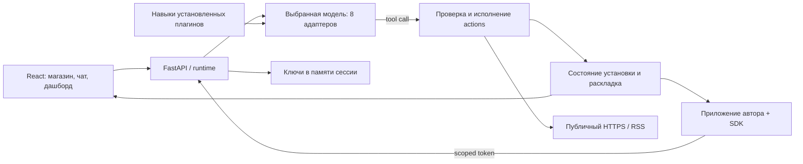

# Мия: платформа приложений вокруг AI-моделей

Дата: 2026-10-05. Обновление WEB-P1-R2: страницы плагинов, Google-аккаунты, браузерный голос и опубликованный серверный POC. Это новое продуктовое направление, инициированное пользователем;
оно дополняет прежний Android/voice-план, а не объявляет его незакрытые проверки выполненными.

## Откуда мы продолжаем

В `docs/implementation/STATUS.md` предыдущая wave W6 имеет статус PARTIAL.
Готовы FastAPI backend, PostgreSQL/Redis, Google sign-in и refresh, история
диалогов, REST/SSE, Android text UI, нормализованные события моделей, Gemini text
и Live, политика и аудит инструментов. Текстовый сценарий проверен на физическом
устройстве; наблюдались три последовательных голосовых хода без разрыва соединения.

Остались S31-R1: слышимость, 20-turn soak, barge-in, reconnect, latency и голосовой
tool smoke. S32 закрыт только по текстовой модальности. S33 release gate ещё
не пройден. Wake word S27/S28 отложен согласно ADR-009. Смена позиционирования
не меняет эти факты. Подробные свидетельства: [STATUS](implementation/STATUS.md),
[S30](implementation/handoffs/S30.md), [S25-R3](implementation/handoffs/S25-R3.md).

## Продукт

Мия — пространство готовых приложений, использующих выбранную человеком модель.
Человек подключает API или локальный inference, добавляет нужные плагины и
получает полезный результат без сборки автоматизаций с нуля. Голос, браузер,
Android, iOS и колонка — разные способы обратиться к одной платформе.

Ключевой объект — установленное приложение с понятной пользой, разрешениями,
настройками и историей запусков. Модель — заменяемый исполнитель; API-ключ
не передаётся автору плагина. Часы и таймер не нуждаются в LLM. AI используется
для понимания задачи, обработки информации и подбора шагов, когда это полезно.

Проверяемая гипотеза POC: человек за несколько минут подключает свою модель,
устанавливает полезный инструмент и самостоятельно создаёт простой AI-рецепт.
Магазин начинается с бесплатного каталога. Оплаты сейчас нет.

## Реализованный первый срез

| Область | Что можно сделать сейчас |
| --- | --- |
| Web | React + TypeScript + Vite; responsive интерфейс, анимация Motion с reduced-motion, диалоги Radix, иконки Lucide, уведомления Sonner, валидация Zod |
| Модели | Добавить несколько подключений OpenAI, Anthropic, Gemini, DeepInfra, Groq, Mistral; выбрать активное; выполнить тестовый запрос; удалить подключение |
| Локальный inference | Ollama `/api/chat`, LM Studio и другие OpenAI-compatible серверы на loopback; редактируемые имя модели, порт и `/v1` |
| Магазин | Поиск, категории, страницы плагинов с описанием/скриншотами/отзывами, установка с подтверждением разрешений, библиотека, удаление |
| Приложения | Мировые часы, таймер, будильник, заметки, фокус-сессии, Интернет и автоматическая новостная сводка |
| Авторы | Manifest v2: skill, typed actions, fields/HTML view, downloads; совместимость с рецептами v1; работающий JS SDK |
| Диалог | Выбранная модель вызывает инструменты; диктовка текста и озвучка ответа браузерными API |
| Аккаунт | Google-вход, Secure/HttpOnly cookie, постоянные изолированные установки/состояния/раскладка и отзывы в SQLite |
| Сервер | amd64 Docker-релиз опубликован на `https://mindmapgen.xyz/mia/`; плитка на общем хабе, публичные проверки PASS |

Интерфейс и детерминированные плагины работают без ключа. AI-плагины требуют
явного подключения модели: демонстрационные тексты не выдаются за ответы LLM.
Сводка собирает публикации за 48 часов через «Интернет» и суммирует выбранной моделью.
Добавлен дашборд с настраиваемыми плитками и привязка самостоятельных приложений по коду.
Инструкции по запуску: [web/README.md](../web/README.md).

## Архитектура POC и границы

`app.web_poc.main` запускается отдельно от `app.main`. Локальная разработка не
требует PostgreSQL/Redis/Google OAuth/secret-value files и ограничена loopback.
Hosted конфигурация требует HTTPS origin, постоянную SQLite и Google-вход,
иначе отказывается запускаться. Существующие Android API/voice gates не изменены.
Vite и SDK поддерживают префикс `/mia/`; отдельное приложение допускает HTTP
localhost либо публичный HTTPS. Подробности релиза: [deploy/README](../deploy/README.md).

На общем сервере MIA использует существующий Google OAuth: сервер подтверждает
hub session через фиксированный `/api/auth/me`, исключает local/demo users и
выдаёт собственную cookie аккаунта. Возможен также отдельный Google Identity
Services flow с проверкой подписи/audience/nonce. Аккаунты, установки, состояния,
раскладка и отзывы сохраняются в SQLite. Hosted API проверяет origin, web header
для изменяющих запросов, JSON и размеры; личное пространство требует аккаунт.

Ключи находятся только в памяти runtime до 8 часов/restart, не сохраняются с
workspace и не выдаются SDK/browser. Облачные адреса фиксированы; HTTP proxy из
окружения выключен. Hosted loopback-модели запрещены: для пользователя с локальной
моделью потребуется companion connector. Лимиты runtime: один модельный/действующий
запрос за раз, 10 чат-ходов/мин и 30 действий/мин; tool loop до 6 шагов,
12 вызовов и 150 секунд. Vault и durable grants остаются задачами WEB-P2.

Сохранённые подключения ещё не проверены, пока пользователь не нажал «Тест API»
или не получил ответ. Тест выполняет небольшой запрос и может стоить денег
по тарифу провайдера. Имена моделей редактируются: примеры в форме не гарантируют
доступ конкретного аккаунта. Облачный текст передаётся соответствующему
провайдеру; при выборе локальной модели запрос остаётся на компьютере.

Установки и данные hosted аккаунта сохраняются в SQLite. Web и привязанные
SDK-приложения видят общее серверное состояние. В анонимной локальной разработке
состояние временное; перенос в Google-аккаунт не выполняется автоматически.
История web-диалога живёт в памяти экрана. Таймер и будильник используют абсолютные
deadlines и не останавливаются при закрытии диалога. Спящая или закрытая вкладка
не гарантирует своевременный звук; после перезагрузки автозвук может требовать
нового пользовательского жеста. Пропущенный deadline показывается при возвращении.
Первый POC поддерживает один таймер, одну focus-сессию и один будильник.

## Следующие этапы и критерии готовности

### WEB-P1 — текущий локальный POC

Показать магазин → установить инструмент → получить полезный результат;
подключить облачную или локальную модель → запустить AI-плагин;
импортировать собственный рецепт → экспортировать его для другого пользователя.
Дополнительный gate WEB-P1-R1: «поставь таймер на 5 минут» → выбранная модель →
валидированный tool call → реальный отсчёт на дашборде и в SDK-приложении.
Авторский HTML view меняет своё состояние через scoped bridge; отзыв SDK доступа
блокирует следующие запросы. Это уже реализовано в локальном POC.

Gate: production web build, строгая TypeScript-проверка, browser journeys,
проверки каждого формата provider API, изоляции сессий и отсутствия ключей
в ответах/браузерном storage. Реальный cloud smoke — отдельно с введённым
владельцем ключом. Первый срез: [WEB-P1](implementation/handoffs/WEB-P1.md).
Обновление runtime/SDK: [WEB-P1-R1](implementation/handoffs/WEB-P1-R1.md).

### WEB-P1-R2 — hosted POC

Реализованы Google-вход, постоянные аккаунты/установки/дашборд/отзывы в SQLite,
страницы плагинов и браузерные речевые API. amd64 сборка и `/mia/` маршрутизация
проверены локально и на публичном сервере. Деплой выполнен 2026-10-06;
Google consent проходит пользователь при входе, автоматически он не проверялся.
[Handoff WEB-P1-R2](implementation/handoffs/WEB-P1-R2.md).

### WEB-P2 — персональный кабинет и постоянные данные

Использовать существующую модель пользователя и auth-сервис; для web спроектировать
cookie/BFF-поток и CSRF отдельно от Android bearer API. Добавить PostgreSQL-таблицы
`provider_connections`, `plugin_versions`, `plugin_installations`, `plugin_runs`.
Секреты хранить зашифрованными через managed vault/KMS с ротацией и отзывом;
UI получает только идентификатор подключения. Добавить ограничение бюджета,
удаление персональных данных и реальные облачные проверки.

Переиспользовать существующие provider-neutral события, orchestration, tool policy
и аудит. POC-адаптеры перенести за единый runtime; не создавать две постоянные
системы диалогов. Учесть существующую проблему provider continuation tokens
(OI-W6-013) до agent/tool-loop с новыми Gemini-моделями.

Gate: два пользователя изолированы, restart сохраняет установки и настройки,
отзыв ключа действует сразу, изменения инструментов отражены в audit.

### WEB-P3 — первые полезные подключения

1. **Новости:** RSS/search/read и сводка уже реализованы в POC. Далее — выбор
   источников и search providers, полнотекстовые материалы, durable расписание, кэш.
2. **Календарь:** OAuth Google Calendar; сначала чтение расписания, затем создание
   событий с предпросмотром и явным подтверждением.
3. **Погода:** API с координатами или выбранным городом, единицы и свежесть данных.
4. **Умный дом:** сначала Home Assistant read-only, затем allowlist сущностей,
   подтверждение действий с последствиями и локальный connector.

Gate: реальные источники, минимальные разрешения, восстановление после истечения
OAuth и сетевых ошибок; необратимые действия не выполняются только по тексту модели.

### WEB-P4 — простые автоматизации

Декларативный workflow «триггер → AI-обработка → действие», без обязательного
визуального графа. Первые шаблоны: утренняя сводка; план дня по календарю;
новость по теме → краткое объяснение → уведомление. Добавить durable scheduler,
очередь, retries, idempotency, dry-run, лимиты и журнал. Включение расписания
и запись во внешние системы требуют понятного согласия пользователя.

Gate: повторный job не создаёт дубли, запуск переживает restart, есть pause,
run history, объяснение источников и понятное управление расходами.

### WEB-P5 — магазин сообщества

Кабинет автора, публикация версий, описание разрешений, модерация, поиск,
обратная связь, обновление с повторным согласием при расширении разрешений.
Локальный импорт prompt/recipe и sandboxed UI уже работает. Для публикации нужны
version pinning, идентичность автора, package review, approved connectors и workflows. Донат-ссылки и рейтинги — после проверки
авторства и понятной политики каталога. Скачанный JSON пока не является
доверенной опубликованной версией.

Gate: рецепт не получает ключи или произвольный код, обновление не расширяет
права молча, вредоносную версию можно отозвать, автор и версия идентифицируемы.

### WEB-P6 — несколько устройств

PWA и mobile companion используют общий manifest/runtime. Android-проект
сохраняет наработки auth/chat/audio; iOS получает тот же API и capability negotiation.
Для колонки нужен локальный агент: inference, устройства, аудио и расписания;
web становится панелью настройки. Поддержка LAN-моделей требует authenticated
connector вместо публикации inference-порта в интернет.

Gate: один плагин корректно объявляет, что доступно в web/mobile/колонке;
фоновые напоминания не зависят от вкладки; локальные операции продолжаются
при отсутствии облака.

### WEB-P7 — коммерческая модель

После проверки пользы решить, за что люди готовы платить: curated пакеты,
синхронизация и автоматизации, готовое оборудование, мобильное приложение.
BYOK и локальный inference не означают оплату вычислений со стороны Мии.
Бесплатные community-плагины можно сохранить отдельным продуктовым принципом.
Подписка на магазин, продажа приложений и колонки — гипотезы; цены, payout
авторам, billing и payment provider пока не выбраны и не реализованы.

## Как понять, что стоит продолжать

На интервью/демонстрациях измерять: время до первого результата, какие плагины
человек повторно открывает, успешно ли подключает модель, может ли создать
свой рецепт без помощи, нужен ли ему голос. Первые качественные проверки можно
проводить без аналитического трекинга и регистрации. Не подменять интерес
к красивому каталогу регулярным использованием конкретных приложений.

## Технические источники

Форматы вызовов сверены с официальной документацией:
[OpenAI Responses](https://developers.openai.com/api/docs/guides/text),
[Anthropic Messages](https://platform.claude.com/docs/en/api/messages/create),
[Gemini generateContent](https://ai.google.dev/api/generate-content),
[DeepInfra Chat](https://docs.deepinfra.com/chat/overview),
[Groq compatibility](https://console.groq.com/docs/openai),
[Mistral Chat](https://docs.mistral.ai/api/endpoint/chat),
[Ollama Chat](https://docs.ollama.com/api/chat),
[LM Studio Chat](https://lmstudio.ai/docs/developer/openai-compat/chat-completions).
UI: [React](https://react.dev/learn), [Vite](https://vite.dev/guide/),
[Motion](https://motion.dev/docs/react). Плагины описаны отдельно в
[PLUGIN_DEVELOPMENT.md](PLUGIN_DEVELOPMENT.md).
